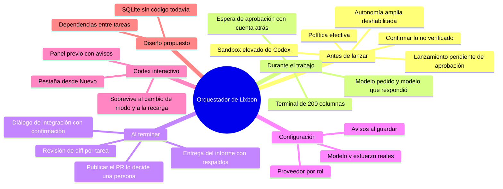
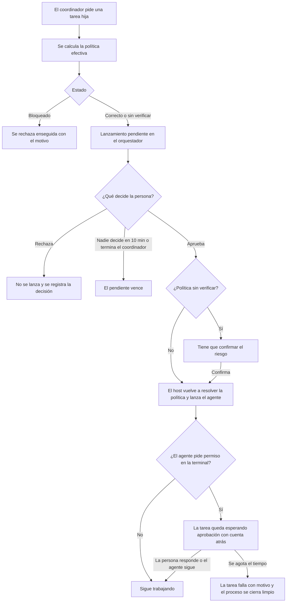
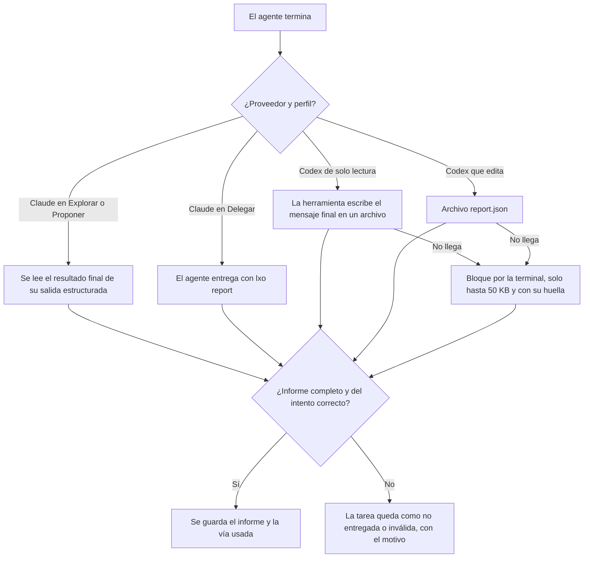
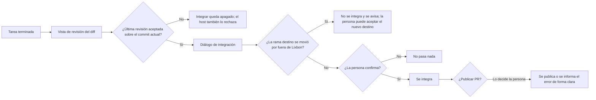
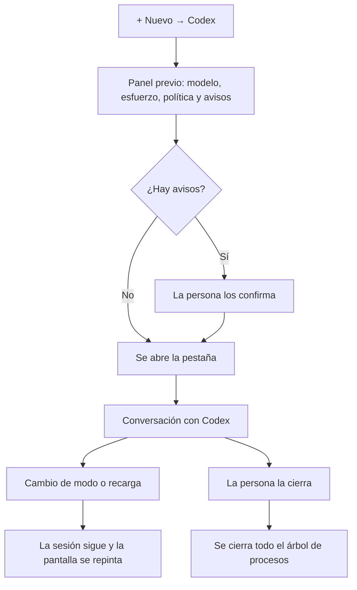
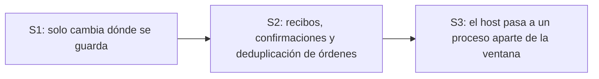

# Orquestador con proveedor por rol, revisión humana y terminal integrada

**Rama:** `orquestador-con-proveedor-por-rol-revision-humana-y-terminal-integrada` · **Base:** `origin/master` (`447bbc4`)
**Contenido:** 55 commits, 96 archivos (+11199 / −339), todo dentro de `apps/desktop`.
**Estado:** las pruebas automáticas pasan (ver la sección 9). **Prueba en la app real en curso.**

---

## 1. Resumen

Este PR junta en uno solo varias líneas de trabajo del orquestador de Lixbon Desktop que estaban repartidas en ramas distintas. La idea de fondo es siempre la misma: **antes de que un agente haga algo, la persona ve con claridad qué va a pasar, con qué permisos y con qué modelo, y nada arriesgado ocurre sin que ella lo confirme.**

Qué trae, en pocas palabras:

1. **Cada lanzamiento de un agente espera a la persona.** Cuando el coordinador pide lanzar una tarea hija, el lanzamiento queda pendiente con su política efectiva; la persona lo aprueba o lo rechaza desde el orquestador. Si nadie decide en 10 minutos, o el coordinador termina, el pendiente vence.
2. **Revisión de cambios por tarea.** Cada tarea terminada tiene su propia vista de diff. La persona la acepta o la rechaza sobre un commit concreto de la rama; si la rama recibe otro commit después, hay que revisar de nuevo.
3. **La integración es una decisión de una persona.** Llevar el trabajo de una tarea a la rama principal, o publicar su PR, ya no lo decide un agente: hay un diálogo que enseña qué se va a integrar y pide confirmación explícita. Solo se integra si la última revisión está aceptada sobre el commit actual de la rama, y lo comprueba el host, no solo la interfaz. Si la rama de destino se movió por fuera de Lixbon, no se integra y se avisa.
4. **Entrega de informes robusta.** Cada agente entrega su informe final por la vía más segura que tiene su herramienta, con respaldos y límites claros. Si el informe no llega o llega dañado, la tarea lo dice con un motivo; nunca se guarda un informe a medias.
5. **Espera de aprobación en la terminal.** Si un agente se queda esperando permiso en su terminal, la tarea lo muestra con una cuenta atrás; si nadie responde a tiempo (300 s por defecto), falla con un motivo claro y el proceso se cierra limpio.
6. **Modelo pedido frente al modelo que respondió**, con avisos cuando no coinciden y la explicación del caso del modo plan.
7. **Proveedor, modelo y esfuerzo por rol.** Cada rol del equipo puede usar Claude Code o Codex, con la lista real de modelos y niveles de esfuerzo de cada herramienta.
8. **Pestaña de terminal interactiva de Codex** desde «+ Nuevo», que sobrevive al cambio de modo y a la recarga de la ventana.
9. **Sandbox elevado de Codex:** la aplicación detecta esa configuración (solo la lee, nunca la cambia) y avisa o bloquea según el perfil.
10. Arreglos de base: terminal del agente con al menos 200 columnas, cierre limpio del proxy de vista previa y caracteres con tilde o emoji que ya no se rompen cuando llegan partidos.

---

## 2. Lanzar una tarea con aprobación humana

Cuando el coordinador pide una tarea hija (`lxo spawn`), el host no la lanza enseguida: la deja **pendiente de aprobación**, con la política efectiva que se usaría. La persona la ve en el orquestador y la aprueba o la rechaza. Al aprobar, el host vuelve a resolver la política y lanza la suya; la línea de arranque que llega de la interfaz solo se compara, nunca se usa tal cual. Un perfil bloqueado se rechaza sin preguntar a nadie. El pendiente vence a los 10 minutos (`LIXBON_SPAWN_APPROVAL_TTL_SECS`) o si el coordinador termina, y cada decisión queda registrada.

Para calcular la política, la aplicación calcula la **política efectiva**: el proveedor (Claude o Codex), el perfil de permisos, la versión de la herramienta, el modelo pedido, la línea de arranque completa y todos los avisos. Las reglas de herramientas permitidas y prohibidas salen una por línea.

- Si algo impide lanzar (herramienta no instalada, opción que la versión instalada no admite, perfil diferido), el estado es **bloqueado** y se muestra el motivo.
- Si la versión no es una de las verificadas, el modelo no está en la lista de la herramienta, o hay un aviso importante (como el del sandbox elevado en Delegar), el estado es **sin verificar** y el botón de lanzar queda apagado hasta que la persona confirma que entiende el riesgo.

---

## 3. Entrega del informe

Cuando el agente termina, el orquestador busca su informe final por la vía principal de esa herramienta y, si no llega, por los respaldos. Guarda qué vía se usó (`delivery_channel`), para que se sepa de dónde salió cada informe.

Los agentes solo usan comandos `lxo` sueltos, de a uno, sin encadenarlos con `;`, `&&` ni `|`. En Claude se permiten exactamente cinco reglas de `lxo`: `report`, `guide`, `phase`, `ask` y `check`.

---

## 4. Revisar e integrar

Cada tarea hija terminada con rama propia tiene una **vista de revisión** aparte del chat: muestra los archivos que tocó y el diff contra su base. La persona acepta o rechaza el diff de un commit concreto; si ese commit ya no es el actual de la rama, la revisión no se registra y hay que mirar el nuevo. Si la rama ya no existe, se dice claramente.

El host comprueba todo antes de integrar, aunque la interfaz no deje pulsar el botón. No integra, sin tocar git ni registrar una decisión, cuando:
- no hay ninguna revisión;
- la última revisión es un rechazo (aunque antes se hubiera aceptado el mismo commit);
- la revisión aceptada es de otro commit;
- la tarea ya está integrada;
- la tarea no tiene rama propia.

Las guías de los agentes ya no les piden integrar: ese paso queda en manos de la persona. Al borrar un run, también se borran las decisiones de sus tareas.

---

## 5. Mientras trabaja el agente

- **Terminal de 200 columnas.** La terminal del agente se abre ya con al menos 200 columnas, y nunca baja de ahí aunque la ventana sea más estrecha. Antes, las líneas largas se cortaban y el informe podía llegar dañado.
- **Modelo pedido y modelo que respondió.** Cada tarea muestra `model_requested`, `model_effective` y si no coinciden (`model_mismatch`). En modo plan, Claude responde con Sonnet aunque se pida otro modelo: la aplicación lo avisa antes de lanzar y explica la diferencia después (`model_mismatch_reason: "plan_mode"`).
- **Espera de aprobación en la terminal.** Se detecta el aviso de permiso del agente; la tarea pasa a «esperando aprobación en la terminal» con una fecha límite. Si el agente vuelve a escribir, sale de la espera. Si vence el plazo, falla con `terminal_approval_timeout`. Un agente que se queda callado 1800 s también falla con su motivo.

---

## 6. Proveedor, modelo y esfuerzo por rol

En **Ajustes → Orquestador → Roles del equipo**, cada rol (Explorador, Implementador, Revisor, Escalado, Adversario) tiene tres selectores: proveedor, modelo y esfuerzo.

- La lista de proveedores sale de un comando nuevo del host que consulta las herramientas instaladas: versión, si están disponibles (y por qué no, si no lo están), sus modelos y sus niveles de esfuerzo reales. Un proveedor no instalado sale **deshabilitado con su motivo**; nunca desaparece.
- Los modelos que la herramienta no confirma salen como «sin verificar» y, si se usan, la política pide confirmación. Un modelo de otro proveedor (por ejemplo, un modelo de Claude en un rol de Codex) se rechaza al guardar.
- En Codex existe la opción «el modelo que defina config.toml»: la aplicación nunca inventa un nombre.
- Los roles de solo lectura con Codex usan el perfil de solo lectura y heredan sus avisos.
- Al guardar, cada rol recibe sus avisos en su propia fila, y la fila muestra siempre lo que la aplicación guardó de verdad. Los roles guardados antes de este cambio siguen funcionando: si no tienen proveedor, se entiende que es Claude.

---

## 7. Pestaña de terminal interactiva de Codex

Desde **«+ Nuevo»** en el modo Agente se puede abrir Codex en una pestaña de terminal para hablar con él directamente.

1. **Panel previo:** se elige modelo y esfuerzo, y se muestra la política, la línea de arranque y los avisos. Si hay avisos, hay que confirmarlos antes de abrir.
2. Se lanza con `--sandbox workspace-write --ask-for-approval on-request` en la carpeta elegida, que tiene que existir y estar dentro del espacio de trabajo. Nunca se usan opciones que se salten el sandbox.
3. Varias pestañas a la vez, sin mezclar su salida. La lista muestra carpeta, modelo, esfuerzo, línea de arranque y, si terminó, su código de salida.
4. **Sobrevive al cambio de modo y a la recarga:** el host guarda la pantalla ya armada (incluidos colores, posición del cursor e historial de hasta unas 5000 líneas) y la repinta al volver. Hay un botón «Redibujar».
5. Al cerrar la pestaña, o la aplicación, se cierra todo el árbol de procesos.
6. Esta pestaña no toca el estado del orquestador y no se expone por el servidor HTTP local.

---

## 8. Cuadros comparativos

### 8.1 Antes y después

| Tema | Antes | Después |
|---|---|---|
| Lanzar una tarea hija | El coordinador la lanzaba solo | Queda pendiente hasta que la persona la aprueba |
| Revisar lo que hizo una tarea | Mezclado en el chat | Vista de diff propia, aceptar o rechazar por commit |
| Integrar el trabajo de una tarea | Lo podía pedir el agente | Lo decide una persona, con confirmación explícita y revisión aceptada del commit actual |
| Rama destino movida por fuera | Se integraba igual | No se integra y se avisa |
| Informe de Codex de solo lectura | Solo por la terminal, se podía cortar | Archivo escrito por la herramienta; la terminal solo como respaldo hasta 50 KB |
| Informe de Claude en Explorar y Proponer | Dependía de que el modelo ejecutara `lxo` | Se lee de su salida estructurada |
| Ancho de la terminal del agente | 120 columnas, y bajaba con la ventana | Al menos 200, siempre |
| Agente esperando permiso | Se quedaba colgado sin aviso | Cuenta atrás y fallo con motivo a los 300 s |
| Modelo usado | No se registraba | Pedido, respondido y si coinciden |
| Proveedor por rol | Solo Claude | Claude o Codex |
| Modelos y esfuerzos | Lista fija | Lista real de cada herramienta, con «sin verificar» |
| Codex interactivo | No había | Pestaña de terminal propia |
| Tildes y emoji partidos entre lecturas | Podían salir como `�` | Se juntan antes de mostrarse |

### 8.2 Perfiles por proveedor

| Perfil | Claude Code | Codex |
|---|---|---|
| Explorar (solo lectura) | Lee y entrega el informe por su salida estructurada; no edita | Se lanza sin interacción (`codex exec`) con sandbox de solo lectura; no edita. **Bloqueado si el sandbox es elevado** |
| Proponer (solo lectura, plan) | Igual que Explorar, en modo plan (responde con Sonnet) | Igual que Explorar. **Bloqueado si el sandbox es elevado** |
| Delegar con revisión | Edita; los comandos de solo lectura y las cinco reglas de `lxo` corren sin pedir aprobación; lo que modifica algo espera aprobación en la terminal | Edita en su carpeta de trabajo. **Con sandbox elevado:** sin verificar y pide confirmación, porque puede editar pero no ejecutar comandos |
| Autonomía amplia | Diferida: se ve pero no se puede elegir | Diferida: se ve pero no se puede elegir, también con sandbox elevado |
| Pestaña interactiva | No aplica | Sandbox de escritura con aprobación a pedido. **Con sandbox elevado:** sin verificar y pide confirmación |

### 8.3 Claude frente a Codex

| | Claude Code | Codex |
|---|---|---|
| Cómo se lanza en solo lectura | `claude -p` con salida estructurada (`stream-json`) | `codex exec` con el mensaje final a un archivo (`-o`) |
| Cómo se lanza para editar | Terminal interactiva con permisos acotados | Terminal interactiva |
| De dónde sale el modelo | Del modelo de sus mensajes en la salida estructurada (`model_source: stream_json`); nunca del evento de inicio | Del archivo de sesión de Codex (`model_source: session_declared`), mostrado como «reportado por Codex» |
| Cómo se ata la sesión al intento | Su `session_id`, que se guarda en `session_ref` | Por su id de sesión o, si no hay, por carpeta exacta y hora de inicio (`session_match`); se descartan las sesiones de subagentes |
| Si no se puede saber | `unknown` | `unknown` (cero o más de una sesión candidata) |
| Chat desde «+ Nuevo» | Sí | No; abre la pestaña de terminal |

### 8.4 Qué pasa ante fallos

| Situación | Qué hace la aplicación |
|---|---|
| El informe no llega | La tarea queda como no entregada, con el motivo |
| El informe llega dañado, de otro intento o más grande que el límite | Se marca como inválido o no entregado; nunca se guarda a medias |
| El agente espera permiso y nadie responde | A los 300 s falla con `terminal_approval_timeout` y se cierra todo su árbol de procesos |
| El agente se queda callado | A los 1800 s falla con su motivo |
| La herramienta no está instalada o no admite una opción | Política bloqueada con el motivo; no se lanza |
| Versión o modelo no verificados | Política sin verificar; hace falta confirmar |
| Sandbox elevado de Codex | Solo lectura bloqueado; Delegar y la pestaña piden confirmación |
| Nadie decide un lanzamiento pendiente | Vence a los 10 minutos, o al terminar el coordinador, y no se lanza |
| Un lanzamiento aprobado falla | Se explica el error y queda registrado |
| Se intenta integrar sin revisión aceptada del commit actual | El host lo rechaza; ni git ni decisión |
| La rama de la tarea ya no existe | La revisión lo dice; no se integra |
| La rama destino se movió por fuera | No se integra y se avisa |
| Falla la publicación del PR | Error estructurado y explicado, sin dejar nada a medias |
| Se cierra la aplicación | Se cierran todas las pestañas de Codex con sus procesos |

---

## 9. Pruebas automatizadas

Medido sobre la punta de esta rama, en Windows, con Node 22.23.3:

| Prueba | Resultado |
|---|---|
| `cargo test --lib` (host) | **194 pasan**, 0 fallan, 1 ignorada |
| `npm test` (interfaz) | **219 pasan** en 13 archivos |
| `npm run build` | Compila; en `dist` no hay datos simulados (la única coincidencia de la palabra «mock» es «mockup» dentro de un texto de ayuda) |

Algunas de las pruebas que cubren lo nuevo: lanzamientos pendientes (aprobar, rechazar, vencer, argv distinto, sin confirmar, run borrado con pendientes); revisión por tarea (rama inexistente, commit nuevo tras aceptar, aceptar y luego rechazar); los cinco rechazos del host al integrar; política y línea de arranque de cada perfil y proveedor; entrega por cada vía y sus respaldos, incluido el informe antes de cualquier cambio de tamaño y a 40, 60 y 76 columnas pedidas; espera de aprobación con un agente falso y un plazo corto; lectura de las salidas reales de las herramientas guardadas como datos de prueba; búsqueda de la sesión de Codex con varios casos ambiguos; proveedores y roles con y sin sandbox elevado; pestaña de Codex con un ejecutable falso (dos pestañas a la vez, escribir, cambiar tamaño y cerrar); y tildes, símbolos de caja y emoji partidos en cada posición posible.

## 10. Pruebas en la app real

- Sobre `4b3a1cb` (la línea del host anterior a la pestaña de Codex): **6 de 7 casos pasaron y 1 pasó en parte.**
- La pestaña de Codex y la interfaz unida (`7bac981`) se están probando ahora: **prueba en la app real en curso.** El lanzamiento con aprobación y la revisión por tarea se sumaron después y entran en esa misma prueba.

---

## 11. Limitaciones conocidas

- **Sandbox elevado en la PC de pruebas.** En esa máquina Codex tiene `[windows] sandbox = "elevated"`. Ahí los perfiles de solo lectura de Codex quedan bloqueados, y Delegar y la pestaña interactiva piden confirmación porque Codex puede editar pero no ejecutar comandos. La aplicación nunca cambia esa configuración.
- **El modelo de Codex lo reporta Codex.** Sale de lo que Codex escribe en su archivo de sesión: dice qué modelo pidió, no prueba cuál respondió el servidor. Por eso se muestra como «reportado por Codex».
- **Autonomía amplia sigue diferida**, a petición del cliente.
- **Opciones en gris en la vista de política.** Algunas opciones salen en gris porque todavía no se pueden elegir; su habilitación queda pendiente.

## 12. Diseño propuesto: SQLite (sin código en este PR)

> El diseño SQLite es una **propuesta (revisión 11)**: este PR no trae código de SQLite y está a la espera de que Presiga lo apruebe.

| Tema | Hoy (`state.json`) | Propuesta (SQLite) |
|---|---|---|
| Dos escrituras a la vez | Una puede pisar a la otra | La base las ordena sin perder datos |
| La app se cierra a mitad de un guardado | El archivo puede quedar a medias | La operación se guarda entera o no se guarda |
| Una orden repetida | Puede ejecutarse dos veces | Se detecta por su clave y se ignora |
| Historial de decisiones humanas | Mezclado en un solo archivo | Tabla propia, consultable |
| Logs y artefactos grandes | Archivos | Siguen en archivos |

La migración iría en tres pasos, y cada uno deja el orquestador funcionando y con pruebas:

Al arrancar por primera vez se haría una copia de respaldo de `state.json` y se importaría todo en una sola operación; si algo sale mal, se descarta y se sigue con `state.json`. La importación se puede repetir sin duplicar nada.

**Pendiente de decisión de Presiga:**
- Aprobar el diseño SQLite (revisión 11) antes de escribir código.
- Dependencias entre tareas: decidir si una tarea arranca cuando su prerrequisito termina o solo cuando se integra. La sugerencia es que arranque cuando termina, con la opción de esperar a la integración.

## 13. Próximos pasos

1. **SQLite**, una vez aprobado el diseño (pasos S1 a S3).
2. **Dependencias entre tareas**, según la decisión pendiente.
3. **Revisor automático** de las tareas antes de pedir la decisión humana.

## 14. Fuera de este PR

- **CLI:** ya fusionado, sin cambios en este PR.

Documentos de diseño completos: `diseno-sqlite-orquestador.md`, `contrato-informe-archivo.md` y `propuesta-attempts.md`.
