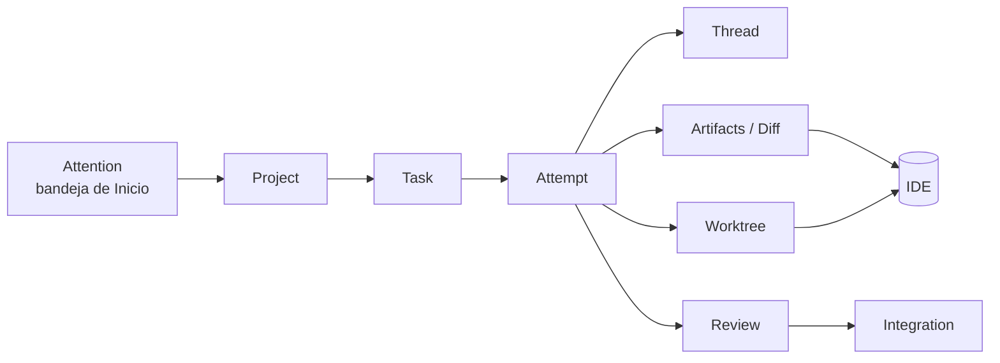

# ADE de Lixbon: arquitectura de interfaz

Estado: **diseño + cimiento con datos simulados** (rama `ui-ade-architecture`, partiendo de `master` 0f72905). Este documento es el diseño; el código vive en `apps/desktop/src/ade/` y se puede ver en `npm run dev` abriendo `/ade-preview.html`.

Lo que **ya existe** en el producto se marca como *vigente*; lo que el Core aún no tiene, como *reservado* o *pendiente de slice*. Nada de lo reservado se da por hecho: la interfaz lo muestra como «no disponible» con el slice que lo habilitará.

---

## 0. Reconocimiento del frontend actual (de dónde parte el cimiento)

Leído en el código, no supuesto:

| Aspecto | Lo que hay | Qué hace el ADE con ello |
|---|---|---|
| Tokens de diseño | `styles/base.css`: seis peldaños de relleno (`--surface-0..6`), `--ink*`, `--accent`, `--info`, `--good`, `--warn`, `--danger`, `--merged`, `--claude`; oscuro por defecto y claro con `[data-theme='light']`; sin bordes ni sombras (la jerarquía la da el relleno) | El ADE **no define colores propios**: sus clases `ade-*` solo usan esas variables. Hereda tema claro/oscuro gratis |
| Tipografía | Hanken Grotesk (UI) y JetBrains Mono (`--font-mono`, clase `.mono`), 13 px de base | Igual; los ids de máquina (commits, ramas, ids) van en mono |
| Primitivas | `studio.css`: `.btn`, `.btn--primary/ghost/accent/sm`, `.field`, `.panelhead`, `.dot` | Se reutilizan las clases tal cual (solo CSS global, sin importar componentes) |
| Estado de tarea | `StatusIcon` en `orch/OrchestratorMode.jsx` + `.orchst*` en `orch.css` (arco que gira, onda, check) | No se importa (arrastra terminal, xterm, diálogos). `StatusMark` del ADE es una pieza propia pequeña, indexada por el **grupo visual** del contrato (`active/waiting/needs_person/ok/error/halted`) |
| Chip de agente | `orch/agent/AgentChip.jsx` (+ `ProviderMark`, `agentIdentity.js`) | **Se reutiliza en modo lectura** (`components/AgentLabel.jsx` lo envuelve y añade rol). Arrastra `orchStore` solo por `AGENT_LABELS`; en pruebas se simula Tauri como hacen las pruebas existentes |
| Iconos | `components/Icons.jsx` (SVG de trazo fino, `size`) | Se importan los existentes |
| Mocks | `mockCodexTerm.js`, `mockIntegrateTask.js`, `mockPendingSpawns.js`… junto a su contrato, solo en dev (`import.meta.env.DEV`), con convenciones por id (`*conflict*`, `*moved*`) | Mismo espíritu: fixtures + un cliente simulado, con fallos y latencia controlables. Pero **detrás de una interfaz** (`AdeClient`) para que el reemplazo no toque pantallas |
| Contratos | `*.d.ts` junto al código (`integrateTypes.d.ts`, `policyTypes.d.ts`) y `*Contract.js` con los nombres | `client/types.d.ts` + `client/contract.js` |
| Pruebas | vitest + jsdom, `@testing-library/react`, `vi.mock('@tauri-apps/api/core')`; `vocabulary.test.js` lee `contracts/status-vocabulary.json` con `readFileSync` y compara | Igual: el contrato **no se importa en tiempo de ejecución** (ver §9.4); una prueba lo compara con el espejo del ADE |
| Estilos | CSS plano por componente con prefijo (`attn__`, `orch__`, `orchst`) importado desde el componente | Prefijo `ade-`; tres hojas en `ade/styles/` |
| Lint | No hay ESLint en `package.json` | No se añade |
| Navegación | No hay router: `useAppStore` decide el modo (`Agente/Chat/Editor/Orquestar`) | El ADE trae su router mínimo en memoria (`navigation/`), sin tocar `appStore.js` |

Hallazgo que condiciona el diseño: **la Attention vigente se calcula en el frontend** (`orch/attention.js`) a partir de tareas de *un solo* workspace, y el móvil (`RemoteOrch.js`) pinta estados por su cuenta (con la divergencia declarada en `VOCABULARIO.md` §7). El ADE no puede repetir esa reconstrucción: consume Attention ya hecha (por el cliente) y **nunca** la calcula.

---

## 1. Principios

1. **Lixbon Core owns state. Clients own capabilities and presentation.** El ADE no calcula verdades: pregunta (`AdeClient`) y presenta. Lo que el cliente sí posee (abrir el diff en el IDE, enfocar la terminal, notificar) entra por otro puerto, `AdeHost`.
2. **Una sola fuente semántica para tres superficies.** Desktop, CLI (`lxo`) y móvil leen las mismas entidades y los mismos ids de estado. Cada superficie decide *qué capacidades ofrece*, no *qué es verdad*.
3. **Vocabulario canónico, sin redefinir.** Ids de máquina del contrato (`status-vocabulary.json`); las etiquetas en español son presentación y viven en una tabla espejo vigilada por pruebas.
4. **Attention primero.** El ADE responde «¿qué necesita de mí ahora?» antes que «¿qué hay?». Con 3 a 5 agentes por persona el tablero ordena por atención, no muestra todo igual.
5. **Lo no disponible se dice.** Una capacidad que el Core no ofrece aparece deshabilitada con el slice que la habilita. Nada finge `retry`, `resume`, `race`, comparar o «continuar con otro proveedor».
6. **Lo simulado se rotula.** Toda acción en mock pasa por `AdeClient`, solo altera la memoria del mock y muestra «simulado». El badge de la barra lo recuerda siempre.
7. **Las derivaciones son selectores puros** (`domain-view/`), documentados, y lo que hoy es del frontend se marca *transitorio hasta slice X*.
8. **Local-first y sin cliente abierto.** El estado existe aunque no haya interfaz; el ADE es una vista. Cuando exista el daemon, el ADE funciona igual.
9. **El móvil no es otro IDE.** Es una consola de Attention: notificaciones, preguntas, aprobar/rechazar, revisión resumida y control remoto.

---

## 2. Arquitectura de información

### 2.1 Entidades (cada una responde una pregunta)

Las del modelo de runtime (`LIXBON-modelo-runtime.md` §1), tal como el ADE las ve:

| Entidad | Pregunta que responde | Estado hoy | En el cliente ADE |
|---|---|---|---|
| Project | ¿En qué producto/repo ocurre? | no existe (el frontend usa `repo`/`cwd`) | `Project` + `locations[]` |
| Task | ¿Qué queremos conseguir? | existe, pero es a la vez tarea e intento | `Task` con estado **derivado** (reservado) |
| Attempt | ¿Qué intento concreto se ejecuta? | **es la propia Task** | `Attempt` con `state` del vocabulario |
| Agent | ¿Quién lo ejecuta? | campos `agent/model/effort/role` de Task | `AgentRef` `{provider, model, effort, role}` |
| Thread | ¿Dónde vive la conversación? | no existe (buzón de mensajes) | `Thread` con mensajes de metadatos |
| Worktree | ¿Dónde se modifican los archivos? | `branch/head_commit/cwd` en Task | `Worktree` |
| Artifact | ¿Qué produjo? | `report*`, diff | `Artifact` genérico |
| Review | ¿Qué necesita validación? | `last_review` | `Review` (`review_state` + decisión) |
| Integration | ¿Cómo entra al proyecto? | `last_integration` | `Integration` (`integration_outcome`) |
| Event / Activity | ¿Qué ocurrió? | `orch:changed` (sin historia) | `ActivityEntry` (evento durable) |
| Attention | ¿Qué necesita a la persona ahora? | solo frontend (4 kinds) | `AttentionItem` |
| CLI / Mobile | superficies | `lxo`, `RemoteOrch.js` | `ClientConnection` (identidad y alcance) |
| IDE↔ADE | puente entre superficies | no existe | `AdeHost` + `resolveLocation` |

### 2.2 Relaciones

```
Workspace (implícito)
 └─ Project ─ ProjectLocation*                 identidad lógica ≠ ruta local
     └─ Task ─┬─ Thread*                       conversación lógica (N:M con Attempt)
              └─ Attempt* ── Agent (provider · modelo · esfuerzo · rol)
                     ├─ Worktree                 pertenece al intento
                     ├─ Artifact*                informe, diff, registros
                     └─ ContextPackage           (reservado: entrada que recibió)
 Task ─ Review* (sobre Attempt + commit) ─ Integration (del Attempt elegido)
 Event* ──reglas──▶ Attention*  (por Attempt / Task / Project)
```

Cardinalidades que la interfaz **debe** soportar desde el primer día aunque hoy sean 1:1: una Task con N Attempts, un Attempt con su propio Worktree, una Task con N Threads, un Project con N locations. Hoy el Core entrega Task = Attempt; el adaptador de `CoreAdeClient` fabricará la Task con un único Attempt (§7.5) y las pantallas no se enteran.

### 2.3 Dos estados que no hay que confundir

- **Estado del Attempt** (`attempt_state`, *reservado*, reutiliza los 8 ids vigentes de `task_status` + `pending_approval`): lo que hace el agente ahora.
- **Estado derivado de la Task** (`task_derived_state`, *reservado*: `open`, `in_progress`, `in_review`, `integrated`, `discarded`): cómo va el objetivo. La calcula el Core, no la interfaz.

---

## 3. Mapa de navegación

### 3.1 Cadena de trabajo (hacia el detalle)



Cada tarjeta de Attention conoce su cadena completa (`projectId → taskId → attemptId`): el primer clic puede ir **directo al nivel útil** (p. ej. «Revisar diff» abre la Revisión del Attempt) y las migas de pan (`Inicio › orbita-web › Pago con tarjeta › Intento 2`) permiten subir a cualquier nivel sin perder contexto.

### 3.2 Camino inverso (IDE → ADE)

```
IDE (archivo/rama/worktree abierto)
   │  host.ideContext = { path | worktreePath | branch }
   ▼
client.resolveLocation(ref)  ──▶  { projectId, taskId, attemptId, worktreeId } | null
   ▼
Panel de contexto del IDE (estrecho):  Task › Intento · AgentLabel · StatusMark
   ├─ Attention de ese intento (si la hay) → botón a la Revisión
   ├─ «Abrir Task / Intento en el ADE»
   └─ si no hay coincidencia: «Este archivo no pertenece a ningún intento»
```

La resolución *ruta → proyecto → intento* es **del Core** (D para ruta→proyecto, Task/Attempt para worktree→intento). La interfaz no adivina por prefijo de ruta.

### 3.3 Mapa de pantallas

```
Inicio (Attention)
├─ Proyectos
│   └─ Proyecto ─ Task ─ Intento ─┬─ Hilo
│                                 ├─ Revisión / Diff ── Integración
│                                 └─ (Worktree, Artefactos: secciones del Intento)
├─ Actividad (global; también filtrable por proyecto/task/intento)
├─ Agentes y proveedores
└─ Ajustes (conexión, capacidades, simulación)
```

Rutas (`navigation/routes.js`): `home`, `projects`, `project/:id`, `task/:id`, `attempt/:id`, `thread/:id`, `review/:attemptId`, `integration/:attemptId`, `activity`, `agents`, `settings`. Se serializan como `#/attempt/att_x` para poder enlazar desde el CLI y desde notificaciones del móvil (mismos ids semánticos).

---

## 4. Catálogo de pantallas

Estados comunes (los resuelve `QueryBoundary`, no cada pantalla): **cargando** (esqueleto, no spinner a pantalla completa), **vacío** (explica qué es y qué haría aparecer contenido), **error** (mensaje + «Reintentar» + código del error; el mock puede provocarlo). Una pantalla con datos parciales muestra lo que tiene y degrada por sección.

Leyenda de implementación: **[V]** vertical slice implementado, **[E]** esqueleto navegable, **[D]** solo diseño.

### 4.1 Inicio / Attention **[V]**
- **Propósito:** responder «¿qué necesita de mí ahora?» y dar el pulso de todo el trabajo.
- **Muestra:** bandeja de Attention agrupada por kind en orden de prioridad (con contador); debajo, Proyectos con sus Tasks, estado y contadores por grupo visual; a un lado, franja de Actividad reciente. Estado de conexión y chip «simulado».
- **Acciones:** por tarjeta, según kind (§4.1.1); «Ir al proyecto»; «Lanzar trabajo nuevo» (simulado); abrir cualquier Task.
- **Vacío:** «Nada necesita tu atención» + resumen de lo que está en marcha. **Error por sección:** si falla Attention pero cargan los proyectos, se ve el resto.
- **Vacío total (sin proyectos):** estado de bienvenida («Registra un proyecto», sin acción real: depende del slice D).

#### 4.1.1 Acciones por kind (presentación; el Core solo dice si están permitidas)

| kind | Acciones ofrecidas | Notas |
|---|---|---|
| `approve_in_terminal` | Ir a la terminal (navegación del host) | Hoy no hay API de aprobar: se aprueba en la terminal del agente. No se finge un botón «Aprobar» |
| `review` | Revisar diff → pantalla de Revisión | Aceptar/rechazar es una decisión con contexto, no un botón de la lista |
| `integrate` | Integrar → pantalla de Integración (confirmación) | La integración exige confirmación explícita |
| `failed` | Ver intento, Ver hilo; **Reintentar** y **Continuar con otro agente** (no disponibles: Task/Attempt, ContextPackage) | Muestra el `failure_reason` con su texto |
| `pending_spawn` *(reservado)* | Aprobar / Rechazar (política efectiva a la vista) | Caduca (cuenta atrás) |
| `unanswered_question` *(reservado)* | Responder en línea | |

`pending_spawn` y `unanswered_question` son kinds **reservados** (hoy el frontend los cuenta aparte). La interfaz los admite porque el vocabulario los reserva, pero los rotula «reservado» en el catálogo de Ajustes y los ordena tras los vigentes hasta que G decida.

### 4.2 Proyectos **[E]**
- **Propósito:** ver todos los proyectos de la máquina y cuál está caliente.
- **Muestra:** una fila por proyecto: nombre, localización primaria (y aviso si `missing`), contadores por grupo visual, Attention pendiente, último evento. Archivados plegados.
- **Acciones:** abrir proyecto; (D) registrar/archivar/reubicar: no disponibles.
- **Vacío / error:** como Inicio.

### 4.3 Proyecto **[E→V]**
- **Muestra:** cabecera (nombre, locations, rama por defecto), Attention del proyecto, Tasks agrupadas por estado derivado, actividad del proyecto.
- **Acciones:** abrir Task, lanzar trabajo nuevo en este proyecto (simulado; requiere D para ser real: hoy el host deduce el repo del `cwd`).

### 4.4 Task **[E→V]**
- **Muestra:** objetivo, estado derivado, **lista de Attempts** (línea por intento: n.º, agente/proveedor/modelo, estado, duración, resultado), Threads, Attention de la Task.
- **Acciones:** abrir intento; **comparar**, **competir N**, **reintentar**, **continuar con otro agente**: visibles y deshabilitadas con su slice. Lanzar un intento nuevo (simulado).
- **Vacío:** una Task sin intentos (estado `open`) invita a lanzar el primero.

### 4.5 Attempt **[V]**
- **Muestra:** cabecera (estado, agente · modelo · esfuerzo · rol, tiempos), motivo de fallo o espera, **pregunta pendiente** con campo de respuesta, política (`policy_status`), Worktree (rama, base→head, limpio/sucio), Artifacts, Review e Integration en resumen, enlaces a Thread.
- **Acciones:** responder; aprobar/rechazar lanzamiento si está en `pending_approval`; Revisar; Integrar; detener; **navegación del host**: Abrir diff / Abrir worktree / Abrir en el IDE / Ir a la terminal (no conectadas en el preview).
- **Estados especiales:** `pending_approval`, `awaiting_terminal_approval` (con cuenta atrás de `approval_deadline`), final (`done/failed/stopped/exited`).

### 4.6 Thread **[E]**
- **Muestra:** conversación lógica de la Task: mensajes con su `message_kind` (`phase`, `done`, `question`, `reply`, `note`, `exited`), quién y cuándo, y los intentos que lo alimentaron. Aviso de la **política de sincronización** (`metadata-only` por defecto): en el Desktop local se ve el texto; en móvil/Team solo metadatos.
- **Acciones:** responder una pregunta abierta. Continuar el hilo con otro proveedor: no disponible (ContextPackage).

### 4.7 Revisión / Diff **[E]**
- **Muestra:** estado de la revisión (`none/stale/accepted/rejected`), commit revisado vs. commit actual (aviso de «desactualizada»), resumen del diff (archivos, +/−), quién revisó y desde qué cliente.
- **Acciones:** Aceptar / Rechazar (simulado; la aceptación **solo** vale sobre el commit mostrado), Abrir diff completo en el IDE (host). El diff en sí lo pinta el IDE (`TaskDiffView`), no el ADE.

### 4.8 Integración **[E]**
- **Muestra:** destino, requisitos (revisión aceptada sobre el commit actual, sin integrar), último resultado (`merged/conflict/error/target_moved`).
- **Acciones:** Integrar con confirmación explícita (simulado). La integración real es del host: el ADE solo muestra el resultado.

### 4.9 Actividad **[V como franja; E como pantalla]**
- **Muestra:** eventos durables (`entidad.verbo`) con actor (persona/agente/sistema y cliente), enlazados a su entidad. Filtros por proyecto. Sin eventos efímeros (`terminal.output`, `token.stream`…).
- **Hoy:** el Core no tiene historia (`orch:changed`). Mientras no llegue E, la Actividad real no existe; es el campo más claro de «mock que sobrevive»: la forma `ActivityEntry` ya es la del sobre de eventos.

### 4.10 Agentes y proveedores **[E]**
- **Muestra:** proveedores (Claude Code, Codex, …) con modelos y esfuerzos, roles, estado de política (`ok/blocked/unverified`), cuántos intentos activos tiene cada uno.
- **Acciones:** configurar roles y políticas: no disponible aquí (hoy en Ajustes → Orquestador).

### 4.11 Ajustes **[E]**
- **Muestra:** conexión (cliente, alcances, fuente `mock`/`core`), **matriz de capacidades** del cliente actual (cada intent con su disponibilidad y slice), catálogo de kinds de Attention (vigente/reservado) y controles de simulación del preview (latencia, fallos, datos vacíos).

---

## 5. Layout y responsive

El ADE no mira la ventana, mira **su propio contenedor** (`useLayoutMode`): el panel «estrecho junto al IDE» no es una ventana pequeña.

| Modo | Ancho del contenedor | Estructura |
|---|---|---|
| `wide` | ≥ 1100 px | Navegación lateral con etiquetas · columna principal (Attention arriba, Proyectos debajo) · columna derecha de Actividad |
| `narrow` | 640 – 1099 px | Carril de navegación solo con iconos · una columna: Attention, Proyectos, Actividad plegable. Detalle **reemplaza** la lista (con migas) |
| `mobile` | < 640 px | Barra inferior (Atención · Proyectos · Actividad), una columna, objetivos táctiles ≥ 44 px, acciones en una fila, sin tablas |

```
WIDE                                           NARROW (junto al IDE)       MOBILE
┌────┬──────────────────────────┬──────────┐   ┌──┬────────────────┐       ┌──────────────┐
│Nav │ Requiere tu atención (3) │Actividad │   │▣ │ Atención (3)   │       │ Atención (3) │
│    │  ▸ tarjeta · acciones    │ ● evento │   │▤ │  ▸ tarjeta     │       │  ▸ tarjeta   │
│    │  ▸ tarjeta               │ ● evento │   │≡ │ Proyectos      │       │    [Aprobar] │
│    │ Proyectos                │ ● evento │   │  │  ▸ proyecto    │       │    [Rechazar]│
│    │  ▸ proyecto · tasks      │          │   │  │ ▾ Actividad    │       ├──────────────┤
└────┴──────────────────────────┴──────────┘   └──┴────────────────┘       │ ◉  ▤  ≡      │
                                                                            └──────────────┘
```

La pantalla de Inicio es la misma en los tres: cambia la composición (CSS por `data-ade-mode`), no los componentes. En `mobile` el Inicio es la **consola de Attention** (`MobileAttentionConsole` reorganiza las mismas secciones en pestañas).

---

## 6. Sistema de diseño y componentes

### 6.1 Reglas
- Solo variables de `base.css`. Prefijo `ade-`. Sin colores literales salvo transparencias derivadas con `rgba(var(--x-rgb), a)` (patrón de `orch.css`).
- Mapa **grupo visual → tono** (único sitio): `active→info`, `waiting→warn` (aro), `needs_person→warn` (relleno con pulso), `ok→good`, `error→danger`, `halted→ink-50`. Distinguir `waiting` de `needs_person` por **forma**, no solo color (accesibilidad).
- Etiquetas: las del Desktop (`presentation.desktop.task_status_label`). El estado `pending_approval` (aún sin etiqueta canónica) se llama «Pendiente de aprobación» y se marca como *propuesta de presentación*.
- Texto en español completo con acentos; ids de máquina en `mono`.

### 6.2 Inventario

| Componente | Responsabilidad |
|---|---|
| `StatusMark` / `StatusPill` | Marca y píldora de estado (de Attempt/Task) por grupo visual |
| `AgentLabel` | Proveedor + modelo + esfuerzo + rol (envuelve `AgentChip` vigente) |
| `ProjectBadge` | Nombre del proyecto con inicial y aviso de ruta ausente |
| `AttentionCard` | Tarjeta de Attention: kind, título, pista, entidad, tiempo/caducidad y **acciones con capacidad** |
| `ActionButton` | Botón de intent: consulta la capacidad; si no está disponible se deshabilita con tooltip y «slice»; si es simulada, lo rotula |
| `SimBadge` | «Simulado» (acciones y barra) |
| `TaskRow` | Fila de Task: título, estado derivado, último intento, agente, contador de intentos |
| `AttemptLine` | Línea de intento: n.º, agente, estado, duración, resultado |
| `ActivityLine` | Línea de evento: actor, verbo, entidad enlazada, tiempo |
| `ProjectCard` | Resumen de proyecto con contadores por grupo visual |
| `EmptyState` / `LoadingState` / `ErrorState` / `QueryBoundary` | Los tres estados + el envoltorio que los decide |
| `NavLink` | Enlace a ruta (migas, tarjetas): siempre un `<a href="#/…">` |
| `HostLink` | Atajo a diff/worktree/IDE/terminal: intent **de host**, no conectado en el preview |
| `Breadcrumbs` | Cadena Inicio › Proyecto › Task › Intento |
| `Section` / `Stat` / `Cluster` | Maquetación |

### 6.3 Accesibilidad
Roles de región con `aria-label`; tarjetas de Attention como `article` con encabezado; botones nativos; foco visible; `prefers-reduced-motion` desactiva pulsos; el estado nunca depende solo del color.

---

## 7. Contrato mock: `AdeClient`

### 7.1 Forma

```
AdeClient
  ├─ getConnection()            ─▶ ClientConnection      { clientKind, scopes, source, coreMode }
  ├─ getCapabilities()          ─▶ Record<IntentId, Capability>
  ├─ listProjects/getProject
  ├─ listTasks/getTask
  ├─ listAttempts/getAttempt
  ├─ listThreads/getThread
  ├─ listWorktrees, listArtifacts, getReview, getIntegration
  ├─ listAttention({projectId?})
  ├─ listActivity({projectId?, taskId?, attemptId?, limit?})
  ├─ listAgents()               ─▶ catálogo de proveedores/modelos
  ├─ resolveLocation(ref)       ─▶ camino IDE → ADE
  ├─ dispatch(intent)           ─▶ IntentResult           (decisiones)
  └─ subscribe(listener)        ─▶ unsubscribe            (cambios)
```

- **Consultas** devuelven entidades en `camelCase` ya con los ids del vocabulario. La traducción desde `snake_case` y desde el modelo legado es del adaptador, no de las pantallas.
- **`dispatch`** es el único punto de escritura. Un intent es `{ type, …args }`; el resultado es `{ ok, simulated, error?, effects? }`. Antes de ofrecer un botón, la interfaz consulta `getCapabilities()`.
- **`subscribe`** notifica *qué cambió* (`{ type:'changed', entities:[{kind,id}], seq? }`), no los datos: la interfaz invalida y vuelve a preguntar. Es compatible con `orch:changed` (hoy) y con `GET /events?since=` (slice E) sin cambiar pantallas.
- **Capacidad** (`Capability`): `{ intent, availability: 'available'|'simulated'|'unavailable', slice, reason, requiresConfirmation, surfaces }`. `simulated` solo lo emite el mock; el Core real emite `available` o `unavailable`.

### 7.2 Catálogo de intents (son intents de **interfaz**, no la API definitiva del Core)

| Intent | Decide | Mock | Real hoy en Desktop | Lo habilita |
|---|---|---|---|---|
| `approve_spawn` / `reject_spawn` | lanzamiento pendiente | simulado | vigente (`orch_spawn_*`) | móvil: **F** (alcances; solo no elevados) |
| `answer_question` | pregunta de un intento | simulado | vigente | móvil/CLI: **F**; Thread: **Task/Attempt** |
| `review_attempt` (`accepted`/`rejected`) | revisión sobre un commit | simulado | vigente (`review.rs`) | móvil: **F** + **G**; solo acepta si el commit coincide |
| `integrate_attempt` | integración | simulado | vigente (`IntegrationDialog`) | confirmación fuera de banda en CLI: **F** |
| `launch_task` | trabajo nuevo | simulado | vigente, pero deduce el repo del `cwd` | proyecto explícito: **D** |
| `stop_attempt` | detener | simulado | vigente (gateway `stop`) | — |
| `mark_attention_seen` / `snooze_attention` | estado por persona y dispositivo | simulado | no existe | **G** (+ **F** identidad) |
| `retry_attempt`, `resume_attempt` | reintento / reanudación | **no disponible** | no existe | **Task/Attempt** (ProviderSession) |
| `continue_with_other_agent` | continuar con otro proveedor | **no disponible** | no existe | **ContextPackage** (tras Task/Attempt) |
| `race_attempts`, `compare_attempts` | competir N / comparar | **no disponible** | no existe | **Task/Attempt** (+ worktrees por intento) |

Intents **del host** (capacidades del cliente, no del Core): `open_diff`, `open_worktree`, `open_in_ide`, `open_terminal`. En el preview no están conectados (`NullHost`) y se muestran como tales.

### 7.3 Tabla campo → slice que lo hace real

«Hoy» es el origen vigente en el código; «Slice» es el que convierte el campo en dato real del Core. `—` = ya es real.

| Entidad.campo | Hoy (vigente) | Slice que lo hace real |
|---|---|---|
| `Project.id`, `name`, `state`, `defaultBranch` | no existe (`repo` = ruta) | **D** |
| `Project.locations[]` (`path`, `primary`, `state`, `lastSeen`) | `repo`/`cwd` en Task | **D** |
| `Task.id`, `title`, `createdAt`, `updatedAt` | Task en `state.json` | — (mapeo del adaptador) |
| `Task.projectId` | derivable de `repo` | **D** |
| `Task.objective` | `spec`/`title` | — (mapeo) |
| `Task.derivedState` (`open/in_progress/in_review/integrated/discarded`) | no existe | **Task/Attempt** |
| `Task.attemptIds`, `Task.threadIds` | no existe (1 intento = 1 task) | **Task/Attempt** |
| `Attempt.id`, `taskId`, `ordinal` | = id de Task | **Task/Attempt** |
| `Attempt.state` | `Task.status` (8 ids vigentes) | — (`pending_approval`: **Task/Attempt**) |
| `Attempt.agent` (`provider`, `model`, `effort`, `role`) | campos de Task | — |
| `Attempt.startedAt`, `endedAt`, `phase`, `note`, `summary` | `created/updated`, `phases`, `report*` | — |
| `Attempt.failureReason`, `approvalDeadline` | `failure_reason`, `approval_deadline` | — |
| `Attempt.policyStatus` | `policy.status` | — |
| `Attempt.worktreeId`, `contextPackageId` | no existe | **Task/Attempt** / **ContextPackage** |
| `Thread.*` | buzón de mensajes por run | **Task/Attempt** (Thread); política de sincronización: **Task/Attempt** |
| `Thread.messages[].kind` | `Kind` del buzón (vigente) | — |
| `Worktree.*` (`path`, `branch`, `baseCommit`, `headCommit`, `dirty`) | `branch/head_commit/cwd` | **Task/Attempt** (worktree propio del intento) |
| `Artifact.*` | `report*`, diff | **Task/Attempt** (genérico) |
| `Review.state`, `decision`, `headCommit`, `at` | `last_review` + derivado `reviewStatus` | — (la derivación pasa al Core con **G**) |
| `Review.by.client` | no existe | **F** |
| `Integration.outcome`, `into`, `resultCommit`, `at` | `last_integration` | — |
| `AttentionItem.kind`, `entity`, `title`, `hint`, `createdAt` | calculada en frontend (`attention.js`, 4 kinds) | **G** |
| `AttentionItem.severity` | no existe, **sin definir** | **G** (decisión pendiente) |
| `AttentionItem.dueAt` | `expires_at` de lanzamiento pendiente | **G** |
| `AttentionItem.person.{seen,snoozed}` | no existe | **G** + **F** |
| kinds reservados `pending_spawn`, `unanswered_question` | contadores aparte | **G** decide |
| `ActivityEntry.*` (`seq`, `type`, `entity`, `actor`, `ts`) | no existe | **E** |
| `ActivityEntry.actor.client` | no existe | **E** + **F** |
| `ClientConnection.clientKind`, `scopes` | no existe | **F** |
| `ClientConnection.coreMode` (`in_process`/`daemon`) | solo en proceso | **daemon** |
| `Capability.*` (por alcance) | gateway móvil limitado a 8 acciones | **F** + **G** |
| `AgentCatalog.*` (proveedores, modelos, esfuerzos, política) | `orch_agents` / ajustes de roles | — |
| `resolveLocation` | no existe | **D** (ruta→proyecto) + **Task/Attempt** (worktree→intento) |

El código lleva la misma tabla (`client/fieldSources.js`) y una prueba comprueba que **cada campo de las fixtures tiene slice declarado**: no se puede añadir un campo al mock sin decir quién lo hará real.

### 7.4 Latencia, fallos, vacío (lo que el mock simula)
`createMockAdeClient({ latencyMs, now, fixtures, clientKind })` y `client.sim.*`: `setLatency`, `failNext(método, error)`, `failAlways`, `clearFailures`, `useEmptyData()`, `reset()`. Los errores usan los mismos códigos que usará el Core (`adeError`: `not_found`, `forbidden`, `unavailable`, `stale`, `core_not_implemented`).

### 7.5 Estrategia MockAdeClient → CoreAdeClient sin reescribir pantallas
1. **Las pantallas solo conocen `AdeClient`** (por `AdeProvider`) y las formas de `types.d.ts`.
2. `CoreAdeClient` es el **único** lugar donde viven: transporte (Tauri/HTTP/daemon), traducción `snake_case → camelCase`, y —mientras no exista el corte— la **fabricación de Attempt a partir de Task** (`attempts = [attemptFromLegacyTask(task)]`), la lectura de `orch_snapshot` y la derivación *transitoria* de Attention (marcada «hasta G»).
3. Sustitución por capas, de menor a mayor riesgo, **un método a la vez**: `CompositeAdeClient` (futuro) enruta cada método a `CoreAdeClient` o `MockAdeClient`. Orden previsto: `listProjects` (D) → `listActivity` y `subscribe` (E) → `getConnection`/`getCapabilities` (F) → `listAttention` + decisiones (G) → Tasks/Attempts (corte) → `continue_with_other_agent` (ContextPackage).
4. Cada paso se valida con la **misma batería de conformidad** (`client/conformance.js`) que hoy valida el mock: mismos métodos, mismas formas, mismos códigos de error.
5. El `source` de `getConnection()` (`mock`/`core`) alimenta la barra del ADE: nunca se muestra mock como si fuera Core.

---

## 8. Matriz de capacidades por superficie

Qué hace cada superficie. «Sí» = en el alcance; «F» = depende de alcances (slice F); «no» = fuera de alcance por diseño; **(gateway hoy)** = lo que el gateway móvil permite hoy (refresh/enable/settings/stop/remove_run/diff/term/agents).

| Capacidad | Desktop / IDE | CLI (`lxo`) | Móvil |
|---|---|---|---|
| Ver Attention (todos los proyectos) | sí | sí (listado) | sí — **es su pantalla principal** |
| Notificaciones push | sí (notificación nativa) | no | sí |
| Ver proyectos / tasks / intentos | sí | sí (`list`) | sí, resumido |
| Ver agente, proveedor, modelo | sí | sí | sí |
| Ver actividad | sí | sí | sí, reciente |
| Responder pregunta | sí | F | F (hoy no: gateway) |
| Aprobar / rechazar lanzamiento | sí | F | F — solo **no elevados**, con política efectiva visible y confirmación |
| Aprobar en terminal | sí (terminal del agente) | sí (su terminal) | no (solo ver; `term` de solo lectura hoy) |
| Revisar | sí (diff completo en el IDE) | F | F — resumida; **rechaza directo, acepta solo si el commit coincide** |
| Integrar | sí (confirmación) | F — exige confirmación fuera de banda | no aprobado (decisión pendiente) |
| Lanzar trabajo nuevo | sí | sí | no previsto |
| Detener | sí | sí | sí (gateway hoy: `stop`) |
| Reintentar / continuar con otro agente / competir / comparar | no disponible (Task/Attempt, ContextPackage) | no disponible | no previsto |
| Abrir diff / worktree / IDE | sí (host) | no | no (control remoto de Desktop: F) |
| Control remoto de una sesión | n/a | n/a | sí (`RemoteOrch.js` vigente) |
| Snooze / marcar visto (por dispositivo) | G | G | G |

Regla: **la capacidad la declara el cliente al conectarse (identidad y alcances, F); la verdad de si algo es posible la confirma el Core en `getCapabilities()`**. Una pantalla nunca deduce permisos por su tamaño ni por el nombre de la plataforma.

---

## 9. Integración IDE ↔ ADE

### 9.1 ADE → IDE (los clientes poseen capacidades)
El ADE no abre archivos ni diffs: **pide** a `AdeHost`:

```
host.perform({ type: 'open_diff',     attemptId, headCommit })
host.perform({ type: 'open_worktree', worktreeId, path })
host.perform({ type: 'open_in_ide',   path, line? })
host.perform({ type: 'open_terminal', attemptId })
```
`host.getCapabilities()` dice cuáles están conectadas. El Desktop real las implementará con el shell (modo Editor, `TaskDiffView`, terminal del agente); el preview usa `NullHost` (todas `unavailable`, razón: «puente IDE↔ADE sin conectar»).

### 9.2 IDE → ADE
El IDE entrega un localizador `{ path?, worktreePath?, branch? }` a `<AdeApp ideContext>` o al panel `IdeContextPanel`; el ADE llama `client.resolveLocation()`. El panel muestra Task, Intento, `StatusMark`, `AgentLabel`, la Attention ligada y atajos a Revisión/Task. Para cambios en vivo se suscribe a `subscribe()` (el estado del agente se refresca solo).

### 9.3 Modos de convivencia
1. **Modo Orquestar actual** (vigente): sigue como está. El ADE no lo sustituye hasta tener paridad.
2. **ADE a pantalla completa** (nuevo modo): `wide`.
3. **Panel lateral junto al IDE**: `narrow`, con `IdeContextPanel` arriba y Attention debajo.
4. **Ventana secundaria** (la mascota flotante ya demuestra que la app soporta una): flota de varios proyectos en un segundo monitor.

### 9.4 Decisión técnica: el contrato no se importa en ejecución
`contracts/status-vocabulary.json` está fuera de la raíz de Vite (`apps/desktop`); el servidor de desarrollo no sirve archivos fuera de ella sin `server.fs.allow` (y `vite.config.js` es un archivo protegido para este frente). Por eso el ADE tiene un **espejo** (`vocab/vocabulario.js`) y `vocab/vocabulario.test.js` lo compara campo a campo con el contrato (mismo patrón que `orch/vocabulary.test.js`). Si el contrato cambia, la prueba falla y dice qué actualizar.

---

## 10. Riesgos de integración futura y decisiones por slice

| Slice | Qué debe decidirse | Riesgo si no se decide | Cómo está aislado en el ADE |
|---|---|---|---|
| **D** (Project) | Forma de `Project`/`ProjectLocation` y de `resolveLocation`; si `launch_task` recibe `project_id` | La agrupación por proyecto sigue dependiendo de `repo` normalizado; proyectos «reubicados» o «desaparecidos» sin interfaz | `listProjects`, `Task.projectId`, `resolveLocation` son solo del cliente; `Project.locations[].state` ya admite `missing` |
| **E** (Events) | Sobre (`seq`, `scope`, `actor`), cursor `since`, qué eventos son durables | La Actividad se queda simulada; la interfaz invalida a ciegas (`orch:changed`) | `ActivityEntry` ya es el sobre; `subscribe` entrega pistas de invalidación |
| **F** (identidad/alcances) | Cómo se expresan alcances; si `Capability` viaja desde el Core | El móvil vería botones que el Core rechaza | `ActionButton` consulta `getCapabilities()`; nunca decide por plataforma |
| **G** (Attention en Core) | **Severidad** (hoy sin definir), si `pending_spawn` y `unanswered_question` son kinds, estado por persona/dispositivo, quién propone las acciones de cada kind | Dos Attentions (la del frontend y la del Core) o severidad inventada por la UI | La interfaz solo ordena por la posición en el vocabulario; `severity` es opcional y no se usa; `domain-view/attentionActions.js` es el único mapa kind→acciones |
| **Task/Attempt** | Qué estado de Task se deriva, si `exited` se funde con `stopped`, historial de intentos, `pending_approval` | Las pantallas de Task/Attempt tendrían que reescribirse si el adaptador no fabrica el Attempt | `Attempt.state` usa los ids reutilizados; `attemptFromLegacyTask` vive en el adaptador |
| **ContextPackage** | Qué contiene, cómo se versiona, cómo se evita filtrar secretos | «Continuar con otro agente» sería una promesa vacía | `continue_with_other_agent` es `unavailable` con su slice |
| **daemon** | Si el ADE puede ver trabajo sin Desktop abierto | Estado «huérfano» o desactualizado | `ClientConnection.coreMode` ya existe; no cambia pantallas |
| **Vocabulario** | Etiqueta de `pending_approval`; `exited` vs `stopped`; etiqueta móvil de `awaiting_terminal_approval` | Divergencia visible entre superficies | Etiquetas en un solo mapa espejo guardado por prueba |

Riesgos transversales:
- **Consistencia entre consultas:** varias consultas no son una foto atómica. Mitigación futura: `asOfSeq` en cada respuesta (E).
- **Doble verdad durante la transición:** mientras el frontend siga calculando Attention (`orch/attention.js`), no debe mezclarse con la del ADE; el adaptador la reutiliza como derivación *transitoria* o la espera de G, nunca ambas.
- **Rendimiento con muchos proyectos/intentos:** las consultas ya son por proyecto/tarea; falta paginación (cursor) en `listActivity`.
- **Seguridad de la interfaz móvil:** la política efectiva debe verse **antes** de aprobar; una aprobación remota sin ver el comando es el riesgo principal.
- **Acoplamiento a `orchStore`:** `AgentLabel` importa `AgentChip` que importa `AGENT_LABELS` de `orchStore.js` (archivo caliente de G). Si G lo mueve, solo se toca `AgentLabel`.

---

## 11. Qué NO posee la UI

- El **estado** de proyectos, tasks, intentos, hilos, worktrees, revisiones, integraciones y Attention (lo posee el Core).
- Las **reglas**: cuándo algo requiere atención, qué estado deriva la Task, si una revisión sigue vigente, si una integración es posible, qué acciones permite un alcance.
- El **vocabulario**: ids de estado y kinds; solo posee sus etiquetas en español.
- La **identidad de proyecto** y la resolución ruta→intento.
- La **política de seguridad**: la interfaz muestra la política efectiva y pide confirmación, pero no la evalúa.
- Las **capacidades de otras superficies**: no deduce qué puede hacer el móvil o el CLI.
- Los **contratos**: no inventa API del Core; sus intents y consultas son de interfaz y la traducción vive en un único adaptador.

---

## 12. Estructura del código y por qué

```
apps/desktop/src/ade/
  vocab/        espejo del contrato (ids + etiquetas) y su prueba
  client/       contrato AdeClient, catálogo de intents, errores, tabla campo→slice,
                MockAdeClient, CoreAdeClient (esqueleto), batería de conformidad
  mock/         fixtures + «núcleo simulado» (reglas del mock, aisladas de la UI)
  host/         AdeHost: capacidades del cliente (IDE/terminal) y NullHost
  state/        AdeProvider, useAdeQuery, useCapability
  navigation/   rutas puras y router en memoria/hash
  domain-view/  selectores puros y view-models
  components/   sistema de diseño
  layouts/      AppShell responsive, consola móvil
  screens/      Inicio, Proyectos, Proyecto, Task, Intento, Hilo, Revisión, Integración,
                Actividad, Agentes, Ajustes, panel de contexto del IDE
  styles/       tres hojas CSS con prefijo ade-
  preview/      entrada aislada (ade-preview.html en la raíz de apps/desktop)
```

Desviaciones respecto a lo pedido, con motivo: **`vocab/`** (el contrato no se puede importar en ejecución, §9.4), **`host/`** y **`state/`** (separan las capacidades del cliente del estado del Core y evitan que las pantallas conozcan el transporte), **`navigation/`** (no existe router en el repo y `appStore.js` está protegido). Todo cuelga de `ade/`: eliminar el frente es borrar una carpeta y un html.
