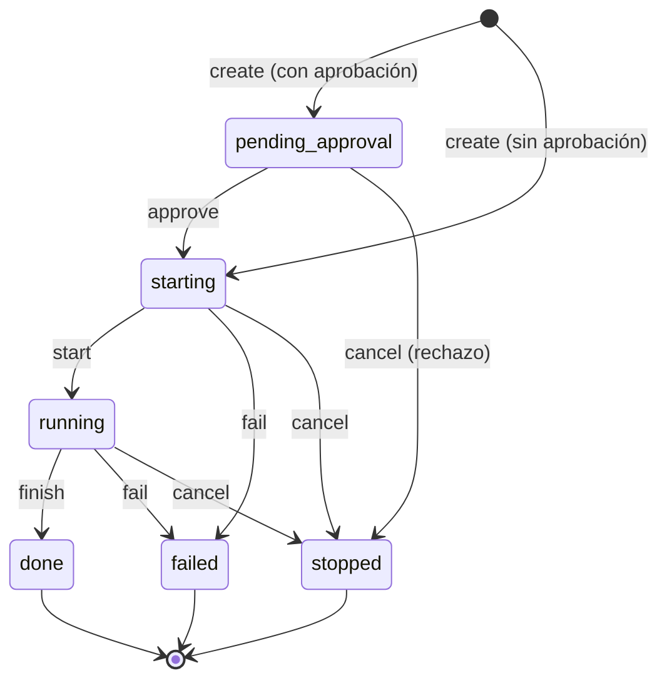

# Attempt como ejecución concreta (LXO-114)

Estado: **esquema y mutadores implementados, inertes hasta el corte**. Segundo paso de código de la épica `[CORE][F3]`
([ADR](CORTE_TASK_ATTEMPT.md), [Task](TASKS.md)). El Attempt guarda **una ejecución concreta de una Task**: qué
proveedor y modelo se eligieron, en qué punto del ciclo de vida está, cuándo empezó y terminó y su resultado mínimo. Un
retry **nunca** reabre un Attempt: crea otro.

* Migración: [`008_attempts.sql`](../../apps/desktop/src-tauri/src/store/migrations/008_attempts.sql).
* Almacén: `store/attempts.rs` (filas, ciclo de vida, atomicidad). Pruebas: `store/attempts_tests.rs`.
* Hechos y permisos: `orch/attempt_ops.rs` (el único que construye sus eventos). Pruebas: `orch/attempt_ops_tests.rs`.

## Inerte hasta el corte

Igual que `runs` y `tasks` ([TASKS.md](TASKS.md#inerte-hasta-el-corte)): hasta que exista `meta.agentic_model`, `attempts`
está vacía, cada mutador devuelve `AgenticModelInactive` **sin escribir nada** y los triggers `attempts_inert_*` abortan
cualquier `INSERT` o `UPDATE` que se salte el almacén. Nada está conectado al RPC, a `lxo` ni a la interfaz; el runtime
legacy sigue siendo la autoridad de las tareas.

## Invariantes y cómo se prueban

| # | Invariante | Mecanismo | Prueba |
|---|---|---|---|
| 1 | El Attempt es inmutable como identidad histórica | trigger `attempts_identity_immutable`: `id`, `task_id`, `n`, `provider`, `model`, `effort`, `role`, `profile`, `external`, `origin` y `created_at` no cambian; el vínculo a Worktree/ProviderSession se fija una sola vez | `la_identidad_no_cambia_y_el_vinculo_se_fija_una_sola_vez` |
| 2 | Retry crea un ID nuevo | `attempt_create_recorded` inserta `n + 1` (`<task>-a<n>`, `UNIQUE (task_id, n)`); nada reabre ni reescribe uno anterior | `varios_attempts_por_task_y_el_retry_conserva_la_historia` |
| 3 | Un Attempt final no vuelve a `running` | trigger `attempts_final_is_final` (ningún `UPDATE` sobre un final) + ciclo de vida cerrado | `un_final_no_vuelve_a_running_ni_cambia_de_final` |
| 4 | Una Task puede existir sin Attempt activo | `attempts` es independiente de la Task; `attempt_active` devuelve `None` | `un_attempt_nace_con_su_identidad_y_su_evento`, `el_ciclo_de_vida_feliz_fija_las_marcas_de_tiempo` |
| 5 | Estado + Events atómicos | cada mutador es UNA transacción con su fila, su evento y la proyección de Attention | `sin_su_hecho_no_hay_cambio`, `un_evento_que_no_se_refiere_al_attempt_o_repetido_deshace_el_cambio`, `si_la_proyeccion_falla_no_queda_ni_el_attempt_ni_su_evento` |
| 6 | Las transiciones inválidas se rechazan sin rastro | tabla cerrada en Rust (`AttemptStep`) y en el trigger `attempts_lifecycle`; se comparan las 81 combinaciones | `la_tabla_de_transiciones_de_rust_cuadra_con_el_trigger_en_las_81_combinaciones`, `desde_cualquier_estado_cada_accion_hace_lo_que_dice_la_tabla_o_se_rechaza_sin_rastro` |
| 7 | La historia no se borra | sin `DELETE` (trigger), FK sin `ON DELETE`; la Task con Attempts no se borra ni se descarta mientras uno corre | `un_attempt_no_se_borra_y_su_task_tampoco_ni_se_descarta_mientras_corre` |
| 8 | La migración es solo hacia adelante y no se edita | sin `DROP`/`ON DELETE`/`CASCADE`; checksum congelado | `la_008_es_una_migracion_hacia_adelante_y_el_attempt_no_lleva_runtime`, `la_migracion_008_tiene_el_checksum_congelado` |
| 9 | Los estados y eventos son los del contrato reservado | los 9 estados y los 7 `kind` salen de `contracts/status-vocabulary.json` | `el_juego_de_estados_y_de_eventos_cuadra_con_el_vocabulario_reservado` |

## Ciclo de vida

Estados (ids de [`VOCABULARIO.md`](../VOCABULARIO.md) §3): `pending_approval` · `starting` · `running` · `waiting` ·
`awaiting_terminal_approval` · `done` · `failed` · `stopped` · `exited`. Los cuatro últimos son **finales**.

`waiting` y `awaiting_terminal_approval` (D20) admiten `finish`, `fail` y `cancel` igual que `running`. Un final no
tiene salida: no hay ninguna flecha que vuelva a `running`.

Tabla cerrada (14 pares). Cualquier otro par es `AttemptTransition` y **no escribe nada**:

| Transición | Desde | Hasta | Marcas de tiempo | Evento |
|---|---|---|---|---|
| `create` | — | `pending_approval` (si pide aprobación) o `starting` | `created_at = updated_at` | `attempt.requested` |
| `approve` | `pending_approval` | `starting` | `updated_at` | `attempt.approved` |
| `start` | `starting` | `running` | `started_at`, `updated_at` | `attempt.started` |
| `finish` | `running` · `waiting` · `awaiting_terminal_approval` | `done` | `ended_at`, `updated_at`, `summary` | `attempt.completed` |
| `fail` | `starting` · `running` · `waiting` · `awaiting_terminal_approval` | `failed` | `ended_at`, `updated_at`, `failure_reason`, `summary` | `attempt.failed` |
| `cancel` | `pending_approval` · `starting` · `running` · `waiting` · `awaiting_terminal_approval` | `stopped` | `ended_at`, `updated_at` | `attempt.rejected` si estaba `pending_approval`; si no, `attempt.stopped` |

* **Idempotencia.** Pedir la transición a un estado en el que el Attempt ya está (`finish` sobre uno `done`) es
  `Unchanged`: sin cambio y sin evento. Un reintento del Core no duplica nada. En cambio, pedir `cancel` sobre uno
  `done` **es un error**: un final no vuelve atrás.
* **Reloj.** Las marcas las fija quien llama y nunca retroceden respecto a `updated_at`.
* **`waiting`, `awaiting_terminal_approval` y `exited`** existen como estados (el corte importa filas del legado en
  ellos y el vocabulario los reserva) pero **entrar en ellos es del runtime (F4)**: su slice ampliará el trigger y
  emitirá `attempt.waiting`. Desde ellos sí se puede terminar, fallar o cancelar. Ver D20.

## Esquema (`008_attempts.sql`)

| Columna | Para qué |
|---|---|
| `id` | `<task_id>-a<n>`, determinista (ADR D2). `CHECK (id = task_id \|\| '-a' \|\| n)` |
| `task_id`, `n` | la Task y el número de intento (`UNIQUE (task_id, n)`). FK sin cascada |
| `status` | uno de los 9 estados |
| `provider`, `model`, `effort`, `role`, `profile` | la selección: qué agente y con qué parámetros. Códigos cortos, no texto libre |
| `external` | coordinador que corre fuera de Lixbon |
| `worktree_id`, `provider_session_id` | referencias **blandas** (D21): las fijan, una sola vez, los slices de Worktree y ProviderSession |
| `summary` | resultado mínimo, como mucho 2000 caracteres. El informe completo será un Artifact |
| `failure_reason` | código `snake_case`; solo cuando `status = failed` |
| `created_at`, `started_at`, `ended_at`, `updated_at` | ms epoch |
| `origin` | `legacy` (copiado por el corte) · `core` |

Restricciones solo para filas `core` (el legado se importa tal cual, sin `ended_at` y a veces sin `started_at`): el
estado final ⇔ `ended_at`, `running`/`done` ⇒ `started_at`, `pending_approval`/`starting` ⇒ sin `started_at`, relojes
ordenados y resumen acotado. Una fila del Core **nace** `pending_approval` o `starting`, con el `n` siguiente, en una
Task abierta de un Run abierto (trigger `attempts_core_create`).

**Nada del runtime** (PID, PTY, argv, rutas, política, canal de entrega, nonce, modelo efectivo…): llega con la
migración del slice que lo usa, como `ALTER TABLE attempts ADD COLUMN`. Una prueba fija la lista de columnas.

## Mutadores

Todos en `store/attempts.rs`, todos `*_recorded`: una transacción con la fila y su evento. El evento lo construye
`attempt_ops` con un closure puro que recibe el Attempt ya cambiado.

| Mutador | Qué hace | Rechaza | Resultado |
|---|---|---|---|
| `attempt_create_recorded(task, NewAttempt)` | nace el Attempt `n + 1` | Task inexistente o descartada; Run cerrado; **ya hay uno activo**; proveedor o etiquetas vacíos | `AttemptRow` |
| `attempt_transition_recorded(id, AttemptAction)` | aplica `Approve` · `Start` · `Finish` · `Fail` · `Cancel` | par fuera de la tabla (`AttemptTransition`); resumen largo o motivo que no es un código | `Changed` · `Unchanged` · `Missing` |

Lecturas (índices `attempts_by_status` y `attempts_one_active`, más `UNIQUE (task_id, n)`): `attempt_row`,
`attempts_of_task` (la historia, por `n`), `attempt_current` (el de mayor `n`), `attempt_active` (el no final) y
`attempts_by_status`.

## Quién puede (`orch/attempt_ops.rs`)

| Operación | Persona | Agente | Sistema |
|---|---|---|---|
| crear | sí | el que coordina la Task (ella misma o un antecesor) | no |
| aprobar | sí | no | no |
| arrancar | no | no | sí (el Core lanza el proceso) |
| terminar · fallar | no | el de **esa** Task | sí (recogida de informes, vigilantes) |
| cancelar | sí | el que la coordina | sí (cierre de Run, apagado) |

Aprobar o rechazar una ejecución es una decisión de una persona; el resto del ciclo lo conduce el Core o el agente.
Una denegación es `AttemptConflict` y no escribe nada. Un Attempt que no existe es `Missing`, no una denegación.

## Events

Contrato completo en [`EVENTOS.md`](EVENTOS.md#attempt-lxo-114). Entidad `attempt` (`entity_id = <task>-a<n>`); Run y
Project, de su Task. Todos llevan `task` y `n`. **Nunca** el resumen, rutas, argv, proceso, worktree ni sesión.

| Mutador | Evento | class | Payload |
|---|---|---|---|
| `create` | `attempt.requested` | state | `task`, `n`, `provider`, `model?`, `effort?`, `role?`, `profile?`, `external`, `approval_required` |
| `approve` | `attempt.approved` | decision | `task`, `n` |
| `start` | `attempt.started` | state | `task`, `n` |
| `finish` | `attempt.completed` | state | `task`, `n`, `has_summary` |
| `fail` | `attempt.failed` | state | `task`, `n`, `reason` ∈ `launch_failed` · `terminal_approval_timeout` · `agent_idle_timeout` · `agent_reported`, `has_summary` |
| `cancel` (pendiente) | `attempt.rejected` | decision | `task`, `n`, `cause` ∈ `cancelled` · `run_closed` |
| `cancel` (el resto) | `attempt.stopped` | state | `task`, `n`, `from`, `cause` |

Los siete `kind` están **reservados** en `contracts/status-vocabulary.json`. `attempt.waiting` también lo está, pero lo
emitirá el runtime (D20). Desde LXO-119, `attempt.failed` levanta `failed` y `attempt.requested` con aprobación levanta
`approval` (que resuelven `attempt.approved`/`attempt.rejected`), **sobre el Attempt** ([ATTENTION.md](ATTENTION.md)).

## Decisiones (LXO-114)

| # | Decisión | Alternativa descartada |
|---|---|---|
| D19 | **A lo sumo un Attempt activo por Task** (índice único parcial `attempts_one_active`, comprobado también en el mutador con un mensaje claro). Reintentar es posible cuando el anterior es final | permitir varios activos desde ya: abre race/compare sin haber decidido sus reglas ni sus credenciales (ADR D11). Esa decisión llegará en su slice y retirará el índice |
| D20 | **Entrar en `waiting`, `awaiting_terminal_approval` y `exited` es del runtime (F4).** Existen como estados y se puede salir de ellos; el slice del runtime añadirá las transiciones al trigger, el mutador y `attempt.waiting` | implementarlas ahora: el contrato del runtime (preguntas al coordinador, aprobación en la terminal, apagado) aún no existe |
| D21 | **`worktree_id` y `provider_session_id` son referencias blandas** con fijado único. Los slices de esas entidades añadirán la comprobación de existencia (trigger) y escribirán el vínculo en la misma transacción que su propio hecho | FK ya: las tablas no existen; o un mutador de enlace aquí, que sería un cambio de estado sin evento |
| D22 | **Cancelar lo pendiente es rechazarlo:** `pending_approval → stopped` emite `attempt.rejected` (decisión), no `attempt.stopped` | un único evento de parada: pierde que la aprobación se denegó |
| D23 | **Pedir el estado en el que ya está es `Unchanged`; el resto de los pares fuera de la tabla, error** | error siempre: obliga al Core a distinguir reintentos de verdad de carreras |
| D24 | **Descartar una Task con un Attempt activo se rechaza** (mutador y trigger de la 008): se cancela antes. Sin cascada implícita | cancelar los Attempts al descartar: un efecto no pedido y sin su evento |
| D25 | **Una Task con Attempts no se borra** (`TaskRemoval::IfUnused` los cuenta). Su historia se conserva descartándola | borrar en cascada: es justo lo que la ADR prohíbe |

## Mutation testing

Manual, como en [`TASKS_MUTACION.md`](TASKS_MUTACION.md): inventario y resultados en
[`ATTEMPTS_MUTACION.md`](ATTEMPTS_MUTACION.md).

## Fuera de este slice

Migrar los datos del legado (lo hace el corte), adapters reales de proveedores (F4), el runtime de las esperas,
Worktree, ProviderSession, Artifact y Thread (sus propios slices), conectar los mutadores al RPC o a `lxo`, UI
(Compare incluida), reglas de Attention de los `attempt.*` y el estado derivado de la Task.
