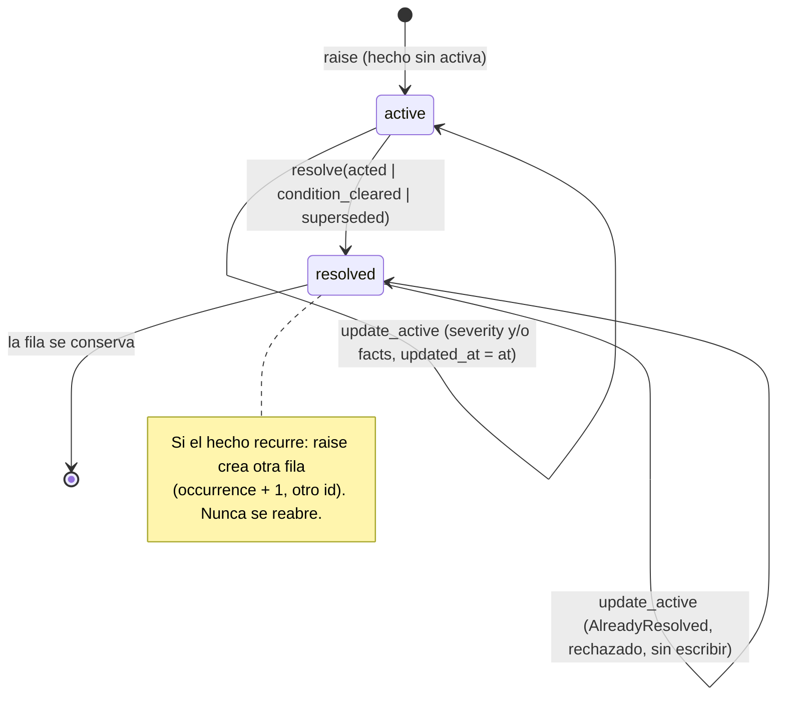

# Attention del Core: modelo autoritativo y ciclo de vida (LXO-87)

Estado: **modelo, ciclo de vida y reglas Events → Attention implementados** (migración `006_attention`; reglas en
LXO-88, ver «Reglas Events → Attention»). Tres señales **no** tienen aún un Event durable que las respalde y se
documentan como gaps (`review_ready`, `environment_blocked` y el discriminador durable de `risk`; ver «Gaps de señal»).
La API de lectura/consulta y la resolución soportada por cliente son **LXO-89**. Aquí no hay interfaz,
notificaciones push, ranking personalizado, asignación de equipo ni *unread*.

## Decisión (ADR)

Attention es una entidad **del Core**, persistida en SQLite (`attention_items`), con identidad estable,
categoría y severidad **fijadas por el Core**, un destino lógico y un ciclo de vida explícito. Desktop, CLI y
Mobile consumirán **la misma lista autoritativa**; ninguno deriva categoría ni severidad.

Se separan tres conceptos que antes se confundían:

| Concepto | Responde a | Dónde vive | Es |
|---|---|---|---|
| **Event** | qué ocurrió | `events` (append-only, `EVENTOS.md`) | historia |
| **Attention** | qué necesita de mí **ahora** | `attention_items` | estado de trabajo pendiente |
| **Unread / Activity** | qué no he visto | cliente / vista Activity (futuro) | lectura por persona y dispositivo |

Alternativas descartadas:

* **Calcularla siempre al leer** (como hoy en `src/orch/attention.js`): cada cliente vería una lista distinta y
  no habría identidad, `resolved_at` ni historia. Las reglas de LXO-88 sí son deterministas y reproducibles,
  pero el *resultado* se persiste.
* **Event sourcing puro** (Attention = fold de eventos): obligaría a que cada cambio de la lista sea un evento y
  a reconstruir la lista leyendo todo el log. Se mantiene el Event Log como historia de hechos y Attention como
  estado; la relación es una referencia blanda (`source_event_id`).
* **`snoozed` en el dominio**: ver «Por qué no hay `snoozed`».

## Invariantes y cómo se prueban

Pruebas en `apps/desktop/src-tauri/src/store/attention_tests.rs`.

| # | Invariante (LXO-87) | Mecanismo | Prueba |
|---|---|---|---|
| 1 | Attention no es una copia del Event Log | solo `source_event_id`/`correlation_id` (referencias); `facts` acotado a 2 KiB; levantar no escribe en `events` | `un_evento_informativo_no_crea_attention_y_attention_no_crea_eventos` |
| 2 | Un Event informativo no crea Attention por defecto | el almacén nunca deriva Attention; solo una regla explícita (LXO-88) llama a `attention_raise` | idem |
| 3 | Resolver no borra Events ni historia | `active → resolved` sobre la fila; triggers prohíben DELETE y reabrir | `resolver_no_borra_ni_toca_los_eventos…`, `una_fila_resuelta_no_vuelve_a_activa…` |
| 4 | Un mismo hecho no crea duplicados activos equivalentes | `fingerprint` + índice único parcial `WHERE status = 'active'` | `un_mismo_hecho_no_crea_dos_activos`, `la_base_impone_un_solo_activo…` |
| 5 | El destino sigue resoluble si cambia una ruta local | destino lógico `(target_kind, target_id)`; rutas rechazadas en Rust y en la base | `el_destino_sigue_resolviendo_aunque_cambie_la_ruta_local_del_proyecto`, `el_destino_rechaza_rutas…` |
| 6 | Categoría/severidad no se derivan en frontend | conjuntos cerrados en Rust **y** CHECK; la categoría es inmutable y la severidad solo cambia en la activa, vía el Core | `las_categorias_iniciales…`, `la_base_impone_los_conjuntos_cerrados`, `la_severidad_de_una_actualizacion_es_un_conjunto_cerrado` |
| 7 | Actualizar severity/facts de la activa no duplica ni altera la identidad ni la historia | `attention_update_active_in`; trigger que solo libera `severity`/`facts`/`updated_at` en filas `active` | `actualizar_*`, `raise_duplicado_tras_actualizar…`, `una_actualizacion_invalida_se_rechaza_sin_cambios_parciales`, `actualizar_una_resuelta_se_rechaza_y_no_la_reabre`, `el_limite_sql_de_campos_protegidos_de_una_activa` |
| — | Attention ≠ unread | el esquema no tiene columnas de lectura, cliente, usuario ni snooze | `attention_no_es_unread…`, `attention_sigue_activa_sea_cual_sea_el_estado_de_lectura…` |
| — | Sin strings de interfaz en el dominio | solo códigos `snake_case` ASCII; no hay título/mensaje/ayuda | `el_dominio_solo_usa_codigos_estables_sin_textos_de_interfaz` |

## Categorías (conjunto cerrado inicial)

Ampliar una categoría exige un ADR y una migración nueva que reemplace el CHECK; no se añade desde un cliente.

| Código | Significa | Origen típico (orientativo, lo fija LXO-88) |
|---|---|---|
| `question` | un agente espera una respuesta | pregunta sin responder |
| `approval` | algo espera una aprobación humana | lanzamiento pendiente; aprobación en terminal |
| `review_ready` | un resultado está listo para revisar o integrar | tarea hecha con rama sin integrar |
| `conflict` | un conflicto impide avanzar | integración con conflicto |
| `failed` | un intento terminó con error | tarea `failed` |
| `environment_blocked` | el entorno impide trabajar | herramienta/credencial/ruta no disponible |
| `risk` | una política o heurística avisa de un riesgo | aviso de política |

Correspondencia con el frontend actual (informativa, **no normativa**; LXO-88 la fija y el frontend deja de
calcular): `approve_in_terminal`, `pending_spawn` → `approval`; `integrate`, `review` → `review_ready`;
`failed` → `failed`; `unanswered_question` → `question`.

## Severidad

Un único campo normalizado, fijado por el Core. Orden total (rank 0 = más urgente). El orden de presentación lo
decidirá la API de lectura (LXO-89); aquí solo se define la escala.

| Código | rank |
|---|---|
| `critical` | 0 |
| `high` | 1 |
| `medium` | 2 |
| `low` | 3 |

La severidad la fija el Core al levantar el hecho y **solo puede cambiar mientras la fila sigue `active`**, y solo
por la operación de actualización de la activa (ver «Actualizar la Attention activa»). Levantar de nuevo el mismo
hecho con otra severidad mientras hay una ocurrencia activa **no** la modifica: devuelve la activa tal cual
(`Raised::Existing`). Una fila `resolved` conserva su severidad para siempre.

## Estados y ciclo de vida

```text
                    attention_raise(hecho nuevo)
                    (sin ocurrencia activa del mismo fingerprint)
          ┌────────────────────────────────────────────────┐
          │                                                ▼
     (no existe) ──────────────────────────────────►   ┌────────┐
          ▲                                            │ active │◄─┐ attention_raise(mismo hecho)
          │                                            └───┬────┘  │ = Existing: devuelve la activa,
          │                                                │       │   no escribe nada
          │                                                │       │ attention_update_active(id, severity?, facts?, at)
          │                                                │       │   = Updated: cambia severity/facts/updated_at
          │                                                │ attention_resolve(id, motivo, at)
          │                                                ▼
          │                                           ┌──────────┐
          │   el hecho vuelve a ocurrir               │ resolved │  terminal e inmutable
          └─── attention_raise ⇒ NUEVA ocurrencia ◄───┤          │  (la fila queda como historia)
               (occurrence + 1, otro id)              └────┬─────┘
                                                           │ attention_resolve(id…) = AlreadyResolved
                                                           └──► no-op (no reescribe resolved_at ni motivo)
```



| Estado | `resolved_at` | `resolution` | `updated_at` |
|---|---|---|---|
| `active` | `NULL` | `NULL` | = `created_at` al levantar; = `at` de la última actualización (≥ `created_at`) |
| `resolved` | ms epoch, ≥ `created_at` | `acted` · `condition_cleared` · `superseded` | = `resolved_at` |

Motivos de resolución: `acted` (una persona, o su agente delegado, actuó), `condition_cleared` (la condición dejó
de cumplirse sin acción directa), `superseded` (la sustituye otra Attention o un hecho posterior).

Las marcas de tiempo (`at`) las **fija quien llama**; el almacén no llama a `now()`. Resolver o actualizar con
`at < created_at` se rechaza (`InvalidAttention`).

### Actualizar la Attention activa (seam para LXO-88)

LXO-88 necesita subir/bajar la severidad y refrescar los `facts` de un hecho que **ya está activo** sin duplicarlo
(si la regla vuelve a observar el mismo hecho con otra severidad, `attention_raise` devuelve `Existing` sin
tocarla). Para eso existe una operación tipada, con el mismo patrón que `raise`/`resolve`:

```text
attention_update_active_in(tx, id, &AttentionUpdate { severity: Option<Severity>, facts: Option<String>, at })
    -> UpdateOutcome::{ Updated(row) | AlreadyResolved(row) | Missing }
Store::attention_update_active(id, &AttentionUpdate)        // una sola transacción
```

| Aspecto | Contrato |
|---|---|
| Qué cambia | **solo** `severity` (si es `Some`), `facts` (si es `Some`; REEMPLAZAN a los anteriores, no se fusionan) y `updated_at = at` |
| Qué no cambia | `id`, `fingerprint`, `occurrence`, `category`, destino, `project_id`, `run_id`, `subject`, `source_event_id`, `correlation_id`, `created_at`, `status`, `resolved_at`, `resolution` |
| Validación | al menos uno de `severity`/`facts` (si no, `InvalidAttention`); `severity` del conjunto cerrado (el tipo `Severity`); `facts` = objeto JSON ≤ 2048 **bytes**; `at ≥ created_at` (sin exigir monotonicidad respecto de `updated_at`) |
| Sin cambios parciales | todo se valida antes de escribir y el `UPDATE` es una sola sentencia sobre `status = 'active'`; si algo falla, la fila queda idéntica |
| Fila `resolved` | terminal e inmutable: devuelve `AlreadyResolved(fila)` **sin escribir** (no es `Updated`, no se confunde con éxito) y nunca se reabre; el hecho recurrente es otra ocurrencia (`raise`) |
| Id desconocido | `Missing` |
| Transacción | la variante `_in` corre dentro de la transacción de quien llama (p. ej. junto al evento que motivó el cambio); si esa transacción se deshace, la actualización también |
| Eventos | **no emite nada**: no hay `attention.updated`. El Event Log, el vocabulario y los clientes (RPC/HTTP/CLI) no cambian; qué evento acompaña a una actualización lo decide LXO-88 |

Lo impone también la base: el trigger `attention_only_resolve` deja de proteger `severity` y `facts` **solo en filas
`active`** (más `updated_at`, que nunca estuvo protegido); sigue prohibiendo cambiar el resto de columnas, tocar
cualquier fila `resolved`, y resolver cambiando a la vez `severity` o `facts` (resolver es una transición pura).
Prueba: `el_limite_sql_de_campos_protegidos_de_una_activa`.

### Por qué no hay `snoozed`

Posponer es una decisión **por persona y dispositivo** («no me avises hasta las 16:00») y depende de la hora del
cliente. Meterlo en el estado autoritativo mezclaría política de cliente con el hecho compartido: dos
dispositivos tendrían estados distintos de una misma fila. Si más adelante hace falta, será una tabla de
preferencias por cliente que **filtre** la lista autoritativa sin cambiar `status`.

## Identidad

Cada **ocurrencia** tiene un `id` opaco y estable; todas las ocurrencias de un mismo **hecho** comparten
`fingerprint`.

```text
fingerprint = SHA-256( "lixbon.attention.v1" \0 category \0 target_kind \0 target_id \0 subject' )
              subject' = "n"            si no hay subject
                         "s" + subject  si lo hay
occurrence  = 1 + max(occurrence) de ese fingerprint
id          = "att_" + hex( SHA-256( "lixbon.attention.id.v1" \0 fingerprint \0 occurrence ) )[0..32]
```

* El `fingerprint` **no** incluye hora, severidad, `facts`, `project_id`, `run_id` ni el evento origen: el mismo
  hecho observado por dos caminos es el mismo hecho.
* `subject` distingue hechos distintos de la misma categoría y destino (dos preguntas de una misma tarea:
  `subject = <id del mensaje>`).
* Los campos van separados por `\0` y los ids no pueden contener caracteres de control: ninguna combinación es
  ambigua.
* **Vectores fijados** (`los_vectores_de_identidad_del_contrato_no_cambian`): para `failed` sobre
  `task/0192f0a0-7b1c-7000-8000-0000000000a1`, `fingerprint =
  30e6fc17321af6c249914dde7f108e5b45340fefed9879f92b632c83751b3fbb`, ocurrencia 1 →
  `att_954184304320b2663da4bdfc5d2942bd`, ocurrencia 2 → `att_51efafc44ec6225c4ff1a24e76ccbc28`. Cambiarlos
  cambia la identidad de toda Attention persistida: es un cambio de contrato.

## Destino lógico

`target = (target_kind, target_id)` es una **identidad del Core**, nunca una ruta.

* `target_kind` (validado en Rust, sin CHECK, igual que `events.entity_kind`): `project`, `task`, `run` (run
  legacy), `spawn_request`, `attempt`, `thread`, `worktree`, `artifact`, `review`, `integration`, `agent`,
  `decision`, `policy`. No existe `attention`: una Attention no apunta a otra.
* `target_id`: 1–200 caracteres, sin caracteres de control, y **no** puede parecer una ruta: se rechazan `/…`,
  `~…`, `\…`, `X:…`, cualquier `\` y `..`. Lo imponen `AttentionTarget::new`/`NewAttention::check` **y** un CHECK
  de la tabla.
* `project_id` y `run_id` son referencias blandas de contexto (para filtrar sin resolver el destino); no forman
  parte de la identidad.
* Cambiar la ruta local de un proyecto no toca ninguna fila: el destino resuelve por su id lógico y la ruta
  nueva lleva al mismo proyecto (`el_destino_sigue_resolviendo_aunque_cambie_la_ruta_local_del_proyecto`).

## Persistencia y reconstrucción (decisión determinista)

* **La tabla `attention_items` es la autoridad** (estado persistido, no vista recalculada al leer). Es la única
  fuente de la lista; no existe `attention.json` ni un segundo almacén.
* **Reconstruible**: identidad y `fingerprint` son funciones puras del hecho; el `id` lo es de `(fingerprint,
  occurrence)`. Un mismo historial de levantar/resolver produce **los mismos ids y filas** en una instalación
  reconstruida (`el_id_se_deriva_del_hecho_y_la_ocurrencia_y_la_reconstruccion_lo_repite`). Las reglas de LXO-88
  podrán volver a derivar el estado vigente desde Events/State y obtendrán los mismos `fingerprint`; no hay
  relleno histórico en la migración (Attention empieza vacía).
* **Atomicidad**: `attention_raise_in` / `attention_resolve_in` corren **dentro de la transacción de quien
  llama**, como el registro de proyectos con su evento. Así el evento origen y la Attention se confirman o se
  deshacen juntos (`el_evento_origen_y_la_attention_se_confirman_o_se_deshacen_juntos`). Lo mismo vale para
  `attention_update_active_in` (`la_actualizacion_participa_en_la_transaccion_de_quien_llama`). Los métodos de
  `Store` (`attention_raise`, `attention_update_active`, `attention_resolve`, `attention_get`) son la vía de una
  operación.
* **Un solo escritor** (el Core), `BEGIN IMMEDIATE`, tiempos fijados por quien llama: reintentar una escritura
  idempotente no cambia el resultado (`raise` → `Existing`, `resolve` → `AlreadyResolved`; repetir un
  `update_active` con los mismos valores y `at` deja la fila igual).

### Relación con el Event Log

* `source_event_id` guarda el `events.id` (UUID v7, identidad global), **no** el `seq` local. Es una referencia
  **blanda** (sin `REFERENCES`): el origen puede ser de otra instalación y archivar un proyecto no bloquea la
  historia. `correlation_id` repite el del evento cuando existe.
* Resolver **no** toca `events`. Los eventos de ciclo de vida reservados en el vocabulario
  (`attention.created`, `attention.resolved`, `entity_kind = attention`) se emiten en la **misma transacción** que el
  Event origen y la fila de Attention; lo implementa LXO-88 (ver «Reglas Events → Attention»).

## Reglas Events → Attention (LXO-88)

### Arquitectura y fronteras
```text
 escritor del Event Log (una transacción de SQLite)
   ├─ commit_authoritative_with_events   Core::mutate*     task.*, run.*, decision.recorded, effect.observed, spawn.resolved(+legacy)
   ├─ append_events                      Core::record_facts spawn.requested, spawn.resolved standalone
   └─ project_*_recorded                 project_ops        project.*
        1. INSERT events                         (event_origen, seq)
        2. EventProjector::project(tx, nuevos)   store::AttentionProjection ── usa ──► AttentionRules::derive   (orch, PURA)
              · aplica cada intención con attention_raise_in / attention_update_active_in / attention_resolve_in
              · devuelve attention.created / attention.resolved
        3. insert_derived_in(tx, derivados)      (sin reproyectar)
        COMMIT   ── o ROLLBACK de las tres cosas si cualquiera falla ──
```
* **Reglas puras en `orch/attention_rules.rs`** (`derive`): función de UN Event; no lee `State`, git, reloj, cliente
  ni SQL. **Driver SQL en `store/attention_projection.rs`**: aplica las intenciones con las variantes `_in` de LXO-87,
  descarta señales antiguas y construye los `attention.*`. `orch` no importa `rusqlite`, no inserta Events ni
  finaliza borradores; solo `store/events.rs` inserta.
* **Instalación:** `orch::store_boot::open_for_boot` instala `AttentionProjection::new(EventRules)` en el `Store` del
  Core. Un `Store` sin proyector (pruebas del almacén, copias) inserta Events sin proyectar. Una base aún sin la `006`
  no proyecta (igual que sin la `004` no hay Event Log); no hay relleno histórico.
* **Writers cubiertos:** los tres. Todo `insert_events` pasa por `insert_events_projected`; no existe otro INSERT en
  `events`. `project.*` no es señal de ninguna regla: su writer ejecuta el proyector y no levanta nada.
* Si la proyección falla, **el writer falla entero**: el Event origen no queda, ni la fila, ni `attention.*`, ni el
  estado en memoria cambia. Para `spawn`, un fallo así se informa como fallo de persistencia, nunca como denegación.

### Tabla Event → Attention
Fuente de verdad en código: `orch::attention_rules::derive`. Severidad fijada por la regla; `facts` solo con códigos
e ids (`event_seq` siempre, el `seq` del último Event que tocó el hecho).

| Event (`kind`, condición) | Transición | Categoría · severidad | Hecho (target · subject) |
|---|---|---|---|
| `task.question` | levanta | `question` · medium | `task` que pregunta · id del mensaje |
| `task.reply` | resuelve `acted` | `question` | `task` que preguntó · `question_id` |
| `spawn.requested` · `policy_status` `ok` / `unverified` | levanta | `approval` · medium | `spawn_request` · — |
| `spawn.resolved` · `approved` / `rejected` / `launch_failed` | resuelve `acted` | `approval` | `spawn_request` |
| `spawn.resolved` · `timeout` / `coordinator_closed` / `cancelled_run_removed` | resuelve `condition_cleared` | `approval` | `spawn_request` |
| `task.status_changed` → `awaiting_terminal_approval` | levanta | `approval` · medium | `task` · `terminal` |
| `task.status_changed` desde `awaiting_terminal_approval` a `starting`/`running`/`waiting` | resuelve `acted` | `approval` | `task` · `terminal` |
| `task.status_changed` desde `awaiting_terminal_approval` a cualquier otro | resuelve `condition_cleared` | `approval` | `task` · `terminal` |
| `task.status_changed` → `failed` (la causa máquina va en `facts.failure_reason`) | levanta | `failed` · high | `task` |
| `task.status_changed` desde `failed` | resuelve `condition_cleared` | `failed` | `task` |
| `decision.recorded` `merge` · `outcome = conflict` | levanta; si ya estaba activa, **actualiza** `facts` (y severidad) | `conflict` · high | `task` |
| `decision.recorded` `merge` · `outcome = merged` | resuelve `acted` | `conflict` | `task` |
| `task.removed` | resuelve `condition_cleared` | `failed`, `conflict`, `approval`(terminal) de esa task | `task` |
| `spawn.requested` · `policy_status = blocked` | levanta | `risk` · high | `spawn_request` · — |

* **`risk` solo nace de `spawn.requested.policy_status = blocked`.** `ok`, `unverified`, un fallo genérico, un
  bloqueo del entorno o del proveedor, y la entrada inválida no la crean (pruebas
  `solo_policy_status_blocked_levanta_risk`, `un_bloqueo_del_entorno_no_deja_event_y_por_tanto_no_crea_risk`,
  `una_entrada_invalida_es_un_error_y_no_se_registra_como_denegada_por_policy`). Ningún Event la resuelve sola: la
  cierra una persona (LXO-89, `acted`).
* **Las señales puramente informativas no crean nada:** `task.created`, `task.phase`, transiciones ordinarias,
  `effect.observed`, `decision.recorded` de `review`/`pr`, `project.*`, `run.*` y los propios `attention.*`.
* **No hay regla** para `review_ready` ni `environment_blocked` (ver «Gaps de señal»); tampoco una cascada de
  `run.removed` ni la resolución de `question` al retirar una task (el evento no trae la lista de hechos).

### Camino de `spawn` (preflight y denegación)
Resumen; contrato completo en `EVENTOS.md`, «Denegación explícita de policy».
* `agents::check_request` valida el **pedido** (agente, modelo, esfuerzo, rol, proveedor × perfil) y **no** aplica la
  compuerta de policy: lo inválido es un error sin Event. Sustituye a `agents::launch` en `plan_spawn`.
* `agents::explicit_denial` (tipado, `PolicyDenial::ProfileDisabled`, vía `Profile::disabled_reason()`) separa la
  denegación explícita de los bloqueos del entorno/proveedor. Solo la primera se registra (`spawn.requested` con
  `policy_status = blocked`) **antes** de devolver la denegación, sin pendiente, Task, aprobación, aviso, PTY, proceso
  ni worktree. Si el Event no se puede persistir se devuelve ese fallo.

### Orden, señales antiguas, replay e idempotencia
* El proyector recibe solo los Events **nuevos** de la transacción, en orden de `seq` (que es el orden de commit).
  Un tramo no ascendente estricto se rechaza entero (`ProjectError::OutOfOrder`); manda `seq`, nunca `at`.
* `after_seq` (marca de agua) descarta lo ya aplicado. Además cada hecho guarda `facts.event_seq`: una señal con
  `seq <= event_seq` del último Event que lo tocó es **antigua** y no se reaplica (`Report::stale`). Así un
  `task.reply` viejo no resuelve una pregunta posterior y un replay sobre un estado poblado no duplica nada.
* **Replay desde cero = estado incremental** (mismos `fingerprint`, ids, ocurrencias y `attention.*`):
  `replay_desde_cero_es_igual_al_estado_incremental`, y contra los writers reales
  `el_estado_que_mantienen_los_writers_es_el_de_un_replay_desde_cero_del_log`.
* **Duplicados/reintentos:** el mismo Event, o el mismo hecho observado otra vez mientras está activo, no crea otra
  fila; un Event repetido por `(kind, idem_key)` ni siquiera se reproyecta. **Resolver es idempotente** (no
  reescribe `resolved_at` ni el motivo).
* **Límite conocido:** no hay una marca de agua durable global; la garantía es por hecho (`event_seq`) más el orden de
  commit del único escritor. Un replay de un tramo *parcial* sobre un estado poblado puede no distinguir una señal
  intermedia que no cambió el hecho; el replay desde cero y el incremental sí son exactos.
* **Reinicio:** las filas y `attention.*` son durables (SQLite); el proyector se reinstala al abrir el almacén. Los
  pendientes de spawn viven en memoria (ver `EVENTOS.md`, «Reinicio»): su `approval` se resuelve cuando la
  reconciliación emita `spawn.resolved`.

### Invariantes de LXO-88
| # | Invariante | Cómo se prueba |
|---|---|---|
| 1 | Mismos Events producen misma Attention | `mismos_events_mismos_ids_y_filas_en_una_instalacion_reconstruida`, replay |
| 2 | Replay no duplica | `reaplicar_todo_el_log_sobre_un_estado_ya_poblado_no_cambia_nada`, `duplicados_y_reintentos_no_duplican_items` |
| 3 | Un client disconnect no altera Attention | `las_reglas_son_funciones_de_los_events_y_no_leen_estado_de_cliente_ni_de_lectura` (la regla es función del Event; no lee cliente, conexión ni lectura) |
| 4 | Un unread/read no resuelve Attention | ídem + `attention_sigue_activa_sea_cual_sea_el_estado_de_lectura_de_la_actividad` (LXO-87): ninguna regla consume lectura |
| 5 | Datos no durables se rechazan o se capturan antes | `review_ready_y_environment_blocked_no_tienen_senal_durable_y_ningun_event_las_infiere` |
| 6 | Event y Attention se confirman o se deshacen juntos | `si_la_proyeccion_falla_*` (los tres writers), `la_attention_y_sus_events_se_confirman_o_se_deshacen_juntos` |

### Mutation testing (a mano, como en `proctable.rs`)
No hay `cargo-mutants` en el repo ni en la CI; se aplicaron **32 mutantes** uno a uno sobre el código de producción
(todos por separado, restaurando el archivo y ejecutando `attention`, `spawn_blocked`). **32 muertos, 0 vivos** (`m02`
sobrevivió a la primera ronda —equivalente con las reglas actuales— y se mató con una prueba de reglas inyectadas).

| Grupo | Mutantes (cada uno lo mata al menos una prueba) |
|---|---|
| create | no emitir `attention.created`; ignorar el guard de señal antigua al levantar (`>=` → `>`); no guardar `event_seq`; marca de agua máxima / `<=` → `<` |
| resolve | no emitir `attention.resolved`; una resuelta deja de ser no-op; guard de señal antigua (`>=` → `>`, mata `una_resolucion_con_el_mismo_seq…`); `at` sin proteger de `created_at`; fingerprint sin `subject`; `task.reply` resuelve otro hecho; `merged` no resuelve; `timeout` como `acted` |
| dedupe/update | una activa tratada como resuelta; no actualizar severidad; orden: aceptar `seq` repetido |
| risk / reglas | `risk` también desde `unverified`; `unverified` sin `approval`; `failed` desde otro estado |
| spawn | ignorar el fallo de persistencia antes de denegar; la denegación crea pendiente y efectos; cualquier bloqueo es «explícito»; no exigir solicitud válida; `check_request` sin validar rol ni proveedor × perfil |
| writers | el escritor no proyecta; `append_events`, `commit_authoritative` y cada uno de los cuatro cambios de Project sin proyector |

## Gaps de señal (decisión pendiente)
Reglas que el issue pide y que **no se infieren**: no hay Event durable autoritativo y no se deducen de Git local, de la
ausencia de una decisión ni de un `failed`.

### `review_ready` («resultado listo para revisar o integrar»)
* **Comportamiento requerido (issue):** `review ready/decisión pendiente → review_ready active; decisión → resolve`.
* **Señales durables hoy:** `task.created{parent}`; `effect.observed{git_worktree, branch}` (la task tiene rama);
  `task.status_changed{to = done}`; `decision.recorded{review: accepted|rejected, head_commit}`;
  `decision.recorded{merge: merged|conflict|…}`; `effect.observed{git_merge}`; `decision.recorded{pr}`.
* **Qué falta:** ningún Event dice «esta task queda lista para revisión». «done + rama + sin decisión» se obtendría
  **por ausencia de decisión** y combinando tres Events, y la caducidad de una revisión («la rama recibió otro
  commit») exige el `head_commit` de la task al terminar, que no es durable (hoy solo el de la decisión).
* **Cambio mínimo a autorizar (Event API):** un Event explícito `task.review_requested` (clase `state`, entidad `task`,
  `idem_key` por task y `head_commit`) emitido por el mutador que cierra una hija `done` con rama (`Tx::close`), y
  la regla: levanta `review_ready` (medium); un nuevo `head_commit` actualiza `facts` (revisión caducada);
  `decision.recorded{review: rejected}`, `{merge: merged}` y `task.removed` la resuelven (`acted` /
  `condition_cleared`); `review: accepted` la deja activa y actualiza `facts.stage = integrate`. Alternativa más
  pequeña: añadir `has_branch` y `head_commit` (opcionales, versión 2) al payload de `task.status_changed` a `done`.

### `environment_blocked` («el entorno o el proveedor impide trabajar»)
* **Comportamiento requerido (issue):** `provider/environment blocked → environment_blocked`, **distinto** de que el
  Attempt falle, sin reinterpretar errores desconocidos.
* **Señales durables hoy:** ninguna. `task.status_changed{to = failed, cause}` solo lleva causas máquina de
  vigilancia (`terminal_approval_timeout`, `agent_idle_timeout`…); `spawn.requested{policy_status = blocked}` mezcla
  política explícita con entorno (CLI ausente, flags, sandbox elevado) y, por diseño, ya no se emite para estos
  últimos; `helper_unknown_error: setup refresh had errors` de Codex solo aparece en la salida de la terminal, y
  Attempt aún no existe. LXO-131 es quien debe detectarlo.
* **Cambio mínimo a autorizar (Event API):** un Event tipado emitido por el detector (LXO-131), p. ej.
  `environment.blocked{provider, code}` (conjunto cerrado de `code`, entidad `task`/Attempt, `idem_key` por
  ocurrencia) y su par `environment.cleared` (preflight o Attempt posterior correctos). La regla: el primero levanta
  `environment_blocked` (high), el segundo la resuelve `condition_cleared`. Mientras no exista, ningún Event levanta
  esta categoría (probado).

### Discriminador durable de `risk`
* **Hoy:** el tipo `agents::PolicyDenial` decide en el momento de emitir; el Event no lo lleva (`policy_status` solo
  distingue `ok`/`blocked`/`unverified` y se omite el motivo a propósito). `risk` es correcto mientras `blocked` solo
  se emita para denegaciones explícitas, invariante que fija `spawn_blocked_tests`.
* **Cuándo hace falta cambiar el contrato:** si otra causa explícita o un bloqueo del entorno debe registrarse como
  solicitud denegada. Cambio mínimo: campo opcional `denied_by` (código cerrado, p. ej. `profile_disabled`) en
  `spawn.requested` (versión 1 aditiva) y la regla de `risk` condicionada a su presencia.

## Esquema (`006_attention.sql`)

| Columna | Para qué |
|---|---|
| `id` | identidad de la ocurrencia (PK) |
| `fingerprint`, `occurrence` | identidad del hecho y su número de ocurrencia (`UNIQUE (fingerprint, occurrence)`) |
| `category`, `severity`, `status` | conjuntos cerrados (CHECK) |
| `target_kind`, `target_id` | destino lógico |
| `project_id`, `run_id` | contexto, referencias blandas |
| `subject` | discriminante opcional del hecho |
| `source_event_id`, `correlation_id` | origen, referencias blandas |
| `facts` | objeto JSON ≤ 2048 bytes con **códigos e ids**; nunca texto de interfaz, cuerpos, diffs, argv, env ni secretos |
| `created_at`, `updated_at`, `resolved_at` | ms epoch, fijados por quien llama |
| `resolution` | motivo; solo en `resolved` |

* Índice único parcial `attention_one_active (fingerprint) WHERE status = 'active'`: **una activa por hecho**,
  impuesto por la base aunque el código falle.
* Índice `attention_by_target (target_kind, target_id, status)`.
* Triggers: `attention_no_delete` (la historia no se borra) y `attention_only_resolve` (solo se admite la
  transición `active → resolved` o, en una fila `active`, cambiar `severity`/`facts`/`updated_at`; identidad,
  categoría, destino, contexto, origen y `created_at` son inmutables y `resolved` es terminal).
* No hay columnas de título, mensaje, ayuda, lectura, cliente, usuario, asignado ni contadores: el dominio guarda
  **códigos** y cada superficie los traduce a texto.

## Ejemplos

### Fila (`attention_items`) — fallo de una tarea, recién levantado

| columna | valor |
|---|---|
| `id` | `att_954184304320b2663da4bdfc5d2942bd` |
| `fingerprint` | `30e6fc17321af6c249914dde7f108e5b45340fefed9879f92b632c83751b3fbb` |
| `occurrence` | `1` |
| `category` / `severity` / `status` | `failed` / `high` / `active` |
| `target_kind` / `target_id` | `task` / `0192f0a0-7b1c-7000-8000-0000000000a1` |
| `project_id` / `run_id` | `0192f0a0-7b1c-7000-8000-0000000000b2` / `r1` |
| `subject` | `NULL` |
| `source_event_id` | `0192f0a1-0000-7000-8000-0000000000c3` |
| `correlation_id` | `NULL` |
| `facts` | `{"failure_reason":"agent_idle_timeout"}` |
| `created_at` / `updated_at` | `1760000000000` / `1760000000000` |
| `resolved_at` / `resolution` | `NULL` / `NULL` |

### La misma fila tras resolverse

`status = resolved`, `resolved_at = 1760000060000`, `updated_at = 1760000060000`, `resolution = acted`. El resto
no cambia y el evento origen sigue intacto en `events`.

### Recurrencia: segunda ocurrencia del mismo hecho

Mismo `fingerprint`, `occurrence = 2`, `id = att_51efafc44ec6225c4ff1a24e76ccbc28`, `status = active`. La
ocurrencia 1 se conserva `resolved`.

### Payload (`AttentionRow`, serialización del Core)

Los códigos viajan tal cual; no hay texto para mostrar. Cada superficie lo traduce.

```json
{
  "id": "att_954184304320b2663da4bdfc5d2942bd",
  "fingerprint": "30e6fc17321af6c249914dde7f108e5b45340fefed9879f92b632c83751b3fbb",
  "occurrence": 1,
  "category": "failed",
  "severity": "high",
  "status": "active",
  "target": { "kind": "task", "id": "0192f0a0-7b1c-7000-8000-0000000000a1" },
  "project_id": "0192f0a0-7b1c-7000-8000-0000000000b2",
  "run_id": "r1",
  "subject": null,
  "source_event_id": "0192f0a1-0000-7000-8000-0000000000c3",
  "correlation_id": null,
  "facts": "{\"failure_reason\":\"agent_idle_timeout\"}",
  "created_at": 1760000000000,
  "updated_at": 1760000000000,
  "resolved_at": null,
  "resolution": null
}
```

(`facts` viaja como texto JSON, igual que `events.payload`. La forma de la API HTTP/RPC la define LXO-89.)

### Entrada (`NewAttention`) que produce esa fila

```json
{
  "category": "failed",
  "severity": "high",
  "target": { "kind": "task", "id": "0192f0a0-7b1c-7000-8000-0000000000a1" },
  "project_id": "0192f0a0-7b1c-7000-8000-0000000000b2",
  "run_id": "r1",
  "subject": null,
  "source_event_id": "0192f0a1-0000-7000-8000-0000000000c3",
  "correlation_id": null,
  "facts": "{\"failure_reason\":\"agent_idle_timeout\"}",
  "at": 1760000000000
}
```

## Migración

`006_attention.sql`. El número se eligió **tras comprobar el registro real** (`src/store/migrations/`:
001–005 existen; ver `MIGRACIONES.md`). Se aplica tras la valla, igual que 003–005, con
`Store::migrate_authoritative`. Una base con la 006 no la abre un binario que no la conoce
(`DatabaseNewer`/`UnknownMigration`), y el checksum queda fijado en una prueba.

## Fuera de alcance de LXO-87

* **LXO-88**: qué Events/State levantan, actualizan o resuelven cada categoría, severidades por regla (que
  consumirán `attention_update_active`), eventos `attention.created|resolved` (y, si hiciera falta, uno de
  actualización: hoy no existe `attention.updated`), retirada del cálculo en `attention.js`.
* **LXO-89**: API de lectura/consulta, orden de presentación, filtros, resolución soportada por cliente y
  autorización (`ClientAction`).
* UI, push, ranking personalizado, asignación de equipo (F9), *unread* y `snoozed`.

## Fuera de alcance de LXO-88

* Notificaciones, ranking (ML o personalizado), textos de interfaz, *snooze* personal y políticas de Team.
* La retirada del cálculo de Attention en el frontend (`src/orch/attention.js`) y su sustitución por la lista
  autoritativa: la consumirá LXO-89 con la API de lectura. Hasta entonces el frontend sigue calculando lo suyo.
* `review_ready`, `environment_blocked` y el discriminador durable de `risk`: requieren un Event que hoy no existe
  (ver «Gaps de señal»); no se infieren.
* Cascada de `run.removed`, resolución de `question` al retirar una task y una marca de agua durable global.
