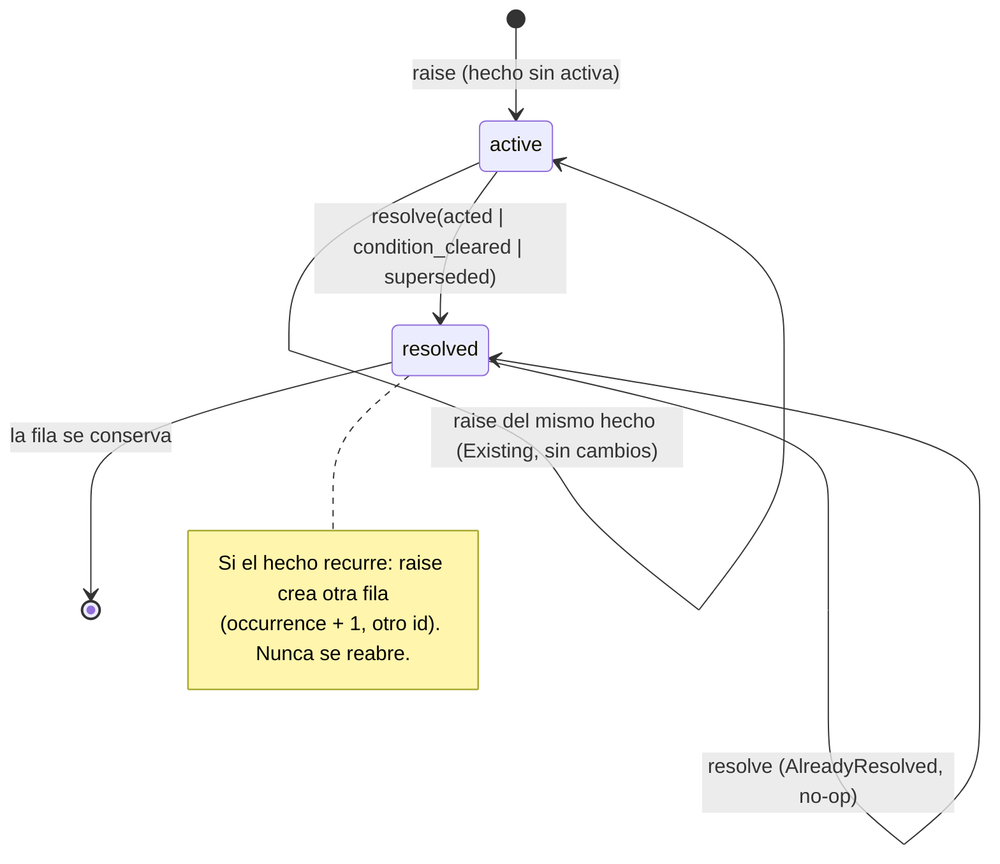

# Attention del Core: modelo autoritativo y ciclo de vida (LXO-87)

Estado: **modelo y ciclo de vida implementados** (migración `006_attention`). Las reglas que derivan Attention
de Events/State son **LXO-88**; la API de lectura/consulta y la resolución soportada por cliente son
**LXO-89**. Aquí no hay interfaz, notificaciones push, ranking personalizado, asignación de equipo ni *unread*.

## Decisión (ADR)

Attention es una entidad **del Core**, persistida en SQLite (`attention_items`), con identidad estable,
categoría y severidad **fijadas por el Core**, un destino lógico y un ciclo de vida explícito. Desktop, CLI y
Mobile consumirán **la misma lista autoritativa**; ninguno deriva categoría ni severidad.

Se separan tres conceptos que antes se confundían:

| Concepto | Responde a | Dónde vive | Es |
|---|---|---|---|
| **Event** | qué ocurrió | `events` (append-only, `EVENTOS.md`) | historia |
| **Attention** | qué necesita de mí **ahora** | `attention_items` | estado de trabajo pendiente |
| **Unread / Activity** | qué no he visto | cliente / vista Activity (futuro) | lectura por persona y dispositivo |

Alternativas descartadas:

* **Calcularla siempre al leer** (como hoy en `src/orch/attention.js`): cada cliente vería una lista distinta y
  no habría identidad, `resolved_at` ni historia. Las reglas de LXO-88 sí son deterministas y reproducibles,
  pero el *resultado* se persiste.
* **Event sourcing puro** (Attention = fold de eventos): obligaría a que cada cambio de la lista sea un evento y
  a reconstruir la lista leyendo todo el log. Se mantiene el Event Log como historia de hechos y Attention como
  estado; la relación es una referencia blanda (`source_event_id`).
* **`snoozed` en el dominio**: ver «Por qué no hay `snoozed`».

## Invariantes y cómo se prueban

Pruebas en `apps/desktop/src-tauri/src/store/attention_tests.rs`.

| # | Invariante (LXO-87) | Mecanismo | Prueba |
|---|---|---|---|
| 1 | Attention no es una copia del Event Log | solo `source_event_id`/`correlation_id` (referencias); `facts` acotado a 2 KiB; levantar no escribe en `events` | `un_evento_informativo_no_crea_attention_y_attention_no_crea_eventos` |
| 2 | Un Event informativo no crea Attention por defecto | el almacén nunca deriva Attention; solo una regla explícita (LXO-88) llama a `attention_raise` | idem |
| 3 | Resolver no borra Events ni historia | `active → resolved` sobre la fila; triggers prohíben DELETE y reabrir | `resolver_no_borra_ni_toca_los_eventos…`, `una_fila_resuelta_no_vuelve_a_activa…` |
| 4 | Un mismo hecho no crea duplicados activos equivalentes | `fingerprint` + índice único parcial `WHERE status = 'active'` | `un_mismo_hecho_no_crea_dos_activos`, `la_base_impone_un_solo_activo…` |
| 5 | El destino sigue resoluble si cambia una ruta local | destino lógico `(target_kind, target_id)`; rutas rechazadas en Rust y en la base | `el_destino_sigue_resolviendo_aunque_cambie_la_ruta_local_del_proyecto`, `el_destino_rechaza_rutas…` |
| 6 | Categoría/severidad no se derivan en frontend | conjuntos cerrados en Rust **y** CHECK; inmutables en la fila | `las_categorias_iniciales…`, `la_base_impone_los_conjuntos_cerrados` |
| — | Attention ≠ unread | el esquema no tiene columnas de lectura, cliente, usuario ni snooze | `attention_no_es_unread…`, `attention_sigue_activa_sea_cual_sea_el_estado_de_lectura…` |
| — | Sin strings de interfaz en el dominio | solo códigos `snake_case` ASCII; no hay título/mensaje/ayuda | `el_dominio_solo_usa_codigos_estables_sin_textos_de_interfaz` |

## Categorías (conjunto cerrado inicial)

Ampliar una categoría exige un ADR y una migración nueva que reemplace el CHECK; no se añade desde un cliente.

| Código | Significa | Origen típico (orientativo, lo fija LXO-88) |
|---|---|---|
| `question` | un agente espera una respuesta | pregunta sin responder |
| `approval` | algo espera una aprobación humana | lanzamiento pendiente; aprobación en terminal |
| `review_ready` | un resultado está listo para revisar o integrar | tarea hecha con rama sin integrar |
| `conflict` | un conflicto impide avanzar | integración con conflicto |
| `failed` | un intento terminó con error | tarea `failed` |
| `environment_blocked` | el entorno impide trabajar | herramienta/credencial/ruta no disponible |
| `risk` | una política o heurística avisa de un riesgo | aviso de política |

Correspondencia con el frontend actual (informativa, **no normativa**; LXO-88 la fija y el frontend deja de
calcular): `approve_in_terminal`, `pending_spawn` → `approval`; `integrate`, `review` → `review_ready`;
`failed` → `failed`; `unanswered_question` → `question`.

## Severidad

Un único campo normalizado, fijado por el Core. Orden total (rank 0 = más urgente). El orden de presentación lo
decidirá la API de lectura (LXO-89); aquí solo se define la escala.

| Código | rank |
|---|---|
| `critical` | 0 |
| `high` | 1 |
| `medium` | 2 |
| `low` | 3 |

La severidad **no cambia** en una fila: si el mismo hecho se levanta de nuevo con otra severidad mientras hay una
ocurrencia activa, se devuelve la activa sin modificarla (escalado de severidad queda fuera de LXO-87).

## Estados y ciclo de vida

```text
                    attention_raise(hecho nuevo)
                    (sin ocurrencia activa del mismo fingerprint)
          ┌────────────────────────────────────────────────┐
          │                                                ▼
     (no existe) ──────────────────────────────────►   ┌────────┐
          ▲                                            │ active │◄─┐ attention_raise(mismo hecho)
          │                                            └───┬────┘  │ = Existing: devuelve la activa,
          │                                                │       │   no escribe nada
          │                                                │ attention_resolve(id, motivo, at)
          │                                                ▼
          │                                           ┌──────────┐
          │   el hecho vuelve a ocurrir               │ resolved │  terminal e inmutable
          └─── attention_raise ⇒ NUEVA ocurrencia ◄───┤          │  (la fila queda como historia)
               (occurrence + 1, otro id)              └────┬─────┘
                                                           │ attention_resolve(id…) = AlreadyResolved
                                                           └──► no-op (no reescribe resolved_at ni motivo)
```



| Estado | `resolved_at` | `resolution` | `updated_at` |
|---|---|---|---|
| `active` | `NULL` | `NULL` | = `created_at` |
| `resolved` | ms epoch, ≥ `created_at` | `acted` · `condition_cleared` · `superseded` | = `resolved_at` |

Motivos de resolución: `acted` (una persona, o su agente delegado, actuó), `condition_cleared` (la condición dejó
de cumplirse sin acción directa), `superseded` (la sustituye otra Attention o un hecho posterior).

Las marcas de tiempo (`at`) las **fija quien llama**; el almacén no llama a `now()`. Resolver con `at <
created_at` se rechaza (`InvalidAttention`).

### Por qué no hay `snoozed`

Posponer es una decisión **por persona y dispositivo** («no me avises hasta las 16:00») y depende de la hora del
cliente. Meterlo en el estado autoritativo mezclaría política de cliente con el hecho compartido: dos
dispositivos tendrían estados distintos de una misma fila. Si más adelante hace falta, será una tabla de
preferencias por cliente que **filtre** la lista autoritativa sin cambiar `status`.

## Identidad

Cada **ocurrencia** tiene un `id` opaco y estable; todas las ocurrencias de un mismo **hecho** comparten
`fingerprint`.

```text
fingerprint = SHA-256( "lixbon.attention.v1" \0 category \0 target_kind \0 target_id \0 subject' )
              subject' = "n"            si no hay subject
                         "s" + subject  si lo hay
occurrence  = 1 + max(occurrence) de ese fingerprint
id          = "att_" + hex( SHA-256( "lixbon.attention.id.v1" \0 fingerprint \0 occurrence ) )[0..32]
```

* El `fingerprint` **no** incluye hora, severidad, `facts`, `project_id`, `run_id` ni el evento origen: el mismo
  hecho observado por dos caminos es el mismo hecho.
* `subject` distingue hechos distintos de la misma categoría y destino (dos preguntas de una misma tarea:
  `subject = <id del mensaje>`).
* Los campos van separados por `\0` y los ids no pueden contener caracteres de control: ninguna combinación es
  ambigua.
* **Vectores fijados** (`los_vectores_de_identidad_del_contrato_no_cambian`): para `failed` sobre
  `task/0192f0a0-7b1c-7000-8000-0000000000a1`, `fingerprint =
  30e6fc17321af6c249914dde7f108e5b45340fefed9879f92b632c83751b3fbb`, ocurrencia 1 →
  `att_954184304320b2663da4bdfc5d2942bd`, ocurrencia 2 → `att_51efafc44ec6225c4ff1a24e76ccbc28`. Cambiarlos
  cambia la identidad de toda Attention persistida: es un cambio de contrato.

## Destino lógico

`target = (target_kind, target_id)` es una **identidad del Core**, nunca una ruta.

* `target_kind` (validado en Rust, sin CHECK, igual que `events.entity_kind`): `project`, `task`, `run` (run
  legacy), `spawn_request`, `attempt`, `thread`, `worktree`, `artifact`, `review`, `integration`, `agent`,
  `decision`, `policy`. No existe `attention`: una Attention no apunta a otra.
* `target_id`: 1–200 caracteres, sin caracteres de control, y **no** puede parecer una ruta: se rechazan `/…`,
  `~…`, `\…`, `X:…`, cualquier `\` y `..`. Lo imponen `AttentionTarget::new`/`NewAttention::check` **y** un CHECK
  de la tabla.
* `project_id` y `run_id` son referencias blandas de contexto (para filtrar sin resolver el destino); no forman
  parte de la identidad.
* Cambiar la ruta local de un proyecto no toca ninguna fila: el destino resuelve por su id lógico y la ruta
  nueva lleva al mismo proyecto (`el_destino_sigue_resolviendo_aunque_cambie_la_ruta_local_del_proyecto`).

## Persistencia y reconstrucción (decisión determinista)

* **La tabla `attention_items` es la autoridad** (estado persistido, no vista recalculada al leer). Es la única
  fuente de la lista; no existe `attention.json` ni un segundo almacén.
* **Reconstruible**: identidad y `fingerprint` son funciones puras del hecho; el `id` lo es de `(fingerprint,
  occurrence)`. Un mismo historial de levantar/resolver produce **los mismos ids y filas** en una instalación
  reconstruida (`el_id_se_deriva_del_hecho_y_la_ocurrencia_y_la_reconstruccion_lo_repite`). Las reglas de LXO-88
  podrán volver a derivar el estado vigente desde Events/State y obtendrán los mismos `fingerprint`; no hay
  relleno histórico en la migración (Attention empieza vacía).
* **Atomicidad**: `attention_raise_in` / `attention_resolve_in` corren **dentro de la transacción de quien
  llama**, como el registro de proyectos con su evento. Así el evento origen y la Attention se confirman o se
  deshacen juntos (`el_evento_origen_y_la_attention_se_confirman_o_se_deshacen_juntos`). Los métodos de `Store`
  (`attention_raise`, `attention_resolve`, `attention_get`) son la vía de una operación.
* **Un solo escritor** (el Core), `BEGIN IMMEDIATE`, tiempos fijados por quien llama: reintentar una escritura
  idempotente no cambia el resultado (`raise` → `Existing`, `resolve` → `AlreadyResolved`).

### Relación con el Event Log

* `source_event_id` guarda el `events.id` (UUID v7, identidad global), **no** el `seq` local. Es una referencia
  **blanda** (sin `REFERENCES`): el origen puede ser de otra instalación y archivar un proyecto no bloquea la
  historia. `correlation_id` repite el del evento cuando existe.
* Resolver **no** toca `events`. Los eventos de ciclo de vida reservados en el vocabulario
  (`attention.created`, `attention.resolved`, `entity_kind = attention`) los emite la capa `orch` en la **misma
  transacción** usando las variantes `*_in`; esa instrumentación pertenece a LXO-88 (decide qué hechos produce
  qué evento) y no se implementa aquí para no fijar reglas ni duplicar el log.

## Esquema (`006_attention.sql`)

| Columna | Para qué |
|---|---|
| `id` | identidad de la ocurrencia (PK) |
| `fingerprint`, `occurrence` | identidad del hecho y su número de ocurrencia (`UNIQUE (fingerprint, occurrence)`) |
| `category`, `severity`, `status` | conjuntos cerrados (CHECK) |
| `target_kind`, `target_id` | destino lógico |
| `project_id`, `run_id` | contexto, referencias blandas |
| `subject` | discriminante opcional del hecho |
| `source_event_id`, `correlation_id` | origen, referencias blandas |
| `facts` | objeto JSON ≤ 2048 bytes con **códigos e ids**; nunca texto de interfaz, cuerpos, diffs, argv, env ni secretos |
| `created_at`, `updated_at`, `resolved_at` | ms epoch, fijados por quien llama |
| `resolution` | motivo; solo en `resolved` |

* Índice único parcial `attention_one_active (fingerprint) WHERE status = 'active'`: **una activa por hecho**,
  impuesto por la base aunque el código falle.
* Índice `attention_by_target (target_kind, target_id, status)`.
* Triggers: `attention_no_delete` (la historia no se borra) y `attention_only_resolve` (solo se admite la
  transición `active → resolved`; identidad, categoría, severidad, destino, origen y `facts` son inmutables y
  `resolved` es terminal).
* No hay columnas de título, mensaje, ayuda, lectura, cliente, usuario, asignado ni contadores: el dominio guarda
  **códigos** y cada superficie los traduce a texto.

## Ejemplos

### Fila (`attention_items`) — fallo de una tarea, recién levantado

| columna | valor |
|---|---|
| `id` | `att_954184304320b2663da4bdfc5d2942bd` |
| `fingerprint` | `30e6fc17321af6c249914dde7f108e5b45340fefed9879f92b632c83751b3fbb` |
| `occurrence` | `1` |
| `category` / `severity` / `status` | `failed` / `high` / `active` |
| `target_kind` / `target_id` | `task` / `0192f0a0-7b1c-7000-8000-0000000000a1` |
| `project_id` / `run_id` | `0192f0a0-7b1c-7000-8000-0000000000b2` / `r1` |
| `subject` | `NULL` |
| `source_event_id` | `0192f0a1-0000-7000-8000-0000000000c3` |
| `correlation_id` | `NULL` |
| `facts` | `{"failure_reason":"agent_idle_timeout"}` |
| `created_at` / `updated_at` | `1760000000000` / `1760000000000` |
| `resolved_at` / `resolution` | `NULL` / `NULL` |

### La misma fila tras resolverse

`status = resolved`, `resolved_at = 1760000060000`, `updated_at = 1760000060000`, `resolution = acted`. El resto
no cambia y el evento origen sigue intacto en `events`.

### Recurrencia: segunda ocurrencia del mismo hecho

Mismo `fingerprint`, `occurrence = 2`, `id = att_51efafc44ec6225c4ff1a24e76ccbc28`, `status = active`. La
ocurrencia 1 se conserva `resolved`.

### Payload (`AttentionRow`, serialización del Core)

Los códigos viajan tal cual; no hay texto para mostrar. Cada superficie lo traduce.

```json
{
  "id": "att_954184304320b2663da4bdfc5d2942bd",
  "fingerprint": "30e6fc17321af6c249914dde7f108e5b45340fefed9879f92b632c83751b3fbb",
  "occurrence": 1,
  "category": "failed",
  "severity": "high",
  "status": "active",
  "target": { "kind": "task", "id": "0192f0a0-7b1c-7000-8000-0000000000a1" },
  "project_id": "0192f0a0-7b1c-7000-8000-0000000000b2",
  "run_id": "r1",
  "subject": null,
  "source_event_id": "0192f0a1-0000-7000-8000-0000000000c3",
  "correlation_id": null,
  "facts": "{\"failure_reason\":\"agent_idle_timeout\"}",
  "created_at": 1760000000000,
  "updated_at": 1760000000000,
  "resolved_at": null,
  "resolution": null
}
```

(`facts` viaja como texto JSON, igual que `events.payload`. La forma de la API HTTP/RPC la define LXO-89.)

### Entrada (`NewAttention`) que produce esa fila

```json
{
  "category": "failed",
  "severity": "high",
  "target": { "kind": "task", "id": "0192f0a0-7b1c-7000-8000-0000000000a1" },
  "project_id": "0192f0a0-7b1c-7000-8000-0000000000b2",
  "run_id": "r1",
  "subject": null,
  "source_event_id": "0192f0a1-0000-7000-8000-0000000000c3",
  "correlation_id": null,
  "facts": "{\"failure_reason\":\"agent_idle_timeout\"}",
  "at": 1760000000000
}
```

## Migración

`006_attention.sql`. El número se eligió **tras comprobar el registro real** (`src/store/migrations/`:
001–005 existen; ver `MIGRACIONES.md`). Se aplica tras la valla, igual que 003–005, con
`Store::migrate_authoritative`. Una base con la 006 no la abre un binario que no la conoce
(`DatabaseNewer`/`UnknownMigration`), y el checksum queda fijado en una prueba.

## Fuera de alcance de LXO-87

* **LXO-88**: qué Events/State levantan o resuelven cada categoría, severidades por regla, eventos
  `attention.created|resolved`, retirada del cálculo en `attention.js`.
* **LXO-89**: API de lectura/consulta, orden de presentación, filtros, resolución soportada por cliente y
  autorización (`ClientAction`).
* UI, push, ranking personalizado, asignación de equipo (F9), *unread* y `snoozed`.
