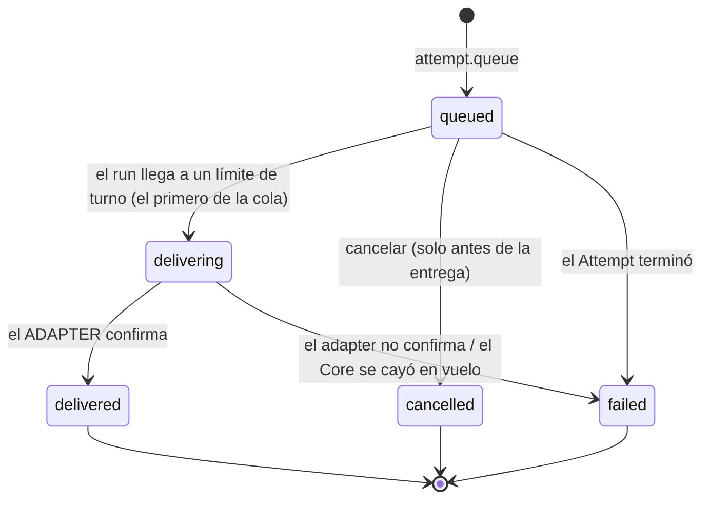

# Queue con semántica explícita y Pending Queue (LXO-143)

Estado: **implementado, inerte hasta el corte**. Épica `[CORE][F5]`. Contratos relacionados:
[Attempt](ATTEMPTS.md) · [adapters](ADAPTERS.md) · [Events](EVENTOS.md) · [Activity](ACTIVITY.md) · [Attention](ATTENTION.md).

**Queue** es la semántica normalizada para una instrucción enviada **mientras un Attempt está ocupado**: el Core la guarda
en una cola durable por Attempt y la entrega como el **siguiente turno** cuando el run llega a un límite de turno. No
depende de cómo cada proveedor interprete un mensaje concurrente (Claude lo encola por su cuenta; Codex tiene
`turn/steer`): el Core nunca manda una instrucción en mitad de un turno.

Código: `orch/queue_commands.rs` (comando, entrega, recuperación, query), `orch/queue_rules.rs` (Attention),
`store/queue.rs` (filas y transacciones), migración
[`018_attempt_queue.sql`](../../apps/desktop/src-tauri/src/store/migrations/018_attempt_queue.sql). Pruebas:
`orch/queue_commands_tests.rs`, `store/queue_tests.rs`.

## Qué NO es

* **No es Steer.** No se llama a `steer` ni se inyecta en el turno en curso. Si el proveedor no puede entregar en un límite
  de turno, **encolar es un error** (`unsupported`) y no se escribe nada: no se degrada a otra semántica.
* No reordena (sin prioridades), no cruza Attempts y no es automatización (F9).
* No es un `answer`: un Attempt `waiting` espera la respuesta a una pregunta y lo que se le diga es una respuesta.

## El item

Una fila de `attempt_queue` por instrucción:

| Campo | |
|---|---|
| `queue_id` | `<attempt_id>-q<seq>`, determinista (como `<task>-a<n>`) |
| `seq` | posición FIFO dentro del Attempt: 1, 2, 3… consecutivo y sin huecos (lo impone la base) |
| `request_id` | clave de idempotencia (1–64 caracteres entre letras, dígitos, `_`, `.`, `-`), única **por Attempt** |
| `request_digest` | SHA-256 de cuerpo y adjuntos: distingue repetir una petición de reutilizar su clave |
| `author_kind`, `author_id`, `client_id` | quién la envió: `person` (+ cuenta) · `agent` (+ su Task); y la instalación, si llegó autenticada |
| `body` | la instrucción, hasta 20 000 caracteres (admite saltos de línea y tabuladores). **No viaja en ningún Event** |
| `attachments` | hasta 8 ids de Artifacts **de la misma Task**; nunca rutas ni contenido |
| `status` | `queued` · `delivering` · `delivered` · `cancelled` · `failed` |
| `failure_reason` | solo `failed`: `unsupported` · `environment_blocked` · `adapter_unavailable` · `adapter_error` · `attempt_ended` · `interrupted` |
| `confirmed_by` | solo `delivered`: `adapter_event` · `adapter_result` (lo que el **adapter** informó) |
| `created_at`, `updated_at`, `delivered_at`, `ended_at` | ms epoch, fijados por quien llama |

Como mucho 50 items pendientes (`queued` + `delivering`) por Attempt: la cola no crece sin límite (`queue_full`).

## Ciclo de vida



Tabla cerrada (5 pares); cualquier otro par se rechaza **sin escribir nada**, también por SQL directo (trigger
`attempt_queue_lifecycle`, comparado con la tabla de Rust en las 25 combinaciones). Un final no tiene salida: un item
cancelado **no se entrega jamás**.

El paso `queued -> delivering` (`Store::queue_claim_next`) es un paso intermedio **sin hecho propio**; el hecho es su
resultado (`delivered` o `failed`). La base impone que solo el primero de la cola pase a `delivering` (FIFO) y que como mucho
haya uno en vuelo por Attempt.

## El comando `attempt.queue`

```
queue_attempt(store, port, ctx, cancel, request) -> Queued | QueueError
```

1. **Autorizar** (persona o el agente que coordina la Task; el Core no encola) y validar `request_id`, antes de escribir.
2. **¿Ya se atendió `request_id`?** Devuelve el item que existe (`replayed = true`), sin escribir ni entregar. Con el mismo
   `request_id` y otro cuerpo o adjuntos: `request_conflict`, sin escribir.
3. **Attempt terminado** → `attempt_final`. **Sin capability** (`QueuePort::capability`) → `queue_unsupported` /
   `environment_blocked`; no se escribe nada y no se cae a Steer.
4. **Una transacción**: item `queued` + `attempt.queued`.
5. **Entrega inmediata si el run ya está en un límite de turno** (idle): `deliver_next`. Si no (busy), el item espera.

`Queued { item, position, replayed, delivery }`: `position` = pendientes delante contándolo (1 = el siguiente);
`delivery` cuenta qué pasó al intentar entregar justo después (`Nothing` · `Delivered` · `Failed`).

### Cancelar: `cancel_queued(store, ctx, queue_id)`

`queued -> cancelled` + `attempt.queue_cancelled`. Persona o el que coordina la Task. Repetirlo sobre uno cancelado no escribe
nada (`AlreadyCancelled`). Uno que se está entregando, se entregó o falló: `not_cancellable`.

### Query: `pending(store, ctx, attempt_id)`

La **Pending Queue**: lo que sigue sin entregarse (`queued` y `delivering`), en el orden en que se entregará, con su posición,
su cuerpo, quién lo envió y su estado. Persona, el que coordina la Task o el Core. La historia de los finales está en los
Events y en `Store::queue_of_attempt`.

## Decisiones

| # | Decisión | Por qué |
|---|---|---|
| D1 | **Queue nunca es Steer** | Steer inyecta en el turno en curso; Queue es el turno siguiente. Sin capability, error; nunca otra semántica |
| D2 | **Límite soportado = fin de turno de un run `running`** | `waiting` / `awaiting_terminal_approval` esperan una persona (es un `answer`); `pending_approval` / `starting` no tienen turno que terminar. Quien dice que el turno acabó es el `QueuePort` |
| D3 | **FIFO por Attempt, sin prioridades; un fallo no bloquea** | Un item fallado es final y la persona ya fue avisada (Attention); los demás siguen su orden. Una entrega por límite: el item entregado abre un turno nuevo |
| D4 | **Entrega a lo sumo una vez** | El único caso ambiguo es `delivering` (el Core cayó entre pedir la entrega y anotar el resultado). Nunca se reintenta: pasa a `failed(interrupted)` y la persona decide si lo reenvía. Una instrucción duplicada es peor que una que hay que reenviar |
| D5 | **La confirmación es del adapter** | `QueueConfirmation` solo tiene `adapter_event` (un evento: el turno empezó, el proveedor reconoció el mensaje) y `adapter_result` (el resultado de la llamada). **No existe un valor «se escribió en stdin»**; la base lo rechaza |
| D6 | **Un fallo de entrega no falla el Attempt** | Solo el item (`attempt.queue_failed`) y su Attention |
| D7 | **Recuperación al arrancar** (abajo) | La cola es durable; lo ambiguo no se reintenta |

### Policy de recuperación (D7)

`recover(store)` se ejecuta al arrancar, **después** de reconciliar los Attempts huérfanos (los que el proceso dejó
`running` y ahora son `exited`):

| item | Attempt | qué pasa |
|---|---|---|
| `delivering` | cualquiera | `failed(interrupted)` + Attention: no se sabe si llegó; **no se reintenta** |
| `queued` | terminado | `failed(attempt_ended)`, sin Attention |
| `queued` | vivo | **se conserva**: se entrega en su próximo límite de turno |

Idempotente: una segunda pasada no encuentra nada que cerrar. `settle_attempt_end(attempt)` aplica lo mismo a un solo
Attempt (lo llama el runtime tras cerrarlo, y `deliver_next` si lo encuentra cerrado).

## El puerto hacia el adapter

El Core no habla con el proveedor directamente: usa el trait `QueuePort`, que el runtime implementará sobre el adapter (a
través de `Gated`).

| Método | Qué responde |
|---|---|
| `capability(attempt)` | ¿puede este proveedor entregar una instrucción en un límite de turno? `Err` si no. Se pregunta al **encolar** |
| `boundary(attempt)` | `Busy` o `TurnEnd` (el único límite soportado) |
| `deliver(attempt, request, cancel)` | entrega como el siguiente turno y devuelve la `QueueConfirmation` **del adapter**; `Err` si no se confirmó |

Cada código de error del adapter tiene su motivo cerrado en la cola (`failure_of`, sin rama comodín): `unsupported_capability`
→ `unsupported`; `environment_blocked` → `environment_blocked`; capability no disponible, run o proveedor desconocidos,
sesión no encontrada → `adapter_unavailable`; el resto → `adapter_error`.

**Estado de la integración.** El contrato de adapters (`ProviderAdapter`) todavía **no tiene** una operación «entregar en un
límite de turno»: es lo que el runtime de F5 tiene que añadir (probablemente como una capability nueva de la matriz) al
implementar `QueuePort`. Hasta entonces el puerto solo lo implementan las pruebas, y nada de esto está conectado al RPC.

## Events, Activity y Attention

| kind | class | Payload | Quién |
|---|---|---|---|
| `attempt.queued` | state | `task`, `n`, `queue_id`, `position`, `attachments` | persona · agente que coordina |
| `attempt.queue_delivered` | state | `task`, `n`, `queue_id`, `confirmed_by` | Core |
| `attempt.queue_cancelled` | state | `task`, `n`, `queue_id` | persona · agente que coordina |
| `attempt.queue_failed` | state | `task`, `n`, `queue_id`, `reason` | Core |

Entidad `attempt`. **Nunca** el texto de la instrucción ni los ids de los adjuntos. Activity: `activity.attempt.queued`,
`.queue_delivered`, `.queue_cancelled` y `.queue_failed` en Desktop, Mobile y `lxo`
([ACTIVITY.md](ACTIVITY.md)).

**Attention** (`orch/queue_rules.rs`): `attempt.queue_failed` con `reason` ≠ `attempt_ended` levanta `failed` · high sobre el
**Attempt** con subject `queue` (una por Attempt; si fallan varios, la activa se actualiza con el último motivo). Se cierra
sola (`condition_cleared`) cuando el Attempt termina. `attempt_ended` no levanta nada: el Attempt ya terminó y la Attention
nacería *después* del evento final que la habría cerrado, quedando abierta para siempre.

## Errores

`QueueError { kind, code, message, queue_id? }`. `kind` es un conjunto cerrado: `unsupported` · `environment_blocked` ·
`invalid` · `failed`. Códigos: `not_allowed` · `invalid_request` · `request_conflict` · `attempt_missing` · `attempt_final` ·
`queue_missing` · `queue_full` · `not_cancellable` · `attachment_unknown` · `queue_unsupported` · `environment_blocked` ·
`adapter_error` · `conflict` · `model_inactive` · `store`.

## Invariantes y cómo se prueban

| # | Invariante | Mecanismo | Prueba |
|---|---|---|---|
| 1 | Queue nunca se convierte silenciosamente en Steer | sin capability, error y nada escrito; la cola no usa `steer` ni escribe en el proceso | `si_el_proveedor_no_puede_entregar_encolar_es_un_error_y_no_se_escribe_nada_ni_se_cae_a_steer`, `queue_no_llama_a_steer_y_solo_queue_commands_construye_sus_hechos` |
| 2 | Retry de request no duplica el item | `UNIQUE (attempt_id, request_id)` + replay antes de escribir + `request_digest` | `repetir_la_peticion_devuelve_el_mismo_item_sin_duplicar_ni_entregar_dos_veces`, `reutilizar_la_clave_para_otra_instruccion_es_un_conflicto_y_no_cambia_nada`, `repetir_el_request_id_devuelve_el_item_que_existe_y_no_escribe_nada` |
| 3 | Un item cancelado nunca se entrega | tabla cerrada de Rust y trigger `attempt_queue_lifecycle` | `un_item_cancelado_antes_de_su_entrega_no_se_entrega_nunca`, `un_item_cancelado_no_se_entrega_ni_por_sql`, `la_tabla_de_transiciones_cuadra_con_el_trigger_en_las_25_combinaciones` |
| 4 | La entrega se confirma con un hecho del adapter | `QueueConfirmation` sin valor «stdin»; `delivered` exige `confirmed_by` (CHECK) | `la_confirmacion_queda_registrada_y_solo_la_da_el_adapter`, `si_el_adapter_no_confirma_el_item_falla_con_su_motivo_su_evento_y_su_attention`, `la_identidad_el_contenido_y_la_historia_no_se_tocan` |
| 5 | La persona puede inspeccionar qué sigue pendiente | `pending` + `Store::queue_pending_of_attempt` | `la_query_de_la_cola_pendiente_muestra_lo_que_sigue_y_en_que_orden` |
| 6 | FIFO | `seq` consecutivo + trigger `attempt_queue_fifo` + un solo `delivering` por Attempt | `n_items_se_entregan_en_fifo_uno_por_limite_de_turno`, `un_item_nuevo_no_se_adelanta_a_los_que_ya_esperaban`, `la_base_impone_fifo_una_entrega_en_vuelo_y_un_orden_sin_huecos` |
| 7 | Reinicio / recuperación | policy D7 | `la_recuperacion_conserva_lo_encolado_de_un_attempt_vivo_y_no_reintenta_lo_que_iba_en_vuelo`, `la_cola_sobrevive_a_reabrir_el_almacen_con_su_orden_y_su_estado` |
| 8 | Estado + Event, juntos | una transacción por mutador | `si_el_evento_falla_o_no_es_del_attempt_no_queda_ni_el_item` |
| 9 | La instrucción no viaja en Events ni Activity | payloads tipados sin cuerpo | `los_eventos_llevan_el_hecho_y_nunca_la_instruccion`, `cada_evento_de_la_cola_tiene_su_activity_sin_la_instruccion` |
