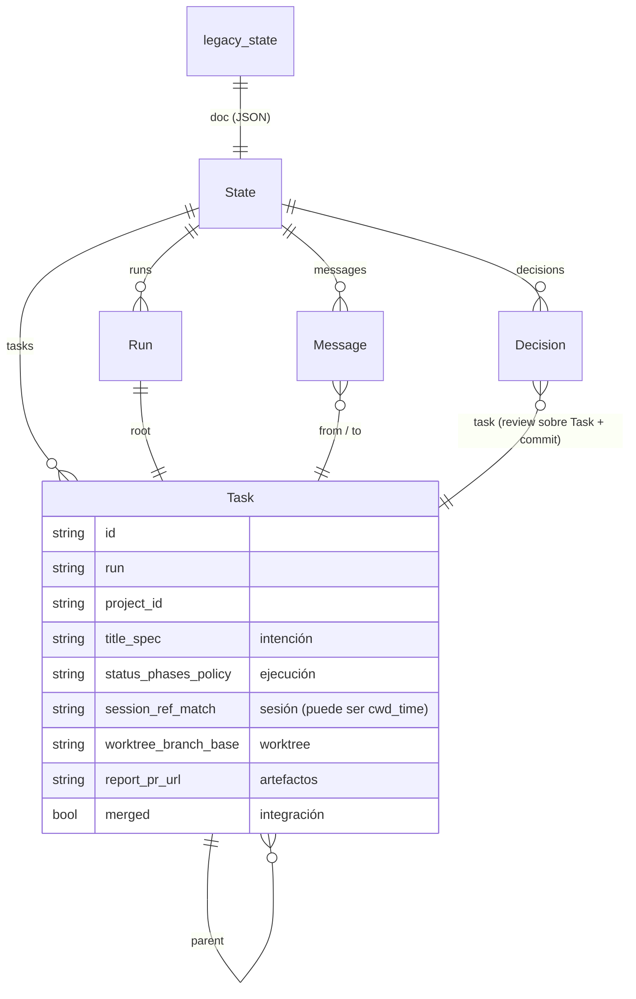
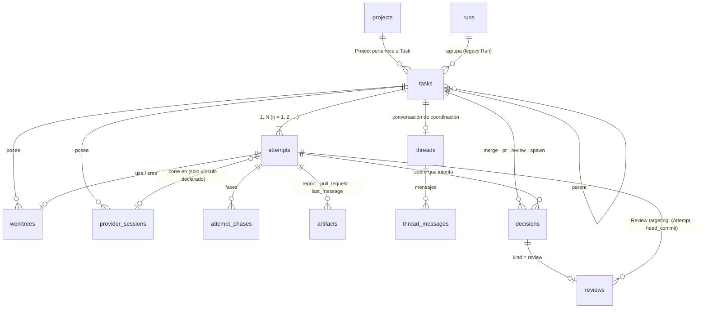

# ADR · Corte Task/Attempt y rollback por copia (LXO-112)

| | |
|---|---|
| **Estado** | Aceptada. Todas las decisiones (§13) se cerraron el 2026-10-21 con la opción recomendada |
| **Épica** | `[CORE][F3]` Corte Task / Attempt y modelo agentic |
| **Fecha** | 2026-10-21 |
| **Entrega** | Solo documentación y fixtures de diseño. **Ningún cambio productivo de esquema ni de runtime** |
| **Prueba** | [`fixtures/corte-task-attempt/`](fixtures/corte-task-attempt/): `python -I docs/core/fixtures/corte-task-attempt/verificar.py` |

## 1. Contexto

El estado del orquestador es **un documento JSON** en la fila única `legacy_state` (`001_core.sql`; SQLite manda
desde C2b, ver [`AUTORIDAD.md`](AUTORIDAD.md)). Ese documento es `orch::state::State`:

```text
State { runs{rN}, tasks{tN}, messages[], seq, decisions[], env_blocks{} }
```

y su `Task` mezcla seis cosas distintas en 48 campos:

* **intención** (título, encargo, árbol, proyecto),
* **ejecución** (estado, fases, política, entrega, modelo, fallo),
* **sesión del proveedor** (`session_ref`, `session_match`),
* **worktree y rama** (`worktree`, `branch`, `base`, `base_commit`, `env`),
* **artefactos** (`report`, `pr_url`, `last_message_path`),
* **integración** (`merged`).

Consecuencias que el corte corrige:

1. `reopen` (`lxo continue`) **pisa** el intento anterior: limpia informe, canal, sesión y fusión de la misma Task.
   No queda historia del intento previo.
2. Codex ata la sesión **por carpeta y hora** (`session_match = cwd_time`) cuando no hay `session_id`: es una
   inferencia, no un hecho.
3. Una revisión (`Decision.kind = review`) apunta a la **Task** y a un commit, no a la ejecución que lo produjo.
4. No se pueden representar dos ejecuciones de la misma intención (retry, race, comparar) sin ambigüedad.

## 2. Decisión

1. Se normaliza `legacy_state` en tablas: **Task, Attempt, ProviderSession, Thread, Worktree, Artifact**, más
   `runs`, `decisions`, `reviews`, `env_blocks` y `legacy_residue`.
2. El corte de **datos** es **una sola migración** (`NNN_task_attempt_cut`), en **una transacción**, que copia el
   documento con SQL determinista (JSON1), verifica conteos y **congela** `legacy_state`. El esquema de cada entidad
   llega antes, en su propia migración (`007_tasks` en LXO-113, `008_attempts` en LXO-114, el resto después), **inerte** hasta el corte
   (D15, revisada en LXO-113).
3. Antes del corte se hace una **copia previa obligatoria** y verificada. Si no se puede hacer, no hay corte.
4. **Rollback = restaurar esa copia** con un binario F2. Nunca una migración hacia atrás ni un deshacer parcial.
5. Los clientes F2 siguen funcionando sin cambios: el Core sirve una **vista legacy** (`legacy_task_v1`)
   proyectada desde las tablas, idéntica al documento salvo las diferencias declaradas (§13, D3).
6. Los IDs que ya circulan (Task, Run, mensaje, decisión) **se conservan**. Los nuevos son deterministas.

## 3. Invariantes y cómo se imponen

| # | Invariante | Mecanismo | Prueba conceptual |
|---|---|---|---|
| 1 | Task = intención durable; Attempt = ejecución concreta | `tasks` solo guarda la intención (`open`/`discarded`, decisión de la persona), sin estado ni campos de ejecución; el resto del estado de la Task se **deriva** de sus Attempts ([TASKS.md](TASKS.md)) | S2, S3 |
| 2 | Retry crea un Attempt nuevo | `attempts UNIQUE (task_id, n)`, `id = task_id-a<n>`; ninguna ruta actualiza un Attempt final para «reabrirlo» | S3 (`1 Attempt n=1 por Task`) |
| 3 | Project pertenece a Task | `tasks.project_id` (FK real a `projects`); Attempt no tiene `project_id`. `CHECK (project_id IS NOT NULL OR origin = 'legacy')` | S2 (t14) |
| 4 | No se infiere ProviderSession por cwd+tiempo | `provider_sessions.binding IN ('stream_json','session_id')`; `cwd_time` va a `legacy_residue` | S3 (t4) |
| 5 | Copia previa obligatoria antes del corte | el arranque no aplica la migración del corte sin copia `pre-f3-cut` verificada y su sidecar | S1 |
| 6 | No hay rollback parcial del esquema | no existe migración inversa; rollback = restaurar la copia; `legacy_state` congelado con triggers | S4, S5 |

## 4. Diagrama antes / después

**Antes (F2):** una fila, un documento.



**Después (F3):** entidades normalizadas; `legacy_state` queda congelado como pieza de auditoría.



## 5. Ownership

| Entidad | Dueño | Por qué |
|---|---|---|
| Task | Run (agrupación legacy) y Project | intención durable; sobrevive a todos sus intentos |
| Attempt | Task | una ejecución concreta; nunca se reabre |
| Worktree | **Task** (`task_id`), registrado por un Attempt (`attempt_id`; creado, adoptado o externo, LXO-116) | un seguimiento o un retry pueden reutilizarlo; liberar o conservar la rama es una decisión sobre la Task |
| ProviderSession | **Task**, abierta por un Attempt (`opened_by_attempt_id`) | un seguimiento en la misma terminal sigue en la misma sesión del proveedor (D7) |
| Artifact | Attempt | el informe, la PR y el último mensaje son de **ese** intento |
| Thread | Task | la conversación con el coordinador continúa entre intentos |
| Decision | Task **y** Attempt | la persona decide sobre un intento concreto de una intención |
| Review | Attempt + `head_commit` | ver §7 |

## 6. Mapping de todos los campos legacy

Regla general: un booleano ausente es `false` (`serde(default)`), una lista ausente es `[]`. Lo que no tiene
destino **no se descarta**: va a `legacy_residue` con un motivo.

### 6.1 `State`

| Campo | Destino | Regla |
|---|---|---|
| `runs` | `runs` | una fila por run (§6.2) |
| `tasks` | `tasks` + `attempts` (+ `worktrees`, `provider_sessions`, `artifacts`, `attempt_phases`) | §6.3 |
| `messages` | `threads` + `thread_messages` | §6.4 |
| `decisions` | `decisions` (+ `reviews`) | §6.5 |
| `seq` | `meta.id_seq` | el contador compartido de `tN`, `rN` e ids de mensaje continúa desde aquí |
| `env_blocks` | `env_blocks (scope, cause)` | admite los dos formatos (una causa o lista) |

### 6.2 `Run`

| Campo | Destino |
|---|---|
| `id` | `runs.id` (se conserva) |
| `objective` | `runs.objective` |
| `root` | `runs.root_task_id` |
| `created` | `runs.created_at` |
| `closed` | `runs.closed` |
| `last_activity` | `runs.last_activity` |

### 6.3 `Task`

| Campo legacy | Destino | Regla / nota |
|---|---|---|
| `id` | `tasks.id` | se conserva |
| `run` | `tasks.run_id` | |
| `parent` | `tasks.parent_task_id` | |
| `depth` | `tasks.depth` | |
| `title` | `tasks.title` | intención |
| `spec` | `tasks.spec` | se copia **entero**, incluidos los «Seguimiento» que añadió `reopen` (D5). Tras el corte, el encargo de un seguimiento va a `attempts.instruction` |
| `repo` | `tasks.repo` | ruta local al crear; candidata a retirada (§11) |
| `project_id` | `tasks.project_id` | solo si el registro lo conoce; si no, `NULL` + residuo `project_not_registered` (D1) |
| `created` / `updated` | `tasks.created_at` / `updated_at` y también `attempts.created_at` / `updated_at` del intento 1 | |
| `agent` | `attempts.provider` | |
| `model`, `effort`, `role`, `profile` | `attempts.*` | se eligen al lanzar: son del intento |
| `external` | `attempts.external` | un coordinador fuera de Lixbon es una propiedad de la ejecución |
| `cwd` | `attempts.cwd` | |
| `status` | `attempts.status` | mismo id (VOCABULARIO §3). La Task no guarda estado de ejecución |
| — | `tasks.intent` | `open`: el legado no tiene descarte |
| `phases[]` | `attempt_phases (attempt_id, ord, …)` | `ord` = posición en la lista |
| `summary`, `files` | `attempts.summary`, `attempts.files` | resultado del intento |
| `report` | `artifacts (kind = report)` | |
| `pr_url` | `artifacts (kind = pull_request)` | |
| `last_message_path` | `artifacts (kind = last_message)` | |
| `merged` | `attempts.integrated` | un seguimiento posterior ya no «desfusiona» el intento anterior: crea otro |
| `worktree`, `branch`, `base` | `worktrees` | fila si hay `worktree` (`state = active`) **o** si hay `branch` y `base` sin worktree (rama conservada: `state = removed`, `branch_kept = 1`, `path = NULL`; LXO-116) |
| `branch` sin `base` ni `worktree` | `attempts.checkout_branch` | la rama del propio checkout de una raíz (RESOURCES.md: no es una rama conservada) |
| `base_commit`, `env` | `worktrees.base_commit`, `worktrees.env_plan` | |
| `ack_unverified`, `requested_argv`, `policy`, `plan_mode`, `stream_json` | `attempts.*` | |
| `report_nonce`, `delivered`, `delivery_channel` | `attempts.*` | `delivered` ya lleva el número de intento en su `idem_key` (`delivery::idem_key(task, 1, sha)`): sigue siendo válido |
| `model_effective`, `model_requested`, `model_mismatch`, `model_mismatch_reason` | `attempts.*` | |
| `model_source` | `attempts.model_source` | **salvo** con `session_match = cwd_time`: pasa a `unknown` y el original va a residuo (D3) |
| `approval_deadline`, `failure_reason` | `attempts.*` | |
| `attempt_started` | `attempts.started_at` | |
| — | `attempts.ended_at` | `NULL`: el legado no registra el fin y no se inventa |
| `session_ref` + `session_match` | `provider_sessions` | **solo** Claude con `stream_json` (`binding = stream_json`) o Codex con `session_match = session_id` (`binding = session_id`). Cualquier otro `session_ref` → residuo `session_not_verified` |

### 6.4 `Message`

| Campo | Destino | Regla |
|---|---|---|
| `id` | `thread_messages.id` | se conserva (lo citan `reply_to` y los eventos `task.reply`) |
| `run` | `threads.run_id` | debe coincidir con el run de los dos participantes |
| `from`, `to` | `from_task_id`, `to_task_id` | |
| — | `thread_id` | el Thread de la Task de **mayor profundidad** (la hija); un mensaje a sí misma (nota de la persona a la raíz) va al Thread de esa Task |
| — | `from_attempt_id` | `NULL` en legacy: una nota con `from = padre` puede haberla escrito la persona o el coordinador (D6) |
| `kind`, `body`, `reply_to`, `read`, `at` | igual nombre | |
| participante inexistente, run distinto o misma profundidad entre tareas distintas | `legacy_residue` (`dangling_participant`) | no se adivina el Thread |

### 6.5 `Decision`

| Campo | Destino | Regla |
|---|---|---|
| `id` | `decisions.id` | se conserva (lo citan los eventos) |
| `task` | `decisions.task_id` | Task inexistente → residuo `dangling_task` |
| — | `decisions.attempt_id` | `<task>-a1`: en el legado cada Task tuvo exactamente un intento en el modelo |
| `kind`, `actor`, `detail_json`, `at` | igual nombre | |
| `kind = review` | además `reviews (decision_id, attempt_id, head_commit, verdict, at)` | sin `head_commit` o con veredicto desconocido → residuo `review_without_target` |

### 6.6 Lo que no está en `legacy_state`

| Dato | Qué pasa |
|---|---|
| `PendingSpawn` (lanzamientos pendientes) | vive en memoria y caduca; no hay nada que migrar (D12) |
| `events`, `attention_items`, `projects`, `clients` | no se tocan. El Event Log es append-only y **no se reescribe**: sus `entity_id` (`t3`, `r1`) siguen siendo válidos porque esos ids se conservan |
| `state.json` (espejo) | ver D4 |

## 7. Semántica tras el corte

* **Retry** (relanzar una Task que terminó): Attempt `n + 1`, proceso nuevo, ProviderSession nueva. Reutilizar el
  Worktree o crear otro es una opción del comando, no del modelo.
* **Seguimiento** (`lxo continue`, hoy `reopen`): también Attempt `n + 1` (D7). Reutiliza Worktree y
  ProviderSession porque sigue en la misma terminal. El intento anterior queda intacto, con su informe.
* **Estado de la Task**: derivado, no guardado: `open`, `in_progress`, `in_review`, `integrated`, `discarded`
  (VOCABULARIO §3). La vista legacy sigue enseñando como `status` el del **Attempt actual** (`max(n)`).
* **Review targeting**: una revisión apunta a `(attempt_id, head_commit)`. Integrar exige que la última revisión
  **del Attempt actual** sea `accepted` sobre su HEAD actual. Una revisión de otro intento no autoriza (D8).
* **Integración**: `attempts.integrated` + la `Decision merge`. `run_wrapped_up` usa «el Attempt actual con rama
  está integrado».

## 8. Matriz de IDs

| Entidad | ¿Se conserva? | Formato | Por qué |
|---|---|---|---|
| Run | **sí** | `r<N>` | `events.run_id`, `attention_items.run_id`, rutas `.lixbon/informes/<run>/` |
| Task | **sí** | `t<N>` | `events.entity_id`, credenciales de Agent (`principal_id`), `.lixbon/tasks/<id>.md`, `LXO_TASK_ID`, ramas `lx/<run>/<id>-…`, lo que escribe la persona en `lxo` |
| Mensaje | **sí** | entero | `reply_to`, payload de `task.reply` |
| Decision | **sí** | entero | payload de los eventos de decisión |
| Project | **sí** | UUID v7 (D) | no lo toca el corte |
| Attempt | nuevo | `<task>-a<n>` (legacy: `-a1`) | determinista: mismo documento ⇒ mismos ids (como Attention). Legible en `lxo` (D2) |
| Worktree | nuevo | `wt-<attempt>` (el Attempt que lo creó) | determinista |
| ProviderSession | nuevo | `ps-<attempt>` (el Attempt que la abrió) | determinista; la referencia del proveedor va en `external_ref` |
| Thread | nuevo | `th-<task>` | uno por Task |
| Artifact | nuevo | legacy: `<attempt>-<kind>`; tras el corte, UUID v7 (un intento puede tener varios del mismo tipo) | |
| Review | — | = `decision_id` | una revisión es una Decision |
| Task / Run / mensaje nuevos | — | siguen saliendo de `meta.id_seq` | mismo contador que hoy: los ids no colisionan con los importados |

## 9. Orden de migraciones y del arranque

La numeración sigue [`MIGRACIONES.md`](MIGRACIONES.md). El esquema de las entidades llega **antes** del corte, una
migración por slice (`007_tasks` en LXO-113; `008_attempts` en LXO-114; ProviderSession, Worktree, Artifact y Thread, las siguientes), con sus tablas **vacías e inertes**:
triggers que abortan cualquier escritura mientras no exista `meta.agentic_model` ([TASKS.md](TASKS.md)). La migración
del corte (`NNN_task_attempt_cut`, el siguiente número libre cuando se escriba) solo copia datos y congela, y es la que
escribe `meta.agentic_model`, **antes** de copiar. Ninguna migración anterior al corte puede tocar `legacy_state`.

En esta sección y en §12, «binario F2» es cualquier binario **anterior al corte**, aunque ya traiga el esquema inerte.

| Paso | Qué | Dónde | Si falla |
|---|---|---|---|
| 1 | Abrir hasta la valla, `decide_boot`, marcador | existente (AUTORIDAD.md) | bloquea (como hoy) |
| 2 | Migraciones pendientes anteriores al corte (003… incluido el esquema inerte, 007…) | existente, con `pre-migracion-vN` | bloquea (como hoy) |
| 3 | **Preflight F3** (solo lectura): base exactamente en la última de F2; fila `legacy_state` con `doc_schema = 0`; el documento se deserializa como `State`; Core no degradado; `core.lock` tomado | Rust, nuevo | bloquea sin tocar nada |
| 4 | **Copia previa `pre-f3-cut`** (§10) | Rust, `backup_to` + sidecar | bloquea sin tocar nada (D13) |
| 5 | **`NNN_task_attempt_cut`** en UNA transacción: `meta.agentic_model` → DDL que aún falte → copia → residuo → asserts de conteo → congelar `legacy_state` → `meta` | SQL ([`task_attempt_cut.sql`](../../apps/desktop/src-tauri/src/store/cut/task_attempt_cut.sql), LXO-117) | ROLLBACK: la base sigue en la versión anterior al corte (S4) |
| 5b | **Dentro de la misma transacción**, antes del COMMIT: comprobación semántica (la vista legacy reconstruida == documento, salvo D3) y evento `system` `core.agentic_cut` (`idem_key = task_attempt_v1`, conteos y nombre de la copia) | Rust: el marco necesita un *check* por migración (nuevo) | ROLLBACK, igual que 5 |
| 6 | Runtime: los Attempts no externos y no finales pasan a `exited` (lo que hoy hace `orphan_all`) | Rust | — |
| — | Migraciones de F3 posteriores al corte (índices, columnas nuevas…) | las siguientes | solo después del corte |
| — | **`NNN_legacy_drop`**: retira `legacy_state` y lo que §11 permita | **otra release**, nunca la del corte | — |

Notas:

* Los asserts de conteo son una tabla temporal con `CHECK (ok = 1)`: un conteo que no cuadra aborta **toda** la
  migración. Los triggers `legacy_state_frozen_*` hacen que cualquier ruta de código vieja que intente escribir el
  documento falle en lugar de crear una segunda autoridad.
* Un binario F2 sobre una base cortada recibe `DatabaseNewer` (bloqueante) y no la toca.
* Ninguna de estas migraciones lleva `BEGIN/COMMIT` ni `PRAGMA foreign_keys`; usa FKs `DEFERRABLE INITIALLY DEFERRED` para las
  referencias circulares (run ↔ raíz, padre ↔ hija, Attempt ↔ Worktree).

## 10. Copia previa obligatoria

* **Qué:** `VACUUM INTO` de `lixbon.db` (nunca una copia en caliente del `.db`), `integrity_check` sobre la copia y
  `rename` desde `*.tmp`: lo que ya hace `store::backup_to`, con etiqueta `pre-f3-cut`. Junto a ella, en el
  mismo directorio y con el mismo prefijo, una copia de `orch/state.json` y de `core/authority.json`: AUTORIDAD.md
  exige restaurar un **conjunto coherente**.
* **Sidecar** `…-pre-f3-cut.db.json`: `{v, label, db, db_sha256, user_version, legacy_rev, legacy_doc_sha256,
  integrity_check, app_version, counts}`. Permite verificar la copia **sin** abrir la base cortada.
* **Es distinta de `pre-migracion-vN`:** esa copia es genérica y podrá tener retención; ésta se conserva hasta que
  se cumplan los criterios de §11, y aun entonces se archiva, no se borra sola.
* **Sin copia no hay corte (D13):** espacio insuficiente, fallo de `VACUUM INTO` o de `integrity_check` bloquean
  el arranque con un mensaje que dice qué falta. El binario F3 no tiene un runtime legacy al que degradar.

## 11. Compatibilidad con `Run` legacy y clientes F2

### 11.1 Fases de transición

| Fase | Core | Clientes |
|---|---|---|
| **C0** (hoy) | documento `legacy_state` | leen la forma legacy |
| **C1** (corte) | tablas; sirve la vista `legacy_task_v1` además de las lecturas nuevas | **sin cambios**: leen la vista legacy |
| **C2** | igual; los campos legacy se marcan *deprecated* en el contrato | migran a las lecturas por Attempt, uno a uno |
| **C3** (retirada) | deja de servir la vista y aplica `NNN_legacy_drop` | todos los de primera parte leen el modelo nuevo |

La transición es **explícita**: la snapshot y `status` llevan `core_model: "task_attempt_v1"` y
`compat: ["legacy_task_v1"]`. Un cliente que no conoce esos campos sigue funcionando en C1 y C2; uno que los conoce
sabe qué puede pedir. El paso a C3 quita `legacy_task_v1` de `compat` una release **antes** de quitar los datos.

### 11.2 Por contrato

| Contrato | Tras el corte (C1) | Cambio visible |
|---|---|---|
| `snapshot` (Desktop `orch:changed`; Mobile por HTTP): `runs`, `tasks`, `messages`, `live`, `integrate_into`, `head_commit` | `tasks` = vista legacy (Task + Attempt actual + su Worktree, ProviderSession y Artifacts); `messages` desde `thread_messages`. Campo aditivo `attempt: {id, n, count}` por Task | ninguno, salvo D3 (sesión `cwd_time` → `null`) |
| `lxo` de agente (`list`, `show`, `status`, `check`, `inbox`, `continue`, `stop`, `release`, `diff`, `done`…) | se sigue direccionando por **id de Task**; el Core resuelve el Attempt actual | ninguno; `continue` crea un Attempt (D7) |
| `lxo` de persona F2 (`projects`, `tasks`, `task show`, `attention`, `events`) | misma forma | ninguno |
| `projects_overview` | `active`/`failed` se cuentan por el estado del Attempt actual (equivale al `Task.status` de hoy); Tasks sin Project en `unassigned` | ninguno |
| `resource_inventory` | `owner {task_id, run_id, status}` + `attempt_id` aditivo; `merged` = `attempts.integrated` del Attempt que creó el Worktree | ninguno |
| `activity_list` | los `task.*` históricos se muestran como hoy; los `attempt.*` nuevos necesitan claves de mensaje (ACTIVITY.md) | aparece «Intento N» |
| `events` | sin reescritura; `entity_kind` admite `attempt`, `thread`, `worktree`, `artifact`, `review` (ya reservados en VOCABULARIO §6). **Sin doble emisión**: los cambios de estado de ejecución pasan a `attempt.*` | filtros por `entity_kind = task` dejan de ver los cambios de estado nuevos |
| `attention_*` | ver D10 | — |
| `review` / `integrate` (UI) | mismos argumentos (`task_id`, `head_commit`); el Core los resuelve al Attempt actual | ver D8 |
| Credenciales de Agent (`principal_id` = id de Task) | se conservan; el Core resuelve el Attempt actual (D11) | ninguno |
| `state.json` | ver D4 | — |
| `Run` | se conserva como tabla `runs` y como agrupación (`run_id` en eventos y Attention). Su retirada **no** es parte de F3 | ninguno |

## 12. Rollback

**Regla:** rollback = restaurar el conjunto `pre-f3-cut` con un binario F2. **Nunca** una migración inversa, ni
borrar tablas nuevas y descongelar `legacy_state`, ni editar `user_version`.

**Cuándo:** solo si el corte **se confirmó** y aparece una regresión crítica. Un corte que falla no necesita
rollback: la transacción se deshace y la base sigue en F2 (S4).

**Qué se pierde:** todo lo posterior al corte (Tasks y Attempts nuevos, eventos, Attention, decisiones, cambios
del registro de proyectos y **clientes y credenciales registrados después**: la CLI tendría que volver a
emparejarse). Por eso la ventana de rollback es corta y se cierra explícitamente (§11.1, C3).

**Procedimiento (offline):**

1. Cerrar Lixbon (Desktop y servidor local): `core.lock` libre.
2. Verificar la copia contra su sidecar: `db_sha256`, `integrity_check`, `user_version` de F2, `legacy_doc_sha256`.
3. **Apartar** (no borrar) `core/lixbon.db`, `-wal` y `-shm` a `core/rollback-<ms>/`.
4. Copiar la base `pre-f3-cut` a `core/lixbon.db` y restaurar `state.json` y `authority.json` del mismo conjunto.
5. Instalar un binario F2 y **fijar la versión**: la actualización automática reinstalaría F3 y volvería a cortar.
6. Arrancar: F2 valida marcador y base (mismo `db_id`; el corte no toca la autoridad) y el espejo.

La herramienta que automatiza 2–4 (`lxo core restore` o similar) es una tarea aparte; esta ADR fija su contrato y
`verificar.py` (S5) lo prueba conceptualmente.

## 13. Decisiones

Todas están cerradas. Las que figuraban como abiertas en el borrador (D1, D3, D4, D7, D8, D10, D11, D12 y D18)
se aprobaron el 2026-10-21 con la opción recomendada. Cambiar cualquiera exige actualizar esta ADR, el borrador SQL
y la fixture en la misma PR.

| # | Decisión | Alternativa descartada |
|---|---|---|
| D1 | **Tasks legacy sin Project** (anteriores a D o con un `project_id` que el registro no conoce): `project_id = NULL` permitido **solo** con `origin = 'legacy'`; se muestran en `unassigned` (ya existe en `projects_overview`). Toda Task nueva exige Project | bloquear el corte hasta asignarlas; Project sintético «sin proyecto» |
| D2 | Ids de Attempt deterministas `<task>-a<n>` | UUID v7: rompe «mismo documento ⇒ mismas filas» y no se puede generar en SQL |
| D3 | **Sesión Codex atada por `cwd_time`:** sin ProviderSession; `model_effective` se conserva y `model_source` pasa a `unknown`; los valores originales quedan en `legacy_residue`. La vista legacy muestra `session_ref` y `session_match` como `null` | conservar `model_source = session_declared` (blanquea una inferencia); `model_effective = NULL` (pierde información visible) |
| D4 | **`state.json` tras el corte:** el Core deja de escribirlo y no lo lee nunca; su última versión queda en el conjunto `pre-f3-cut`. Tras un rollback, F2 lo regenera desde SQLite (ya lo hace si falta) | seguir escribiéndolo como proyección legacy: mantiene vivo un formato que nadie debe leer |
| D5 | No se reconstruyen intentos anteriores a partir de los «Seguimiento» del `spec` | partir el `spec` por el marcador: es texto libre y sería inferir |
| D6 | Los mensajes legacy no se atribuyen a un Attempt (`from_attempt_id = NULL`) | atribuir al `-a1` del emisor: una nota con `from = padre` puede ser de la persona |
| D7 | **`lxo continue` crea Attempt `n + 1`** que reutiliza el Worktree y la ProviderSession del anterior (es lo que ya anticipa `delivery::ATTEMPT`, «n = 1 hasta que haya intentos») | un «turno» dentro del mismo Attempt: vuelve a pisar informe y canal |
| D8 | **Una revisión no autoriza integrar otro intento**, aunque el `head_commit` coincida: hay que revisar el Attempt actual | aceptarla si el commit es el mismo: más cómodo, pero la revisión deja de apuntar a lo que se ejecutó |
| D9 | Sin doble emisión en el Event Log: estados de ejecución nuevos en `attempt.*`; los `task.*` históricos no se tocan | emitir `task.*` y `attempt.*` a la vez: duplica la historia |
| D10 | **Attention activa con `target_kind = task` en el corte:** se respeta hasta resolverse; las reglas nuevas apuntan a `attempt` solo para Attempts creados tras el corte, sin duplicar `fingerprint` | resolverlas `superseded` en el corte y recalcular: se pierde el estado por persona |
| D11 | **Credenciales de Agent:** siguen ligadas a la Task durante F3 y el Core resuelve el Attempt actual; las credenciales por Attempt llegan cuando exista el retry en paralelo | por Attempt ya en el corte: obliga a reemitir las de coordinadores externos vivos |
| D12 | **Lanzamiento pendiente:** tras el corte es un Attempt `pending_approval` (id ya reservado en VOCABULARIO §3); un rechazo lo deja `stopped` | mantenerlo en memoria, fuera del modelo |
| D13 | Sin copia previa, el arranque se bloquea | degradar a legacy: obligaría a mantener dos runtimes |
| D14 | La copia `pre-f3-cut` no entra en ninguna retención automática | — |
| D15 | El corte de datos es UNA migración (activar + copiar + congelar). **Revisada en LXO-113:** el esquema de cada entidad llega antes, en su migración, **inerte** (triggers que impiden escribir sin `meta.agentic_model`), así que no hay dos autoridades aunque las tablas existan vacías | esquema + datos en la misma migración: obliga a publicar todo el modelo de golpe y hace imposible probar cada entidad por separado; esquema escribible antes del corte: dos posibles autoridades |
| D16 | `Run` se conserva (tabla `runs`) | retirarlo en F3: amplía el corte sin necesidad |
| D17 | El estado de ejecución de la Task se deriva, no se guarda. Solo se guarda la **intención** (`open` · `discarded`), que es una decisión de la persona y no se puede derivar (LXO-113) | columna `tasks.status`: se desincroniza de sus Attempts |
| D18 | **Rutas:** `tasks.repo` y `attempts.cwd` se conservan; `tasks.repo` se retira cuando `project_locations` resuelva la ubicación de toda Task (§14) | retirarlas ya: el runtime todavía las necesita para git |

**Decisiones añadidas por los slices de F3** (cada una vive en el contrato de su slice, que es su fuente):

| # | Decisión | Dónde |
|---|---|---|
| D19 | A lo sumo un Attempt activo por Task; race/compare lo retirará en su slice | [`ATTEMPTS.md`](ATTEMPTS.md) (LXO-114) |
| D20 | Entrar en `waiting`, `awaiting_terminal_approval` y `exited` es del runtime (F4); existen como estados | [`ATTEMPTS.md`](ATTEMPTS.md) |
| D21 | `worktree_id` y `provider_session_id` son referencias blandas de fijado único hasta que existan sus tablas | [`ATTEMPTS.md`](ATTEMPTS.md) |
| D22–D25 | Cancelar lo pendiente es rechazarlo; reintento idempotente = `Unchanged`; una Task con un Attempt activo no se descarta; una Task con Attempts no se borra | [`ATTEMPTS.md`](ATTEMPTS.md) |
| D26–D29 | La sesión del proveedor nace sin referencia y la recibe una vez; `idle` solo si es resumible y `closed` es final; el Thread no tiene estado ni guarda secretos; solo el Core conduce la sesión | [`SESIONES_THREADS.md`](SESIONES_THREADS.md) (LXO-115) |
| D30–D33 | La ruta del Worktree es ubicación, no identidad; procedencia `created`/`adopted`/`external` fija; quitar exige motivo (`integrated` del Core, `discarded` confirmado por una persona, `gone` si ya faltaba) y uno externo solo sale con `gone`; el Artifact apunta a la evidencia, inmutable | [`WORKTREES_ARTIFACTS.md`](WORKTREES_ARTIFACTS.md) (LXO-116) |
| D34–D36 | Una revisión activa por Attempt; `stale` es final (reabrir es revisar otra vez); la puerta de integrar exige el Attempt actual | [`REVIEWS.md`](REVIEWS.md) (LXO-118) |

La columna `attempts.cwd` de D18 y el resto de las columnas de runtime del borrador del corte (política, entrega, modelo
efectivo…) **no** están en la `008_attempts`: cada slice las añade con `ALTER TABLE ... ADD COLUMN` cuando las usa.

## 14. Criterios para eliminar campos legacy (C3)

Se cumplen **todos** y se documentan en la PR de `NNN_legacy_drop`:

1. Desktop, Mobile, `lxo` y el TUI de Go tienen una versión **publicada** que lee el modelo nuevo, y una prueba de
   contrato (como las de `vocab.rs` y `vocabulary.test.js`) falla si algún cliente lee un campo *deprecated*.
2. Al menos una release completa en C2 sin regresiones que hayan requerido rollback.
3. La ventana de rollback se cierra **por decisión explícita**: tras `NNN_legacy_drop`, volver al estado anterior
   al corte ya no es posible; la copia `pre-f3-cut` queda solo como archivo.
4. `legacy_residue` revisado: ninguna ruta de lectura lo necesita (se archiva en la copia o se conserva como tabla
   de auditoría).
5. `NNN_legacy_drop` es su propio slice y su propia release, nunca la del corte.

Campos que se retiran en C3: de la vista `legacy_task_v1`, todos los que tienen destino en Attempt, Worktree,
ProviderSession o Artifact (`status`, `phases`, `report`, `pr_url`, `merged`, `worktree`, `branch`, `base`,
`session_ref`, `session_match`, …); de la base, `legacy_state` y sus triggers. `tasks.repo` solo con D18 resuelto.
`Run` no entra en esta lista.

## 15. Prueba conceptual con fixture

[`fixtures/corte-task-attempt/`](fixtures/corte-task-attempt/):

| Archivo | Qué es |
|---|---|
| `legacy_state.before.json` | un `State` real (se deserializa con `orch::state::State`) con los casos límite |
| [`task_attempt_cut.sql`](../../apps/desktop/src-tauri/src/store/cut/task_attempt_cut.sql) | el mapeo ejecutable: la SQL del corte (LXO-117), fuera de `migrations/` hasta activarlo |
| `normalizado.after.json` | las filas esperadas tras el corte |
| `verificar.py` | aplica las migraciones publicadas anteriores al corte (hoy 001…007), la copia, el corte, un corte roto y el rollback |

Casos de la fixture: raíz con rama de checkout (`t2`); hija Codex integrada, con revisión aceptada, sesión por
`session_id`, fases, política y artefactos (`t3`); hija Codex fallida con sesión `cwd_time` y pregunta respondida
(`t4`); hija Claude con seguimiento, worktree liberado, rama conservada, revisión rechazada y PR (`t5`); raíz
anterior al registro de proyectos (`t14`); coordinador externo en marcha (`t17`); nota de la persona a la raíz
(`from = to`); mensaje de una Task que ya no existe; `env_blocks` en los dos formatos.

| Escenario | Comprueba |
|---|---|
| S0 | base anterior al corte con las migraciones publicadas (hoy 001…007, con `runs`/`tasks` vacías e inertes) y `legacy_state` = fixture |
| S1 | copia previa: `integrity_check`, versión 6, SHA-256 del documento en el sidecar |
| S2 | corte en una transacción; tablas == `normalizado.after.json` |
| S3 | FKs íntegras; `t4` sin ProviderSession y con residuo; 1 Attempt por Task; ids conservados; revisiones sobre Attempt; `legacy_state` congelado (UPDATE/DELETE/INSERT abortan); determinismo; vista legacy == documento salvo D3, comparando **los 48 campos** de cada Task (un campo sin destino aparecería como diferencia) |
| S4 | un corte con un estado desconocido aborta y deja la base exactamente como estaba |
| S5 | rollback: la base cortada se aparta, la copia restaurada tiene la versión, el esquema y el documento de F2, y `legacy_state` vuelve a ser escribible |

## 16. Fuera de alcance

Implementar la migración, el *check* por migración del marco, la vista `legacy_task_v1`, la herramienta de
restauración, retry/race/comparar, UI y adapters de proveedores. Cada uno es una tarea de la épica F3.
