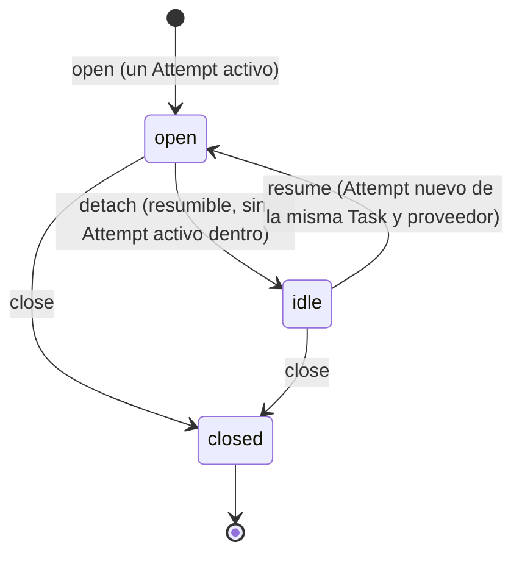

# ProviderSession y Thread explícitos (LXO-115)

Estado: **esquema y mutadores implementados, inertes hasta el corte**. Tercer paso de código de la épica `[CORE][F3]`
([ADR](CORTE_TASK_ATTEMPT.md), [Task](TASKS.md), [Attempt](ATTEMPTS.md)).

Separa del Attempt dos cosas que el legado mezclaba en la Task:

* **ProviderSession**: la sesión durable del proveedor (Claude, Codex…) en la que corre un Attempt, la que permite
  reanudar en un seguimiento. Sustituye a `session_ref` + `session_match`, sin la inferencia por carpeta y hora.
* **Thread**: la conversación de coordinación de una Task (preguntas, respuestas, notas), que sobrevive a sus Attempts.

Piezas:

* Migración: [`009_sessions_threads.sql`](../../apps/desktop/src-tauri/src/store/migrations/009_sessions_threads.sql).
* Almacén: `store/sessions.rs`. Pruebas: `store/sessions_tests.rs`.
* Hechos y permisos: `orch/session_ops.rs`. Pruebas: `orch/session_ops_tests.rs`.

## Inerte hasta el corte

Como `runs`, `tasks` y `attempts`: sin `meta.agentic_model`, cada mutador devuelve `AgenticModelInactive` sin escribir
y los triggers `*_inert_*` abortan cualquier `INSERT` o `UPDATE`. Nada está conectado al RPC, a `lxo` ni a la interfaz.

## Invariantes y cómo se prueban

| # | Invariante (LXO-115) | Mecanismo | Prueba |
|---|---|---|---|
| 1 | ProviderSession no se deduce por cwd + tiempo | `binding IN ('stream_json', 'session_id')`; una sesión solo nace de un Attempt activo (`provider_sessions_core_create`) y su referencia la fija el Core al leerla del proveedor. Ningún agente la declara | `la_referencia_es_opaca_se_fija_una_vez_y_no_admite_credenciales`, `solo_el_core_conduce_la_sesion_y_el_thread_y_una_persona_puede_cerrar` |
| 2 | El id externo del proveedor es opaco | `external_ref` es texto sin interpretar (un uuid o la ruta de un rollout valen igual), único por proveedor y fijado una vez (`provider_sessions_identity_immutable`). Nunca viaja en un evento | `la_referencia_es_opaca_…`, `cada_mutador_deja_su_evento_sin_la_referencia_ni_el_resumen` |
| 3 | Un Attempt puede carecer de sesión resumible | `attempts.provider_session_id` es opcional; `resumable = 0` no admite `idle` (CHECK) ni reanudar | `un_proveedor_sin_resume_…`, `un_attempt_sin_sesion_es_valido_…` |
| 4 | Thread no es fuente de verdad del estado del Attempt | `threads` no tiene estado ni columna de Attempt; terminar un Attempt no lo toca | `el_thread_es_de_la_task_y_no_dice_nada_del_estado_del_attempt` |
| 5 | Ni secretos ni tokens en la metadata del Thread | `looks_secret` rechaza el resumen (y la referencia de la sesión) con forma de credencial antes de escribir | `el_resumen_del_thread_es_corto_y_nunca_guarda_secretos`, `looks_secret_no_confunde_ids_ni_commits_con_credenciales` |
| — | Estado + evento atómicos; sin borrado | una transacción por mutador; triggers `*_no_delete`; FKs sin cascada | `sin_su_evento_no_hay_sesion_ni_enlace`, `una_sesion_cerrada_es_final_y_ninguna_se_borra` |

## Ownership (ADR §5)

| Entidad | Dueña | Vínculos |
|---|---|---|
| ProviderSession | la **Task** (`task_id`) | la abre un Attempt (`opened_by_attempt_id`, id `ps-<attempt>`); cada Attempt que corre en ella la nombra en `attempts.provider_session_id` (el vínculo blando de la 008, D21, que ahora valida el trigger `attempts_provider_session_exists`) |
| Thread | la **Task** (`task_id`, id `th-<task>`) | sus mensajes pueden nombrar el Attempt que los envió (`thread_messages.from_attempt_id`, `NULL` en el legado por D6) |

## Ciclo de vida de la ProviderSession

| Transición | Desde | Hasta | Evento | Rechaza |
|---|---|---|---|---|
| `open` | — | `open` | `provider_session.opened` | Attempt inexistente, terminado o que ya tiene sesión |
| `bind` | `open` · `idle` | (igual) | `provider_session.bound` | referencia ya fijada (otra), con forma de credencial, de otra sesión del proveedor, o sesión cerrada |
| `detach` | `open` | `idle` | `provider_session.detached` | no resumible (se cierra); un Attempt activo sigue dentro |
| `resume` | `idle` | `open` | `provider_session.resumed` | sesión no en espera; Attempt de otra Task, de otro proveedor, terminado o con sesión |
| `close` | `open` · `idle` | `closed` | `provider_session.closed` | — (final: nada vuelve) |

Pedir el estado en el que ya está (o repetir la misma referencia, o reanudar con el Attempt que ya corre en ella) es
`Unchanged`, sin evento. El resto de pares es `SessionConflict` sin escribir nada. La tabla vive en `SessionStep`
(Rust) y en el trigger `provider_sessions_lifecycle`; una prueba compara las 6 combinaciones.

## Esquema (`009_sessions_threads.sql`)

**`provider_sessions`**: `id`, `task_id`, `opened_by_attempt_id` (único), `provider` (el del Attempt), `external_ref` y
`binding` (juntos o ninguno; se fijan una vez), `resumable`, `status`, `created_at`, `updated_at`, `closed_at` (⇔
`closed` en filas del Core), `origin`. Índices: `(provider, external_ref)` único, `(task_id, status)` y
`attempts (provider_session_id, n)`.

**`threads`**: `id = 'th-' || task_id`, `task_id` (único), `run_id` (el de su Task), `summary` (1–2000 caracteres o
`NULL`), `created_at`/`updated_at` (`NULL` solo en el legado), `origin`.

**`thread_messages`**: la forma del borrador del corte (`id` legacy conservado, `thread_id`, emisor y destino,
`from_attempt_id`, `kind`, `body`, `reply_to`, `read`, `at`). Un mensaje no se reescribe (solo cambia `read`) y el
Attempt que lo envía es de la Task emisora. Lo llena el corte; los mensajes nuevos los escribirá el runtime.

Nada del adapter: ni transcript, ni rutas a archivos internos del proveedor, ni credenciales.

## Lecturas por Attempt

| Lectura | Devuelve |
|---|---|
| `provider_session_of_attempt(attempt)` | la sesión en la que corre (o corrió) ese Attempt; `None` si no tiene |
| `attempts_of_provider_session(ps)` | el Attempt que la abrió y los que la reanudaron, por `n` |
| `provider_sessions_of_task(task)` · `provider_session_row(ps)` | las sesiones de la Task · una sesión |
| `thread_of_attempt(attempt)` · `thread_of_task(task)` · `thread_row(th)` | el Thread de su Task |
| `thread_messages(th)` · `thread_messages_of_attempt(attempt)` | los mensajes del Thread · los que envió ese Attempt |

Ninguna depende del adapter de F4.

## Quién puede (`orch/session_ops.rs`)

| Operación | Persona | Agente | Sistema |
|---|---|---|---|
| abrir · fijar referencia · reanudar · dejar en espera | no | no | sí |
| cerrar | sí | no | sí |
| abrir el Thread · fijar su resumen | no | no | sí |

## Events

Contrato en [`EVENTOS.md`](EVENTOS.md#providersession-y-thread-lxo-115) y su Activity en [`ACTIVITY.md`](ACTIVITY.md).
`provider_session` es una entidad nueva del vocabulario (`contracts/status-vocabulary.json`); `thread.created` ya estaba
reservado y se añade `thread.summarized`.

## En el corte (borrador de LXO-112)

El [SQL del corte](../../apps/desktop/src-tauri/src/store/cut/task_attempt_cut.sql) ya no crea estas tablas y rellena las columnas nuevas:
las sesiones del legado con vínculo declarado son **resumibles**; quedan `open` si su Attempt no terminó e `idle` si
terminó; `created_at` es el arranque del intento (o la creación de la Task). Los Threads del legado no tienen fechas ni
resumen. `verificar.py` lo comprueba sobre todas las migraciones publicadas.

**Runtime (LXO-232).** Tras el corte, el runtime abre la sesión que declara el proveedor y la deja `idle` al terminar
el Attempt. Un seguimiento la reutiliza si el proveedor vuelve a declarar la misma referencia. Si la declara tarde (Codex,
tras salir el proceso), nace `idle` (013). Los mensajes nuevos van al Thread con el id del documento
([RUNTIME_TABLAS.md](RUNTIME_TABLAS.md)).

## Decisiones (LXO-115)

| # | Decisión | Alternativa descartada |
|---|---|---|
| D26 | **La sesión nace sin referencia y la recibe una vez** (`bind`): Claude entrega el id en el flujo, después de arrancar | exigirla al abrir: obliga a esperar al proveedor antes de registrar que el Attempt ya tiene sesión |
| D27 | **`idle` solo si es resumible; `closed` es final.** Reanudar enlaza un Attempt nuevo (ADR D7) y deja la sesión `open` | reabrir una sesión cerrada: deja de distinguir «se puede seguir» de «se acabó» |
| D28 | **El Thread no tiene estado** y su resumen pasa por `looks_secret`. Los mensajes nuevos y su evento son del runtime (ADR D9: sin doble emisión con `task.question`/`task.reply`) | `thread.message_added` ya: duplicaría los hechos de los mensajes legacy |
| D29 | **Solo el Core conduce la sesión** (un agente nunca declara la suya); una persona puede cerrarla | dejar que el agente informe su sesión: vuelve a ser un dato no verificado |

## Fuera de este slice

Adapters de Claude y Codex (F4), sincronizar transcripts, ContextPackage, escribir mensajes del Thread en el runtime,
conectar los mutadores al RPC o a `lxo`, UI y migrar los datos (lo hace el corte, LXO-117).
