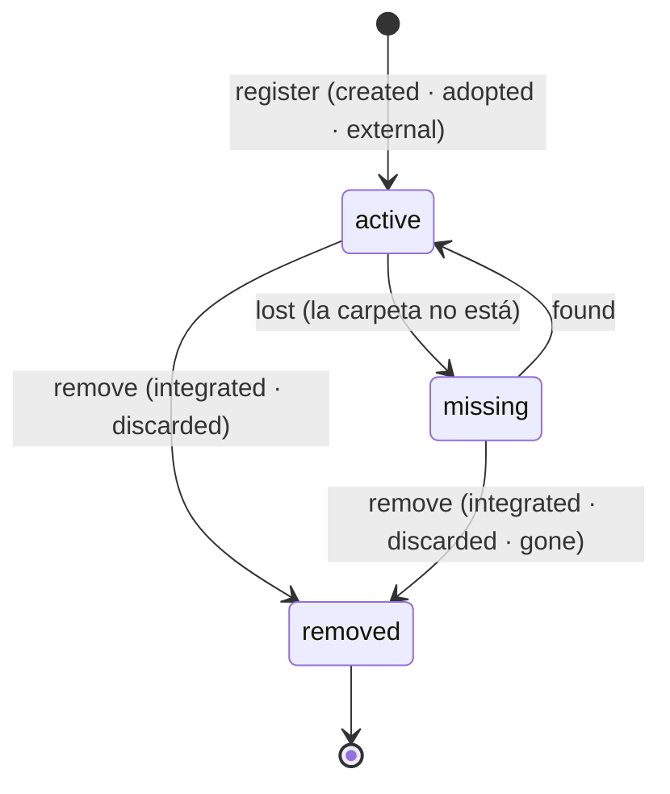

# Worktree y Artifact como entidades de ejecución (LXO-116)

Estado: **esquema y mutadores implementados, inertes hasta el corte**. Cuarto paso de código de la épica `[CORE][F3]`
([ADR](CORTE_TASK_ATTEMPT.md), [Attempt](ATTEMPTS.md), [ProviderSession y Thread](SESIONES_THREADS.md)).

Saca del documento legacy las rutas sueltas de la Task (`worktree`, `branch`, `base`, `report`, `pr_url`,
`last_message_path`) y las convierte en dos entidades ligadas al Attempt:

* **Worktree**: dónde trabaja un Attempt. Lo registra un Attempt; lo reutilizan sus seguimientos.
* **Artifact**: lo que deja un Attempt (informe, PR, último mensaje, commit, archivo de evidencia). Apunta a la
  evidencia; nunca copia su contenido.

Piezas:

* Migración: [`010_worktrees_artifacts.sql`](../../apps/desktop/src-tauri/src/store/migrations/010_worktrees_artifacts.sql).
* Almacén: `store/worktrees.rs`. Pruebas: `store/worktrees_tests.rs`.
* Hechos y permisos: `orch/worktree_ops.rs`. Pruebas: `orch/worktree_ops_tests.rs`.

Inerte hasta el corte, como el resto del modelo: sin `meta.agentic_model` nada escribe. **No borra nada en disco**: el
almacén registra el hecho; quitar la carpeta o la rama es del runtime (Resource Manager, fuera de alcance).

## Invariantes y cómo se prueban

| # | Invariante (LXO-116) | Mecanismo | Prueba |
|---|---|---|---|
| 1 | La ruta nunca es identidad durable | id `wt-<attempt>`; `machine` + `path` son ubicación (única entre los activos de una máquina) y se pierde al quitarlo; la ruta no cambia mientras existe | `la_ruta_es_ubicacion_no_identidad` |
| 2 | El Worktree pertenece a una ejecución | lo registra un Attempt activo (`attempt_id`, único); los seguimientos de la misma Task se enlazan con `attempts.worktree_id`. Dueña: la Task (ADR §5) | `el_seguimiento_trabaja_en_el_mismo_worktree_…` |
| 3 | Externo/adoptado ≠ creado por Lixbon | `provenance` ∈ `created` · `adopted` · `external`, fija; eventos distintos (`worktree.created` / `worktree.adopted`) | `creado_adoptado_y_externo_se_distinguen_y_no_cambian` |
| 4 | Artifact sin secretos y sin cuerpos enormes | tipo cerrado, localizador validado por tipo, `looks_secret`; solo `sha256` y `bytes` como verificación; el evento no lleva el localizador | `cada_tipo_valida_su_localizador`, `un_artifact_no_guarda_secretos_…` |
| 5 | Cleanup no borra trabajo no integrado sin policy/confirmación | quitar exige motivo: `integrated` (solo el Core, tras integrar), `discarded` (solo una persona: es la confirmación) o `gone` (ya faltaba). Nunca con un Attempt activo dentro. Uno externo solo sale con `gone` | `quitar_no_borra_trabajo_en_uso_ni_lo_externo_y_es_final`, `descartar_trabajo_lo_confirma_una_persona_…` |

## Ciclo de vida del Worktree

| Paso | Evento | Rechaza |
|---|---|---|
| `register` | `worktree.created` (creado) · `worktree.adopted` (adoptado o externo) | Attempt terminado o con Worktree; carpeta activa ya registrada en la máquina; datos vacíos, con control o con forma de credencial |
| `attach` (seguimiento) | `worktree.attached` | Worktree no activo; Attempt de otra Task, terminado o con Worktree; otro Attempt activo dentro |
| `lost` · `found` | `worktree.missing` · `worktree.found` | pares fuera de la tabla |
| `remove` | `worktree.removed` (`reason`, `branch_kept`) | `gone` con la carpeta en disco; externo sin `gone`; `branch_kept` sin rama; Attempt activo dentro |

Un Worktree `missing` sigue sabiendo dónde debería estar (`path`) y desde cuándo falta (`missing_since`). `removed` es
final. Pedir el estado en el que ya está es `Unchanged`. La tabla vive en `WorktreeStep` y en el trigger
`worktrees_lifecycle`; una prueba compara las 6 combinaciones.

## Artifact

| Tipo | Localizador |
|---|---|
| `report` · `last_message` · `file` | ruta local (sin `://` ni `..`) |
| `pull_request` | URL `https://` sin usuario ni contraseña |
| `commit` | sha hexadecimal en minúsculas, 7–64 caracteres |

Opcionales: `sha256` (64 hex) y `bytes`. Id UUID v7 (un Attempt puede dejar varios del mismo tipo); los del legado son
`<attempt>-<kind>`. Nace de un Attempt que ya arrancó (también de uno terminado: el informe se recoge al final). No se
modifica ni se borra. Lo deja el Core o el agente de esa Task.

## Esquema (`010_worktrees_artifacts.sql`)

**`worktrees`**: `id`, `task_id`, `attempt_id` (único), `provenance`, `machine`, `repo`, `path`, `branch`,
`base_branch`, `base_commit`, `env_plan`, `state`, `removed_reason`, `branch_kept`, `missing_since`, `created_at`,
`updated_at`, `origin`. En el legado `machine`, fechas y motivo quedan `NULL` (no se registraban).

**`artifacts`**: `id`, `attempt_id`, `kind`, `uri`, `sha256`, `bytes`, `created_at`, `origin`.

Índices: `worktrees (task_id, state)`, `(machine, path)` único entre los que tienen ruta, `attempts (worktree_id, n)`
y `artifacts (attempt_id, kind, created_at)`. El trigger `attempts_worktree_exists` valida el vínculo blando de la 008
(D21): el Worktree existe, es de su Task y está activo.

## Lecturas

| Lectura | Devuelve |
|---|---|
| `worktree_of_attempt` · `attempts_of_worktree` | el Worktree en el que trabaja un Attempt · los Attempts que trabajaron en uno |
| `worktrees_of_task` · `worktrees_of_project` · `worktree_row` | por Task, por Project, uno |
| `artifacts_of_attempt` · `artifacts_of_task` · `artifacts_of_project` | por Attempt, Task y Project |

## Quién puede (`orch/worktree_ops.rs`)

| Operación | Persona | Agente | Sistema |
|---|---|---|---|
| registrar uno creado por Lixbon | no | no | sí |
| registrar uno adoptado o externo | sí | no | sí |
| enlazar un seguimiento · ausente · encontrado | no | no | sí |
| quitar por `integrated` · `discarded` · `gone` | no · **sí** · sí | no | sí · no · sí |
| dejar un Artifact | no | el de esa Task | sí |

## Events

Contrato en [`EVENTOS.md`](EVENTOS.md#worktree-y-artifact-lxo-116) y Activity en [`ACTIVITY.md`](ACTIVITY.md).
`worktree.created`, `worktree.removed` y `artifact.created` ya estaban reservados; se añaden `worktree.adopted`,
`worktree.attached`, `worktree.missing` y `worktree.found`. Ninguno lleva rutas ni localizadores.

## En el corte

El [SQL del corte](../../apps/desktop/src-tauri/src/store/cut/task_attempt_cut.sql) ya no crea estas tablas: los Worktrees del legado son
`created`; con carpeta quedan `active`; sin carpeta pero con rama conservada, `removed` con `branch_kept = 1`.

## Decisiones (LXO-116)

| # | Decisión | Alternativa descartada |
|---|---|---|
| D30 | **La ruta es ubicación** (`machine` + `path`), única entre los activos de una máquina y perdida al quitarlo | id derivado de la ruta: un `git worktree move` o otra máquina lo romperían |
| D31 | **Procedencia fija** de tres valores; un externo nunca se limpia por integración ni descarte | un booleano `external`: no distingue «lo gestiona Lixbon aunque no lo creó» |
| D32 | **Quitar es un hecho con motivo**, sin borrar nada en el almacén; `discarded` solo lo pide una persona | permitir al Core descartar trabajo sin integrar: viola el invariante 5 |
| D33 | **El Artifact apunta**: localizador por tipo + `sha256`/`bytes`; inmutable | guardar el informe en la base: el Event Log y la base crecerían con cuerpos |

`looks_secret` (de LXO-115) separa ahora también por `/ \ ? & = : @`, para ver un token dentro de una ruta o una URL.

## Fuera de este slice

Resource Manager destructivo (borrar carpetas y ramas), UI de adopción, Proof Pack, sincronía entre máquinas, conectar
los mutadores al RPC o a `lxo`, y migrar los datos (lo hace el corte, LXO-117).
